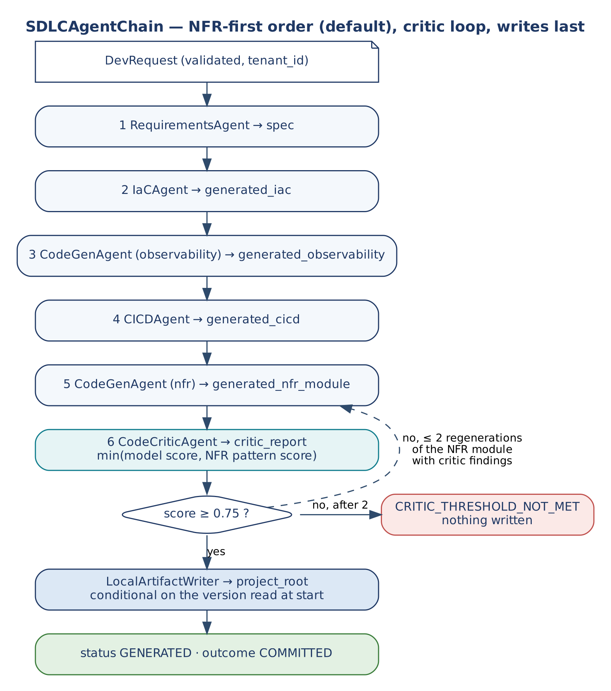
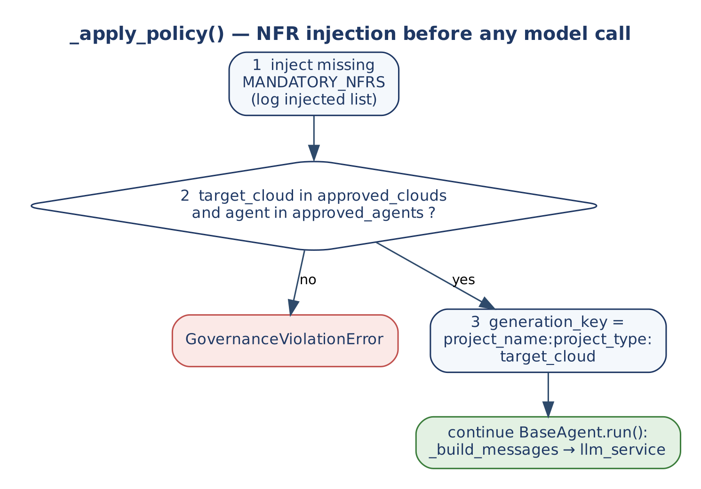

# A2C Framework

**Architecture-to-Code**

A Developer Platform Framework for Generating Enterprise-Grade Code, IaC, and CI/CD Using Agentic AI

Built on: E2A Architecture Framework (github.com/subhamviky/e2a-framework)

Author: Subham Gupta, Staff Architect & AI Architect

A2C extends E2A. E2A governs agentic AI systems. A2C uses those governed agents to generate enterprise-grade software.

> **Core thesis.** The same architectural discipline that makes enterprise systems reliable should be enforced at code generation time, not discovered through production failures.

> **The Meta-Insight.** E2A governs how agentic AI systems are built. A2C applies E2A's own governance mechanism (`BaseAgent.run()` with idempotency, latency SLO, policy enforcement, quality gates) to GENERATE code that ITSELF follows E2A patterns. The agent is governed. The output is governed. The framework is self-referential.

## 1. Executive Summary

The Architecture-to-Code (A2C) Framework is a developer platform methodology that uses E2A-governed agentic AI to generate production-grade software artifacts: microservice code, Infrastructure-as-Code (IaC), CI/CD pipelines, and NFR implementations. It addresses a fundamental gap: code generators produce functional code but not architecturally sound code. A2C enforces enterprise architecture patterns — idempotency, circuit breakers, observability, policy-as-code — at generation time through agent governance, not through post-generation review.

A2C extends E2A in one precise direction: E2A defines how to build governed agentic AI systems. A2C uses those governed agents as the engine for a developer platform that generates governed software. The developer specifies the requirement. The agent enforces the architecture.

| Dimension | E2A Framework | A2C Framework |
|:---|:---|:---|
| Purpose | Build governed agentic AI applications | Use governed agents to generate enterprise software |
| Primary abstraction | `BaseAgent`, `BaseRAGPipeline`, `BaseToolService` | `SDLCAssistantAgent`, `CriticAgent`, `CodeGenTool`, `IaCGenTool`, `CICDGenTool` |
| Public entry point | `agent.run(state, config)` | `sdlc_agent.run(dev_request, config)` — same pattern |
| Output | Agent responses, tool results, RAG answers | Python/Java microservice code, Terraform IaC, GitHub Actions workflows, NFR implementations |
| NFR enforcement | Inherited by all agent subclasses from `BaseAgent` | Injected into all generated code artifacts via `_apply_policy()` |

### 1.1 What v1.2 changes

| Change | Effect | Where |
|:---|:---|:---|
| **No business-service module** (A-4) | `CodeGenAgent` writes the observability and NFR modules; the business mode is no longer run. The service's agents, workflow and tools come from G2C (`harness.agents`), its routers from P0. A2C runs 6 agent steps (topology order: 5). | Sections 3.7, 5 |
| **Declarations instead of patches** (C-02) | `a2c_sdlc.settings` (Terraform variables, runtime environment, secret references, a Terraform test per setting), `a2c_sdlc.contracts` (models), Maven coordinates, `repository_layout: monorepo`. | Section 9 |
| **Upgrades** (A-6) | `.a2c/manifest.json` and `aidlc-build --upgrade`. | Section 9 |
| **E2A v1.2** | A2C pins `e2a-framework` `v1.2.0`. A2C's own agents keep the v1.1 hook signatures, which E2A v1.2 runs with a `DeprecationWarning` (to migrate before E2A v1.3). | Section 3.7 |

## 2. The Problem A2C Solves

### 2.1 Code Generation Without Architecture

Current LLM-based code generation tools (GitHub Copilot, Cursor, Claude artifacts) produce syntactically correct code that fails the production-readiness test. The failure modes are consistent across tools and teams:

| Failure Mode | Description | Production Consequence |
|:---|:---|:---|
| NFR Amnesia | Generated code has no idempotency, no circuit breakers, no retry logic, no structured logging. These are not in the prompt. | Duplicate writes, cascading failures, silent errors, undebuggable production incidents. |
| Architecture Drift | LLM generates business logic directly in route handlers, skipping service layers, interface contracts, and data models. | Untestable components, tight coupling, impossible to maintain at scale. |
| Governance Gap | No approval gates, no policy-as-code, no PII redaction, no tool allow/deny lists in generated code. | Compliance failures discovered in production, not at generation time. |
| IaC Afterthought | Infrastructure is manually configured in the cloud console, not version-controlled or reproducible. | Environment drift, deployment failures, no audit trail, impossible to recreate. |
| CI/CD Bolted On | Pipelines are added after the code works, not designed as quality gates from day one. | No RAGAS gate, no vulnerability scan, no auto-rollback. Production is the test environment. |

### 2.2 What A2C Fixes

A2C treats NFR enforcement, IaC, and CI/CD not as post-generation additions but as mandatory generation targets. The `SDLCAssistantAgent`'s `_apply_policy()` method programmatically injects required NFRs into the generation contract before the LLM call. The agent cannot produce a microservice that lacks idempotency or observability — not because the developer remembered to ask, but because the architecture enforces it structurally.

> **The A2C Design Principle.** Architecture is not a prompt. It is a constraint. A2C embeds the architectural constraint (NFR requirements, Clean Architecture layers, E2A patterns) into the agent's governance layer (`_apply_policy`) before any LLM call. The developer specifies WHAT to build. A2C determines HOW it must be built. The output is production-ready by construction, not by review.

## 3. A2C Framework Architecture

### 3.1 The Meta-Abstraction

A2C is a meta-application of E2A. The same abstract class hierarchy that governs agentic AI systems is used to build the developer platform that generates those systems. This is not coincidence — it is the correct structural choice. Every A2C agent inherits NFR enforcement from E2A's `BaseAgent`. Every generated artifact follows the E2A pattern because the generating agent enforces it through its governance layer.

| Layer | E2A (governs agents) | A2C (generates governed code) |
|:---|:---|:---|
| Data model | `AgentState` TypedDict | `DevRequest` TypedDict (project_name, project_type, mandatory_nfrs, context, target_cloud) |
| Interface contract | `BaseAgent` abstract class | `SDLCBaseAgent` extends `BaseAgent` (same contract, SDLC domain) |
| Business logic | Agent class: LLM + tool calls | `SDLCAssistantAgent`: LLM generates code + IaC + CI/CD artifacts |
| Quality gate | `CriticAgent`: RAGAS groundedness | `CodeCriticAgent`: validates generated code contains mandatory NFR patterns |
| Tool layer | `BaseToolService`: HTTP microservice calls | `CodeGenTool` (writes files), `IaCGenTool` (validates Terraform), `CICDGenTool` (generates YAML) |
| Orchestration | `BaseWorkflow`: LangGraph StateGraph | `SDLCWorkflow`: routes `DevRequest` through Code → IaC → CICD → Critic agents |

### 3.2 Multi-Agent SDLC Workflow

A production A2C implementation is a multi-agent LangGraph workflow. A single agent handling code + IaC + CI/CD in one LLM call is a prototype pattern. The correct architecture separates concerns across specialised agents, each governed by E2A's `BaseAgent` contract.

**SDLCWorkflow — LangGraph StateGraph topology**

```text
# SDLCWorkflow routes DevRequest through 5 specialist agents:
# Each agent inherits run() from BaseAgent. The model call is delegated to
# config['llm_service'] (a BaseLLMAgentService); agents hold no provider code.

DevRequest (input)
    ↓
RequirementsAgent   ← validates project_type, mandatory_nfrs, target_cloud
    ↓
CodeGenAgent        ← generates Clean Architecture microservice code
    ↓
IaCAgent            ← generates Terraform / Azure Bicep / CDK IaC
    ↓
CICDAgent           ← generates GitHub Actions workflows with RAGAS gate, Trivy, rollback
    ↓
CodeCriticAgent     ← validates all artifacts: NFRs present, architecture layers correct
    ↓
DevRequest (output)  ← generated_* fields, critic_report, artifacts written into the P0 workspace
```

The reference implementation runs the agents in the NFR-first order of Section 5 by default (`a2c_sequence = nfr_first`); `topology` runs the five agents once each in the order above. Both orders end with `CodeCriticAgent`.

### 3.3 NFR Injection Pattern

The `_apply_policy()` hook in each agent is the enforcement point. It runs before the LLM call and modifies the `DevRequest` state to guarantee mandatory NFRs are included in the generation contract. This is the key architectural decision: governance enforced structurally, not as a prompt suggestion.

**NFR injection sequence in _apply_policy()**

```python
# _apply_policy() runs inside BaseAgent.run(), after validation and before the LLM call
MANDATORY_NFRS = [
    'Idempotency',      # __ensure_idempotency + DynamoDB conditional write
    'Observability',    # structlog JSON + OTel tracing + CloudWatch metrics
    'CircuitBreaker',   # pybreaker per downstream service
    'RetryWithBackoff', # tenacity decorator with jitter
    'HealthCheck',      # /health endpoint for ECS/K8s readiness probe
    'GracefulShutdown', # SIGTERM handler for zero-downtime deploys
]

def _apply_policy(self, state: DevRequest, config=None, **kwargs) -> None:
    # 1. Inject missing mandatory NFRs into generation contract
    injected = []
    for nfr in MANDATORY_NFRS:
        if nfr not in state.get('mandatory_nfrs', []):
            state['mandatory_nfrs'].append(nfr)
            injected.append(nfr)
    if injected:
        logging.info(f'Policy injection: added mandatory NFRs: {injected}')
    # 2. Validate target cloud is in approved list
    approved = (config or {}).get('approved_clouds',
                                  ['aws','gcp','azure','standalone'])
    if state.get('target_cloud','').lower() not in approved:
        raise GovernanceViolationError(
            f"Cloud {state['target_cloud']} not in approved list")
    # 3. Set idempotency key for this generation request
    #    (BaseAgent.__ensure_idempotency handles request_id; this is the
    #     business-level dedup key for the project itself)
    state['generation_key'] = (
        f"{state['project_name']}:{state['project_type']}"
        f":{state['target_cloud']}")
```

### 3.4 CodeCriticAgent

**CodeCriticAgent — the quality gate for generated code**

The critic combines two checks and reports the lower score. A model reviews the code against the mandatory NFRs; a deterministic pattern check runs on the same code with comments removed. A lenient model review therefore cannot pass code whose NFRs exist only in comments.

```python
class CodeCriticAgent(BaseAgent):
    agent_name = 'CodeCriticAgent'

    # No _validate_state here. Input validation is not an agent concern:
    # run() assumes state already passed BaseValidationService.validate()
    # (see 3.6, `_validate_code_critic_agent`).

    def _apply_policy(self, state, config=None, **kwargs) -> None:
        # Governance only. The cheaper critic model is chosen by the chain
        # (model_id=critic_model_id on this agent's run), never by writing
        # into the shared config dict.
        agents = (config or {}).get('approved_agents')
        if agents is not None and self.agent_name not in agents:
            raise GovernanceViolationError(f'{self.agent_name} is not an approved agent')

    def _build_messages(self, state, config=None, **kwargs) -> list:
        code = '\n\n'.join(state.get(k, '') for k in
                           ('generated_observability', 'generated_nfr_module'))
        return [{'role': 'system', 'content':
                 'You are a senior architect. Score 0.0-1.0: does this code contain all '
                 'required NFR patterns as code (not comments) and the Clean Architecture '
                 'layers? Return JSON only: {"score": float, "missing": [..], "passed": [..]}'},
                {'role': 'user', 'content':
                 f'Required NFRs: {", ".join(state.get("mandatory_nfrs", []))}\n\nCode:\n{code}'}]

    def _evaluate_output(self, response, state, config=None, **kwargs) -> float:
        try:
            review = json.loads(_strip_fences(_text(response)) or '{}')
            model_score = float(review.get('score', 0.0))
        except (json.JSONDecodeError, ValueError, TypeError):
            review, model_score = {'parse_error': True}, 0.0
        code = '\n'.join(state.get(k, '') for k in
                         ('generated_observability', 'generated_nfr_module'))
        pattern = nfr_pattern_report(code, state.get('mandatory_nfrs', MANDATORY_NFRS))
        score = round(min(model_score, pattern['score']), 4)
        state['critic_report'] = {'score': score, 'model_score': model_score,
                                  'pattern_check': pattern,
                                  'missing': sorted(set(review.get('missing', [])) | set(pattern['missing'])),
                                  'passed': pattern['passed']}
        return score

    def _fallback(self, state, config=None, **kwargs):
        return {'text': 'Code review failed. Regenerating with stricter NFR prompt.', 'degraded': True}
```

Do not assign `config['model_id']` inside `_apply_policy`: it mutates a dictionary shared by concurrent requests, so one request could switch another request's model. The chain passes the critic model per call instead.

### 3.5 Concurrency and Capacity

A2C describes one generation request. In a shared environment, several requests run at once, and each fans out into agents that call a model. This subsection states the bounds that apply. It changes none of the contracts above: `SDLCWorkflow` still routes a `DevRequest` through the same agents in the same order, `run()` is still not overridden, and the second-phase rule is unchanged — generating a class does not produce IaC or CI/CD; the workflow (`IaCAgent`, `CICDAgent`) must be invoked explicitly to do so.

> **Status.** This subsection specifies how the A2C classes use the framework's concurrency primitives. The A2C classes are implemented in `a2c_base.py` of the `a2c-framework` repository (Section 3.7) and run on E2A's `BaseAgent`, `BaseWorkflow`, `BaseToolService` and `BaseValidationService`. They are exercised by `smoke_test_a2c.py` and `smoke_test_aidlc_integration.py` against in-memory test doubles and scripted model responses; nothing has been validated against a live inference gateway, a live distributed store or production load. In addition, the G2C generators emit these rules into generated A2C code through the versioned system prompts, and `GeneratorCriticAgent.concurrency_findings()` flags generated code that adds its own semaphore or rate limiter, imports a provider SDK, or defines `_validate_state` (a text heuristic, not a proof). The primitives it relies on are the E2A reference scaffold's; see the Implementation Playbook, Section 2.19.

- **Model capacity belongs to the gateway.** Every agent in the workflow — including `IaCAgent`, `CICDAgent` and `CodeCriticAgent` — obtains its completion through `config['llm_service']`, a `BaseLLMAgentService`. The tenant-and-pod permit, the RPM/TPM quota and the per-call timeout apply to these calls as they do to any other agent. No A2C agent keeps its own semaphore or rate limiter, and none calls a provider SDK.
- **Fan-out is bounded.** The topology in Section 3.2 is sequential. If an implementation runs independent branches in parallel (for example generating code and IaC concurrently for a large project), the number of concurrent branches is a bounded setting, not unbounded, and each branch draws on the same gateway quota. Sizing the fleet's model concurrency must include the critic's regeneration retries (Implementation Playbook, Section 2.19).
- **Duplicate requests resolve once.** `generation_key` (`project_name:project_type:target_cloud`) is a business key; `BaseAgent`'s idempotency claim is the technical one. With a distributed idempotency store the claim is atomic, so two identical `DevRequest`s produce one generation: the second receives the stored result or an "in progress" outcome. In the reference implementation `SDLCWorkflow` claims `a2c:<project_name>:<project_type>:<target_cloud>` (tenant-scoped, so `tenant_id` is required) through `BaseWorkflow.execute()`; on a replay only `state['response']` is restored, which is why the run summary carries every generated artifact.
- **Tool writes are conditional where writers compete.** `CodeGenTool`, `IaCGenTool` and `CICDGenTool` write with an idempotency key of project and path (Section 7). Two different requests writing the same path are different writers; where that can happen, the write is conditional on the version the writer read, and the loser receives a typed conflict rather than silently overwriting. In the reference implementation `LocalArtifactWriter` reads each artifact's SHA-256 at the start of the run and writes only if the file still has that version: an identical file is `UNCHANGED`, a changed file is a `CONFLICT` (status `ARTIFACT_CONFLICT`, outcome `UNKNOWN` if some files were already committed), and nothing is overwritten silently.
- **Cancellation and overload are typed.** A request deadline, when set, caps each agent's wait and model call; a cancelled workflow releases its permits and stops at the next step boundary. A call that cannot obtain capacity within its bounded wait fails as a retryable rejection, and its quota is refunded.


### 3.6 Input Validation (BaseValidationService)

Input validation is not an agent responsibility, so agents carry no `_validate_state` hook. Validation sits in a `BaseValidationService` subclass (Implementation Playbook §2.2) that runs **before** `BaseWorkflow` or `BaseAgent` is instantiated, typically in a small separate compute tier. `BaseAgent.run()` therefore assumes state that has already passed validation.

How it works for A2C agents:

- `BaseValidationService.validate(agent_name, state, config=None, correlation_id=None, **kwargs)` looks up the validator registered for `agent_name` (`validator_registry`).
- Each agent has one `_validate_<agent_name>` method that checks the required `DevRequest` fields for that agent's domain.
- The result is a `ValidationResult` dict `{valid, errors, agent_name, correlation_id}`. A failure is a normal return value (an HTTP 400 body), not an exception.
- When no validator is registered, `strict_mode` decides whether the request is rejected or allowed.
- After schema validation succeeds, the abstract `_enforce_entitlement_gate` (ABAC) runs.
- `correlation_id` now originates in `validate()` and is propagated to the workflow and agents.

```python
class DevPlatformValidationService(BaseValidationService):
    """Validators for the A2C SDLC agents. Runs before the workflow starts."""

    def _validate_sdlc_assistant_agent(self, state, config=None, **kwargs):
        required = ['project_name', 'project_type', 'mandatory_nfrs', 'target_cloud', 'tenant_id']
        errors = [f'missing field: {k}' for k in required if k not in state]
        if 'mandatory_nfrs' in state and not isinstance(state['mandatory_nfrs'], list):
            errors.append('mandatory_nfrs must be a list')
        return (not errors, errors)

    def _validate_code_critic_agent(self, state, config=None, **kwargs):
        errors = [f'missing field: {k}'
                  for k in ('generated_nfr_module', 'mandatory_nfrs') if k not in state]
        return (not errors, errors)

    def _enforce_entitlement_gate(self, agent_name, state, config=None, **kwargs):
        ...  # ABAC check for the calling principal; deployment-specific
```

Policy checks that depend on configuration at run time (for example the `approved_clouds` check in `_apply_policy()`) stay in the agent, because they are governance rules rather than input-shape checks.

*Note: the reference implementation is `DevPlatformValidationService` in `a2c_base.py`. Its registry maps `SDLCAssistantAgent`, `SDLCWorkflow` and `CodeCriticAgent` to the validators above (the workflow is validated as a whole with the `SDLCAssistantAgent` validator), and a configurable `entitlement_policy` callable can deny a request at the ABAC gate. The validators return `(valid, errors)`; `validate()` wraps that in the `ValidationResult` dictionary.*

### 3.7 Reference Implementation (`a2c_base.py`)

`a2c_base.py` in the `a2c-framework` repository implements this document on top of E2A, installed as the `e2a-framework` package (`v1.2.0`; `a2c_base.py` imports through its `e2a_base` compatibility module). The classes:

| Class | Role |
|:---|:---|
| `DevRequest` | The `TypedDict` input/output contract (Section 4). |
| `SDLCAssistantAgent` | A2C base agent: NFR injection, approved-cloud and approved-agent checks, `generation_key`. Used alone it generates one code module in one call (the prototype pattern). |
| `RequirementsAgent`, `CodeGenAgent`, `IaCAgent`, `CICDAgent` | Specialists extending `SDLCAssistantAgent`. `CodeGenAgent` writes the observability module and the NFR module; its business-logic mode remains selectable but neither order runs it since v1.2. |
| `CodeCriticAgent` | Model review plus deterministic NFR-pattern check; reports the lower score (Section 3.4). |
| `SDLCAgentChain` | The node sequence `BaseWorkflow.execute()` runs as one unit. |
| `SDLCWorkflow` | `BaseWorkflow` subclass; `execute(dev_request, config)` is inherited and never overridden. |
| `DevPlatformValidationService` | The `_validate_<agent_name>` validators (Section 3.6). |
| `LocalArtifactWriter` | Conditional writes keyed by project and path (Section 3.5). |
| `CodeGenTool`, `IaCGenTool`, `CICDGenTool`, `TerraformValidateTool` | `BaseToolService` subclasses for remote writes (Section 7). |

**How `SDLCAgentChain` runs a request.**

1. It reads the settings below, builds the sequence (NFR-first by default), and reads the version of each artifact path when `project_root` is set.
2. It runs each agent with the per-step idempotency key `<generation_key>:<agent>:<mode>`, the shared deadline, and the agent limits. The critic runs with `model_id = critic_model_id` when that is set.
3. The deadline is checked before each step. An agent that records an error stops the chain with status `AGENT_FAILED`.
4. While the critic score is below `a2c_min_confidence` it regenerates the NFR module, passing the critic's `missing` list back as `regeneration_feedback`, up to `a2c_max_regenerations` times. If the score is still below the threshold the chain stops with status `CRITIC_THRESHOLD_NOT_MET`; nothing is written.
5. Only after the critic passes does it write the artifacts (default paths: `docs/a2c/spec.md`, `src/generated/observability.<ext>`, `src/generated/nfr.<ext>`, `infra/main.tf`, `.github/workflows/a2c-ci.yml`; overridable with `a2c_artifact_paths`). `status` becomes `GENERATED`.

**Settings** (registered in E2A's central registry, resolved kwargs > config > environment > default):

| Key | Environment variable | Default | Meaning |
|:---|:---|:---|:---|
| `a2c_min_confidence` | `A2C_MIN_CONFIDENCE` | 0.75 | Agent fallback threshold and critic pass mark. |
| `a2c_max_latency` | `A2C_MAX_LATENCY` | 30.0 | Per-agent latency SLO in seconds. |
| `a2c_max_tokens` | `A2C_MAX_TOKENS` | 32000 | Per-agent token budget. |
| `a2c_max_regenerations` | `A2C_MAX_REGENERATIONS` | 2 | Business-code regenerations after a failed review. |
| `a2c_sequence` | `A2C_SEQUENCE` | `nfr_first` | `nfr_first` or `topology`. |
| `a2c_write_artifacts` | `A2C_WRITE_ARTIFACTS` | true | Write artifacts into `dev_request.project_root`. |
| `critic_model_id` | `CRITIC_MODEL_ID` | unset | Model for `CodeCriticAgent` (a cheaper one). |

**Second-phase rule.** Class generation (G2C) never produces IaC or CI/CD. `SDLCWorkflow` must be run explicitly, after `DevPlatformValidationService.validate()`, with the `dev_request` that P0 hands off (P0 Framework Reference, Section 4).

**Evidence level.** The A2C tests use scripted model responses and in-memory stores. They show the sequencing, regeneration, conditional-write and replay behaviour; they do not show the quality of code a real model produces.

## 4. SDLCAssistantAgent

**DevRequest TypedDict — structured input replacing plain dict**

```python
from typing import TypedDict, List, Optional

class DevRequest(TypedDict, total=False):
    # Developer / P0 hand-off
    project_name: str       # e.g. 'SettlementEngine'
    project_type: str       # 'FastAPI Microservice' | 'Spring Boot' | 'LangGraph Agent'
    mandatory_nfrs: List[str]  # NFRs developer requested (A2C will add missing mandatory ones)
    context: str            # free-text domain context
    target_cloud: str       # 'aws' | 'gcp' | 'azure' | 'standalone'
    language: str           # 'python' | 'java'
    tenant_id: str          # required by SDLCWorkflow.execute()
    project_root: str       # P0 workspace; artifacts are written here
    # Written by A2C agents:
    generation_key: str     # business idempotency key
    spec: str               # output from RequirementsAgent
    generated_observability: str   # CodeGenAgent, observability mode
    generated_nfr_module: str      # CodeGenAgent, NFR mode
    generated_code: str     # CodeGenAgent business mode (not run since v1.2)
    port: int; package_name: str   # from P0 (v1.1.2)
    settings: List[dict]    # declared app settings (v1.2)
    generated_iac: str      # output from IaCAgent
    generated_cicd: str     # output from CICDAgent
    critic_report: dict     # CodeCriticAgent: score, model_score, pattern_check, missing, passed
    artifacts: dict         # relative path -> sha256 of what was written
    agent_scores: dict      # per-agent quality scores
    status: str             # GENERATED | AGENT_FAILED | CRITIC_THRESHOLD_NOT_MET | ARTIFACT_CONFLICT
    trace_id: str           # written by BaseAgent.run()
    request_id: str         # written by BaseAgent.__ensure_idempotency
    errors: List[str]       # error accumulator
```

**SDLCAssistantAgent**

```python
# SDLCAssistantAgent — generates enterprise-grade microservice code
# Inherits run() from BaseAgent. All NFR enforcement inherited.
# The model call is delegated to config['llm_service'] — not overridden.
from src.e2a_base import BaseAgent, GovernanceViolationError
import logging, os

MANDATORY_NFRS = ['Idempotency','Observability','CircuitBreaker',
                  'RetryWithBackoff','HealthCheck','GracefulShutdown']

class SDLCAssistantAgent(BaseAgent):
    agent_name = 'SDLCAssistantAgent'

    # No _validate_state here. The required-field check for this agent lives
    # in `_validate_sdlc_assistant_agent` on the validation service (see 3.6)
    # and has already passed before run() is called.

    def _apply_policy(self, state, config=None, **kwargs) -> None:
        # 1. Inject missing mandatory NFRs
        injected = [n for n in MANDATORY_NFRS
                    if n not in state.get('mandatory_nfrs', [])]
        state['mandatory_nfrs'].extend(injected)
        if injected:
            logging.info(f'A2C policy injection: {injected}')
        # 2. Validate approved cloud
        approved = (config or {}).get('approved_clouds',
                                      ['aws','gcp','azure','standalone'])
        if state.get('target_cloud','').lower() not in approved:
            raise GovernanceViolationError(
                f"Cloud {state['target_cloud']} not approved")
        # 3. Business dedup key (NOT idempotency — that is BaseAgent.__ensure_idempotency)
        state['generation_key'] = (
            f"{state['project_name']}:{state['project_type']}"
            f":{state['target_cloud']}")

    def _build_messages(self, state, config=None, **kwargs) -> list:
        # Construct generation prompt encoding E2A patterns as requirements
        nfr_list = ', '.join(state['mandatory_nfrs'])
        lang = state.get('language', 'python')
        cloud = state.get('target_cloud', 'aws')
        system_prompt = (
            f'You are a Principal Cloud Architect generating production-ready {lang} code. '
            f'Generate a {state["project_type"]} named {state["project_name"]} for {cloud}. '
            f'Mandatory architecture requirements:\n'
            f'1. Clean Architecture: separate data model, interface contract, '
            f'   service layer, exposure layer.\n'
            f'2. All NFRs structurally implemented: {nfr_list}.\n'
            f'3. NFRs must appear as code (decorators, middleware, classes) '
            f'   not as comments.\n'
            f'4. Include structured logging (JSON), OTel tracing, /health endpoint.\n'
            f'5. Follow E2A Template Method: one public entry point, '
            f'   protected domain methods, private infrastructure helpers.'
        )
        return [
            {'role':'system','content': system_prompt},
            {'role':'user',  'content':
             f'Project context: {state.get("context","standard microservice")}'}
        ]

    def _evaluate_output(self, response, state, config=None, **kwargs) -> float:
        # Deterministic check: which requested NFRs appear as code. Comments and
        # docstrings are stripped first, so an NFR mentioned only in a comment
        # does not count. The CodeCriticAgent adds a model review on top.
        text = _strip_fences(_text(response))
        state[self.artifact_field] = text
        report = nfr_pattern_report(text, state.get('mandatory_nfrs', MANDATORY_NFRS))
        state['nfr_check_detail'] = report      # {score, passed, missing}
        state.setdefault('agent_scores', {})[self.agent_name] = report['score']
        return report['score']

    def _fallback(self, state, config=None, **kwargs):
        # Fall back to the best draft so far, flagged as degraded
        missing = (state.get('nfr_check_detail') or {}).get('missing', [])
        return {'text': state.get(self.artifact_field, ''), 'degraded': True,
                'note': f'quality gate below threshold; missing NFR patterns: {missing}'}

    def _handle_error(self, error, state, config=None, **kwargs):
        # Structured error logging with project context
        logging.error(f'[SDLCAssistantAgent]'
                      f'[{state.get("project_name","?")}] {error}')
        state.setdefault('errors',[]).append(str(error))
        return state

# run() is NOT overridden. Inherits from BaseAgent:
# idempotency, latency SLO, token budget, observability log, trace_id.

# Usage:
agent = SDLCAssistantAgent(
    config={
        'model_id': 'anthropic.claude-3-5-sonnet-20241022-v2:0',
        'approved_agents': ['SDLCAssistantAgent'],
        'approved_clouds': ['aws','gcp','azure'],
        'min_confidence': 0.75,   # share of requested NFR patterns that must appear as code
        'max_latency': 30.0,      # code gen takes longer than agent calls
        'max_tokens': 32000       # code gen requires large token budget
    },
    state=dev_request
)
# Validation has already run upstream (BaseValidationService.validate, Section 3.6)
result = await agent.run(dev_request, agent.config)
```

## 5. NFR-First Generation Sequence

A2C applies the same NFR-First development sequence from the E2A Enterprise Framework to code generation. Every generated project follows this sequence — the artifacts are produced in the order that reflects production-readiness priority.

| Phase | Agent / Tool | Artifact Generated | Enterprise Equivalent |
|:---|:---|:---|:---|
| 1 | `RequirementsAgent` | Project spec: TypedDict schema, NFR list, architecture layer map, E2A class mapping | ABAP package design + transport structure + interface contract |
| 2 | `IaCAgent` | Terraform: ECS/EKS/Cloud Run, ALB, SQS/DLQ, OpenSearch, Secrets Manager, VPC | SAP system landscape provisioning (DEV → QA → PROD) |
| 3 | `CodeGenAgent` (Observability) | Observability module: structlog JSON, OTel tracing, CloudWatch custom metrics, SLO checker, error budget | CDS analytical views + SAP Cloud ALM integration |
| 4 | `CICDAgent` | GitHub Actions: OIDC auth, RAGAS eval gate, Trivy scan, ECR push, ECS deploy, auto-rollback | SAP CTS+ transport with ATC approval gates |
| 5 | `CodeGenAgent` (NFRs) | NFR module: pybreaker circuit breakers, tenacity retry, FinOps token routing, policy-as-code YAML, LLM cache | ABAP resilience framework + authorisation objects |
| 6 | `CodeCriticAgent` | Validation report: NFR patterns confirmed present, architecture layers verified, quality score ≥ 0.75 | ATC transport check + authorisation review + quality gate |

*Since v1.2 the business logic (former phase 6: agent classes, RAG pipeline, tool microservices, routers, workflow) is not generated by A2C. G2C generates the service's E2A v1.2 agents, workflow, governance, validation and tool stubs from the request's `harness.agents` declaration, and P0 the routers; A2C's critic reviews the observability and NFR modules.*

## 6. Domain-Specific Use Cases

A2C is applicable to any project that needs enterprise-grade generated code. The following use cases demonstrate the breadth of the framework.

| Domain | DevRequest | Generated Artifacts | Mandatory NFRs Injected |
|:---|:---|:---|:---|
| SAP TM Settlement Engine | FastAPI Microservice, AWS, Python, context: SAP OData integration, high-volume freight orders | Settlement orchestrator, ledger service, audit-AI service, Terraform ECS, GitHub Actions with RAGAS gate | Idempotency (DynamoDB conditional write), double-entry ledger invariant, saga compensation, RAGAS CI/CD gate, FinOps routing |
| Order-to-Cash Agentic AI | LangGraph Agent, AWS, Python, context: 5-agent orchestration, hybrid RAG, MCP tools | `BaseAgent` subclasses, `BaseRAGPipeline`, `BaseToolService`, Terraform OpenSearch, GitHub Actions with OIDC | All E2A NFRs enforced: idempotency, circuit breakers, groundedness SLO, governance approval, latency SLO |
| Payment Reconciliation Engine | Spring Boot Microservice, AWS, Java, context: reconcile payments vs ledger, fraud detection | Spring Boot service layers, @Idempotent AOP, Kafka consumer, Terraform EKS, GitHub Actions | @Idempotent annotation, double-entry invariant, Kafka DLQ, structured logging, circuit breaker per downstream |
| Developer Platform Itself | A2C Platform, Any Cloud, Python, context: generate enterprise-grade code from requirements | `SDLCAssistantAgent`, `CodeCriticAgent`, `IaCAgent`, `CICDAgent`, `CodeGenTool`, LangGraph `SDLCWorkflow` | All above: A2C is its own reference implementation |

## 7. A2C Tool Services

Each code generation capability is a `BaseToolService` subclass. This ensures idempotency, latency SLO, governance approval, and structured logging are enforced for every file write and validation call — not just the LLM calls.

**CodeGenTool — writes generated code to disk / repository**

```python
# BaseToolService subclass: write generated code files
# Idempotency: same project_name + file_path = overwrite (idempotency=True)
class CodeGenTool(BaseToolService):
    tool_name = 'code_gen'

    def _get_endpoint(self, config=None, **kwargs) -> str:
        return resolve_config('tool_base_url', config) + '/codegen/write'

    def _build_payload(self, payload, config=None, **kwargs) -> dict:
        return {
            'project_name': payload['project_name'],
            'file_path': payload['file_path'],
            'content': payload['content'],
            'language': payload.get('language', 'python'),
            'overwrite': payload.get('overwrite', True)
        }

    def _validate_input(self, payload, config=None, **kwargs) -> bool:
        return all(k in payload for k in
                   ['project_name','file_path','content'])

# IaCGenTool — validates Terraform before writing
class IaCGenTool(BaseToolService):
    tool_name = 'iac_gen'

    def _validate_input(self, payload, config=None, **kwargs) -> bool:
        # Terraform plan validation before writing IaC files
        return ('terraform_hcl' in payload and
                len(payload['terraform_hcl']) > 100)
```

| Tool | Operation | Idempotency Contract | Validation Rule |
|:---|:---|:---|:---|
| `CodeGenTool` | WRITE | project_name + file_path as idempotency key. Same key = overwrite (expected). Different key = new file. | file_path, content, project_name required |
| `IaCGenTool` | WRITE | project_name + resource_type as idempotency key. Prevents duplicate Terraform resource generation. | terraform_hcl > 100 chars; valid HCL syntax |
| `CICDGenTool` | WRITE | project_name + workflow_name as idempotency key. Same workflow = overwrite. | workflow_yaml contains OIDC auth, build, deploy stages |
| `TerraformValidateTool` | READ | No idempotency (`tool.idempotency = False`). Read-only validation call. | HCL syntax validation via `terraform validate` |

## 8. Quick Reference

### 8.1 A2C vs E2A — At a Glance

| Aspect | E2A Framework | A2C Framework |
|:---|:---|:---|
| What it governs | Agentic AI applications (agents, RAG, tools, workflows) | Developer platform agents that generate enterprise software |
| Input to `run()` | `AgentState` (query, intent, retrieved_docs, response) | `DevRequest` (project_name, project_type, mandatory_nfrs, target_cloud) |
| Output of `run()` | Updated `AgentState` with response, tokens, trace_id | Updated `DevRequest` with generated_observability, generated_nfr_module, generated_iac, generated_cicd, critic_report |
| `_apply_policy` enforces | Tool deny-lists, must-cite rules, approval gates, governance violations | Mandatory NFR injection, approved cloud validation, business dedup key |
| Quality gate | `CriticAgent`: RAGAS groundedness ≥ 0.85 | `CodeCriticAgent`: model review and deterministic NFR-pattern check (comments ignored); the lower score must be ≥ 0.75 |
| Tool layer | `BaseToolService`: HTTP API calls to microservices | `BaseToolService`: file write, IaC validate, YAML generate |

### 8.2 DevRequest Resolution Chain

Resolution follows the central `E2A_CONFIG` registry (Implementation Playbook Section 5): call-time kwargs > config dict (developer input and `_apply_policy` injection) > environment variable > registered default, always through `resolve_config()`. A2C-specific keys are added with `register_config_key()`; no A2C class calls `os.getenv()`.

```python
# Developer provides:
state = {'project_name':'SettlementEngine','project_type':'FastAPI Microservice',
         'mandatory_nfrs':['Observability'],'target_cloud':'aws'}

# _apply_policy injects:
state['mandatory_nfrs'] += ['Idempotency','CircuitBreaker','RetryWithBackoff',
                            'HealthCheck','GracefulShutdown']  # policy-driven
state['generation_key'] = 'SettlementEngine:FastAPI Microservice:aws'

# BaseAgent.__ensure_idempotency adds:
state['request_id'] = 'uuid4-...'   # technical dedup, prevents re-generation

# BaseAgent.run() adds:
state['trace_id'] = 'uuid4-...'     # observability correlation ID
```

### 8.3 Implementation Checklist

**New SDLCAgent subclass:**

- Define `agent_name` class attribute
- Add to `config['approved_agents']`
- Do NOT add a `_validate_state` to the agent. Register a `_validate_<agent_name>(state, config=None, **kwargs)` method on your `BaseValidationService` subclass that checks the required `DevRequest` fields for this agent's domain (see 3.6)
- Override `_apply_policy`: inject domain-specific mandatory NFRs and validate `approved_clouds`
- Override `_build_messages`: construct generation prompt encoding E2A patterns as hard requirements
- Override `_evaluate_output`: structural keyword check OR delegate to `CodeCriticAgent`
- Override `_fallback`: return link to E2A template or regeneration instruction
- DO NOT override `run()` — all NFR enforcement inherited from `BaseAgent`
- Set `max_latency`: 30.0 (code generation takes longer than agent calls)
- Set `max_tokens`: 16000-32000 (code generation requires large token budgets)
- Obtain every model completion through `config['llm_service']`; never add a local semaphore, rate limiter or provider call (Section 3.5)
- Bound any parallel branch fan-out, and make a write conditional where two requests can write the same path (Section 3.5)
- Register the agent in `SDLCWorkflow(agents=...)` and add its node to `REQUIRED_NODES` only if the workflow cannot run without it; set A2C limits through the `a2c_*` settings (Section 3.7), not by editing the shared config dictionary

*A2C Framework (Architecture-to-Code) · Built on E2A · github.com/subhamviky/e2a-framework · Subham Gupta*

---

## 9. Declarations and Upgrades (v1.2)

A request declares what projects used to patch by hand after scaffolding. `aidlc-build` reads each declaration once and the component that owns the file writes it.

```json
{
  "context": {"project_name": "orders", "runtime": "python", "platform": "aws",
              "dependencies": ["fastapi>=0.111"], "repository_layout": "monorepo"},
  "a2c_sdlc": {
    "settings": [
      {"name": "TABLE_NAME", "terraform": "aws_dynamodb_table.orders.name"},
      {"name": "LEDGER_URL", "default": "http://ledger.internal:8080"},
      {"name": "LEDGER_TOKEN", "secret": true}
    ],
    "contracts": ["contracts/order-event.v1.schema.json"]
  }
}
```

| Declaration | Result |
|:---|:---|
| `settings` | A Terraform variable and runtime environment variable per setting on AWS, GCP and Azure; a secret is declared in the cloud's secret store and referenced (Terraform never holds its value); `terraform` takes the value from the project's own Terraform; `.env.example`; `settings.py` (`load_settings()` names missing settings at start-up) or an `app:` block in `application.yml`; one `terraform test` assertion per setting. |
| `contracts` | Pydantic models (Python) or Java records (Jackson) and a test that round-trips the schema's `examples`; unsupported JSON-Schema keywords are refused by name. |
| `dependencies` (Java) | `group:artifact[:version][@scope]` is a Maven coordinate; a short name is a Spring starter. |
| `repository_layout: monorepo` | The generated workflows run from the repository root, scoped to the service (`paths`, working directories, `hashFiles`, Maven cache). |

**Upgrades.** Every build writes `<project>/.a2c/manifest.json` (version, request, a SHA-256 per generated file). `aidlc-build --upgrade <project>` regenerates with the installed version and replaces the files you have not changed, adds new ones, writes `a2c-upgrade.patch` for the files you changed (apply with `git apply --reject`), and never touches files outside the manifest. A project scaffolded before v1.2 passes `--baseline <dir>`: the same request rebuilt with its original A2C version.

The design is in the A2C Framework Design Document, Sections 5.6, 5.7 and 8.8.

## Related Documents and Diagrams

The full high- and low-level design of A2C is in [`design/a2c/`](design/a2c/A2C_FRAMEWORK_DESIGN.md), with every diagram as PNG plus PlantUML or Graphviz source. This reference remains the contract; the design document explains how it fits together.



*Figure — SDLCAgentChain: NFR-first order, critic loop, writes last*



*Figure — _apply_policy(): NFR injection before any model call*

The family-level design (how E2A, P0, G2C, A2C and AI-DLC fit together, claim namespaces and open cross-framework gaps) is in the `e2a-framework` repository: [`docs/design/system/E2A_FAMILY_SYSTEM_DESIGN.md`](https://github.com/subhamviky/e2a-framework/blob/main/docs/design/system/E2A_FAMILY_SYSTEM_DESIGN.md).
