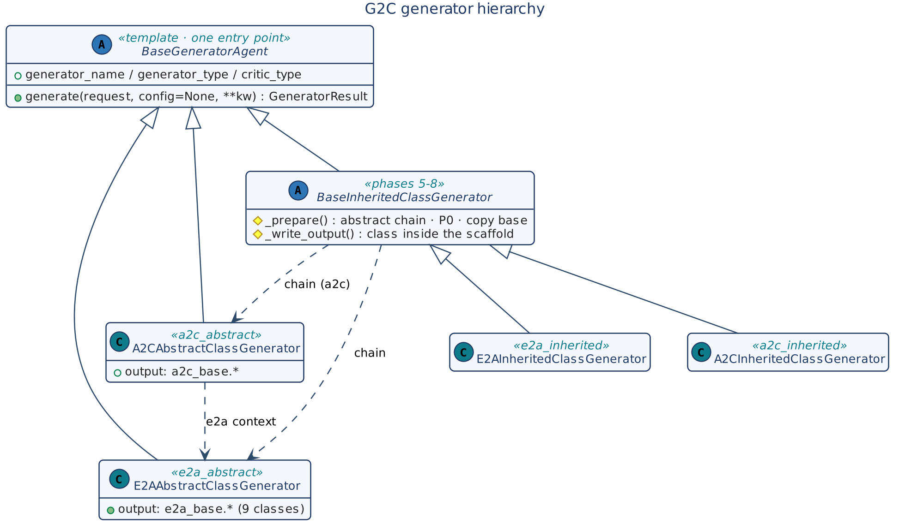
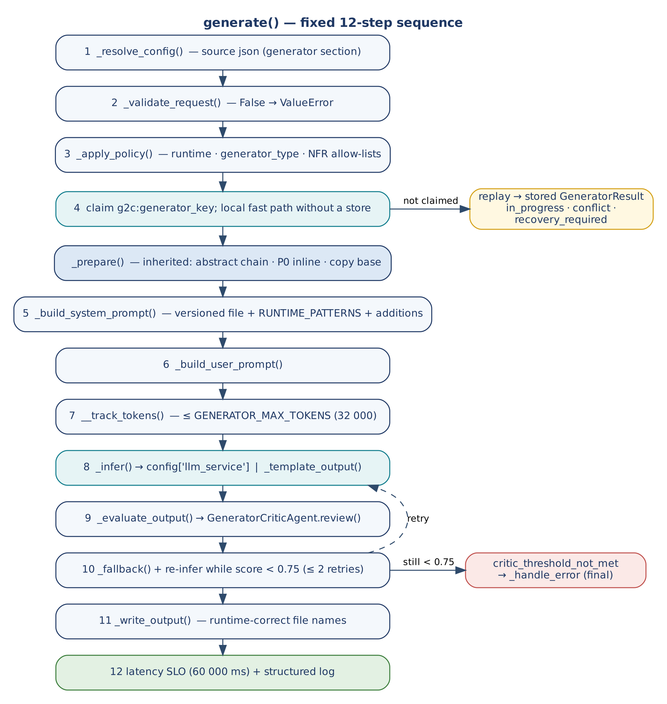

# G2C — Generate-to-Class Framework

**Agentic AI Generator Classes for E2A, A2C, and P0 Frameworks**

E2A-governed generators that produce E2A abstract classes, A2C abstract classes, and inherited concrete implementations via LLM

Extends: A2C Framework | Requires: E2A Framework, P0 Framework | Generator runtime: Python

github.com/subhamviky/a2c-framework

Author: Subham Gupta, Staff Architect & AI Architect

## 1. Executive Summary

The G2C (Generate-to-Class) Framework is the top layer of the framework stack. It provides a set of agentic AI generator classes that use LLM calls to generate E2A abstract classes, A2C abstract classes, and their concrete inherited implementations. Every generator class is written in Python. Every generated output is runtime-agnostic — Python, Java, Node, or Go — determined entirely by the `runtime` parameter in the request.

A developer who needs a new E2A agent, an A2C SDLC workflow, or a complete scaffolded project provides a single JSON config or natural-language prompt. G2C resolves or generates the abstract class, scaffolds the project structure via P0, generates the business logic via LLM, validates the output through a `GeneratorCriticAgent` quality gate, and writes all files. One call. One result.

> **The Self-Referential Design Principle.** All G2C generator classes are themselves E2A-governed agents. Every generator inherits from `BaseGeneratorAgent`, which follows the same Template Method Pattern as E2A's `BaseAgent`: one PUBLIC entry point (`generate()`), PROTECTED domain hooks, and PRIVATE infrastructure methods (`__write_file`, `__ensure_idempotency`) and a model call delegated to a `BaseLLMAgentService`. The agent is governed by E2A. The output follows E2A. The framework stack is self-generating.

| Layer | Framework | Entry Point | What it produces | Built on |
|:---|:---|:---|:---|:---|
| 1 | E2A | `agent.run()` | Governed agentic AI agents, RAG pipelines, tool services | — |
| 2 | A2C | `sdlc_agent.run()` | Microservice code, Terraform IaC, GitHub Actions CI/CD | E2A |
| 3 | P0 | `bootstrapper.bootstrap()` | Project structure, build manifests, Dockerfile, Makefile | Alongside A2C |
| 4 | G2C (this document) | `generator.generate()` | E2A/A2C abstract classes, inherited class files, scaffolded projects | E2A + A2C + P0 |

## 2. Design Principles

### 2.1 Four Generator Classes

G2C provides four generator classes, each with a single responsibility:

| Generator Class | generator_type | Generates | P0 scaffold? |
|:---|:---|:---|:---|
| `E2AAbstractClassGenerator` | `'e2a_abstract'` | `e2a_base.py` or `E2ABase.java` — the E2A abstract class foundation | No — standalone file only |
| `A2CAbstractClassGenerator` | `'a2c_abstract'` | `a2c_base.py` — `SDLCAssistantAgent`, `DevRequest`, `SDLCWorkflow` | No — standalone file only |
| `E2AInheritedClassGenerator` | `'e2a_inherited'` | Abstract class (if needed) + P0 project scaffold + inherited agent/workflow class | Yes |
| `A2CInheritedClassGenerator` | `'a2c_inherited'` | E2A + A2C abstract classes (if needed) + P0 scaffold + `SDLCAssistantAgent` subclass | Yes |

### 2.2 BaseGeneratorAgent — Shared Base

All four generators inherit from `BaseGeneratorAgent(ABC)`. Cross-cutting concerns — LLM delegation (to `BaseLLMAgentService`), idempotency, latency SLO, token budget, quality gate, file writing, and observability — are enforced once in the base class via the Template Method Pattern. Subclasses override only domain-specific protected methods.

### 2.3 Runtime Agnosticism

The generator class is written in Python. The generated output is runtime-agnostic. The same `E2AAbstractClassGenerator` instance generates a Python abstract class or a Java abstract class based solely on `request['runtime']`. The generator never executes, compiles, or imports the code it generates. The `_write_output()` method writes the LLM response string to a file with the runtime-correct extension.

| request['runtime'] | Output file | Language pattern | Import style in generated code |
|:---|:---|:---|:---|
| `'python'` | `e2a_base.py` | Python 3.x ABC with `@abstractmethod` decorators | `from common.e2a_base import BaseAgent` |
| `'java'` | `E2ABase.java` | Java 21 abstract class with final template methods | `import com.company.common.E2ABase.BaseAgent` |
| `'node'` | `e2aBase.ts` | TypeScript abstract class with abstract methods | `import { BaseAgent } from './e2aBase'` |
| `'go'` | `e2a_base.go` | Go interface + struct with embedded base methods | `import 'github.com/org/e2a'` |

### 2.4 Abstract Class Source — Three Modes

For inherited class generators, the abstract class can come from three sources. If `abstract_class_source` is not provided, it defaults to `'generate'` — the abstract class is created automatically before the inherited class generation begins.

| Source mode | When to use | abstract_class_source value |
|:---|:---|:---|
| **Generate (default)** | No abstract class exists yet. Generator calls `E2AAbstractClassGenerator` internally and places the output in `common/` before generating the inherited class. | `'generate'` (default when not specified) |
| **Path** | Abstract class file already exists locally. Generator reads from `abstract_class_path` and uses the content as LLM context. | `'path'` |
| **Package** | Abstract class published as pip/Maven package. Generator produces the inherited class with the correct package import statement. | `'package'` + `package_name` field |

### 2.5 System Prompt Auto-Build

The system prompt encoding E2A NFR guardrails, governance, and reliability patterns is always auto-built from versioned prompt files stored in `prompts/`. Whether or not `system_prompt_additions` is provided by the developer, the full E2A framework specification is always present in the system prompt. `system_prompt_additions` only adds domain/team-specific rules on top of the mandatory base.

### 2.6 Abstract Class Distribution — Standalone vs Library

Abstract classes can be distributed as standalone files or as published packages. G2C supports both distribution modes through the `abstract_class_source` field. Publishing as a library is a separate CI/CD concern outside the generator scope.

| Aspect | Standalone file (current) | Library package (design supported) |
|:---|:---|:---|
| abstract_class_source | `'generate'` or `'path'` | `'package'` |
| Location | `common/` directory in project repo | Installed pip/Maven dependency |
| Import style | `from common.e2a_base import BaseAgent` | `from e2a_framework import BaseAgent` |
| Multi-team sharing | Copy `common/` file to each repo | All teams install same package version |
| G2C support | Fully implemented | Design supported via `'package'` source mode; publishing out of scope now |

### 2.7 Quality Gate on All Paths

Every generator's `generate()` sequence ends with a `GeneratorCriticAgent` call that scores the generated output 0.0–1.0. A score below 0.75 triggers `_fallback()` and regeneration with a stricter prompt. The critic validates structural correctness: access modifier rules, required abstract methods, correct inheritance, NFR patterns in code not comments.

## 3. TypedDicts — Input and Output Contracts

### 3.1 GeneratorRequest — Unified Input

A single TypedDict accepted by all four generators. The `generator_type` field routes to the correct class via `GeneratorFactory`. All fields not explicitly provided resolve to safe defaults.

```python
class GeneratorRequest(TypedDict, total=False):
    # ── Universal (all generators) ─────────────────────────────────────────
    generator_type: str        # 'e2a_abstract' | 'a2c_abstract'
                               # | 'e2a_inherited' | 'a2c_inherited'
    source: str                # 'json' | 'prompt' | 'inline' (default: 'inline')
    config_path: str           # path to generator-config.json (if source='json')
    runtime: str               # 'python' | 'java' | 'node' | 'go'
    runtime_version: str       # '3.12' | '21' | '20' | '1.22'
    idempotency: bool          # include idempotency pattern (default: True)
    async_mode: bool           # async vs sync execution (default: True)
    platform: str              # 'aws' | 'gcp' | 'azure' | 'standalone'
    domain: str                # 'financial' | 'logistics' | 'e-commerce'
    team: str                  # team name for governance scoping
    company: str               # company name for governance scoping
    output_path: str           # base output directory
    # ── Prompt customisation ───────────────────────────────────────────────
    system_prompt_additions: str  # domain NFRs, governance rules to add to base prompt
    user_prompt: str           # developer natural-language requirement
    mandatory_nfrs: List[str]  # additional NFRs beyond E2A defaults
    optional_nfrs: List[str]
    # ── Abstract-class-specific (E2AAbstractClassGenerator, A2CAbstractClassGenerator) ──
    base_class_name: str       # 'BaseSettlementAgent' | 'BaseOrderProcessor'
    abstract_methods: List[str]  # method names beyond E2A defaults
    class_description: str     # one-line description for generated docstring
    # ── Inherited-class-specific (E2AInheritedClassGenerator, A2CInheritedClassGenerator) ──
    agent_name: str            # 'RefundAgent' | 'SettlementOrchestrator'
    abstract_class_source: str # 'generate' (default) | 'path' | 'package'
    abstract_class_path: str   # required if abstract_class_source='path'
    abstract_class_config: dict  # if abstract_class_source='generate'
    package_name: str          # if abstract_class_source='package'
    scaffold: dict             # ScaffoldRequest from P0 Framework
    # ── LLM config ─────────────────────────────────────────────────────────
    model_id: str              # main model (default: claude-3-5-sonnet)
    critic_model_id: str       # quality gate (default: claude-3-haiku)
    # ── Written by generator (do not supply) ───────────────────────────────
    generator_key: str         # idempotency key: name:type:runtime:platform
    generated_files: List[str] # absolute paths of all created files
    critic_report: dict        # {score, missing, passed}
    errors: List[str]
```

### 3.2 GeneratorResult — Output Contract

```python
class GeneratorResult(TypedDict, total=False):
    success: bool
    status: str               # generated | replay | in_progress | conflict | recovery_required
                              # | failed_final | inference_rejected | deadline_exceeded
                              # | critic_threshold_not_met | scaffold_failed
    generator_key: str
    generated_files: List[str]   # all created file paths
    abstract_class_path: str     # path to abstract class (inherited generators)
    e2a_abstract_class_path: str          # a2c_inherited chain only
    abstract_class_generated_fresh: bool  # this request created the abstract class
    project_root: str
    scaffold_result: dict        # ScaffoldResult from P0 (incl. dev_request), if P0 was invoked
    critic_report: dict          # {score, missing, passed, attempts, mode}
    trace_id: str                # UUID correlation ID
    latency_ms: float
    errors: List[str]
    replayed: bool               # True when a stored result was returned
    retryable: bool              # True for a typed transient failure
```

### 3.3 Minimum Viable Request per Generator

Based on default behaviour rules: if `abstract_class_source` is not provided it defaults to `'generate'`; if `system_prompt_additions` is not provided the full E2A base system prompt is used unchanged; if `idempotency` or `async_mode` are not provided they default to True.

| Generator | Minimum required fields | What defaults automatically |
|:---|:---|:---|
| `E2AAbstractClassGenerator` | generator_type, runtime, output_path | idempotency=True, async_mode=True, system prompt from versioned file |
| `A2CAbstractClassGenerator` | generator_type, runtime, output_path | Same as above + E2A abstract class resolved automatically |
| `E2AInheritedClassGenerator` | generator_type, runtime, agent_name, output_path | abstract_class_source='generate', P0 scaffold from defaults, system prompt from file |
| `A2CInheritedClassGenerator` | generator_type, runtime, agent_name, output_path | Same + E2A and A2C abstract classes generated if not provided |

## 4. BaseGeneratorAgent — Abstract Base Class

### 4.1 Class Variables

| Variable | Type | Default | Purpose |
|:---|:---|:---|:---|
| `generator_name` | str | `'BaseGeneratorAgent'` | Governance key — set in every subclass, used in all log entries |
| `idempotency` | bool | True | Same generator_key = skip. Set False to regenerate an existing output. |
| `APPROVED_RUNTIMES` | List[str] | `['python','java','node','go']` | Validated against `request['runtime']` at Step 3 |
| `APPROVED_GENERATOR_TYPES` | List[str] | `['e2a_abstract','a2c_abstract','e2a_inherited','a2c_inherited']` | Governance allow-list |
| `PROMPT_DIR` | str | `'prompts/'` | Base directory for versioned system prompt files |

### 4.2 Method Contract Table

| Access | Method / Signature | Returns | Purpose |
|:---|:---|:---|:---|
| PUBLIC | `generate(request, config, **kwargs)` | GeneratorResult | Single entry point. Fixed 12-step sequence. Never override in subclasses. |
| ABSTRACT | `_validate_request(request, config, **kwargs)` | bool | Check required fields for this generator type. Return False to abort. |
| PROTECTED | `_resolve_config(request, config, **kwargs)` | GeneratorRequest | Load from JSON file or LLM prompt if source != inline. |
| PROTECTED | `_build_system_prompt(request, config, **kwargs)` | str | Load versioned base prompt + merge system_prompt_additions. |
| ABSTRACT | `_build_user_prompt(request, config, **kwargs)` | str | Construct developer-facing user prompt from request fields. |
| PROTECTED | `_apply_policy(request, config, **kwargs)` | None | Governance: approved runtime, approved generator type, NFR allow-lists. |
| ABSTRACT | `_evaluate_output(response, request, config, **kwargs)` | float | Score generated output 0.0–1.0 via `GeneratorCriticAgent`. |
| PROTECTED | `_fallback(request, config, **kwargs)` | str | Stricter regeneration prompt when critic score < 0.75. |
| ABSTRACT | `_write_output(response, request, config, **kwargs)` | List[str] | Write generated files to output_path. Return list of file paths. |
| ABSTRACT | `_template_output(request, config, **kwargs)` | str | Deterministic skeleton emitted instead of a model completion when no `config['llm_service']` is bound (template mode, Section 17.4). |
| PROTECTED | `_prepare(request, config, **kwargs)` | dict | Inherited generators only: resolve the abstract class and run P0 after the claim (steps 5-8 of Section 7.2). The base default does nothing. |
| PROTECTED | `_handle_error(error, request, result, config, **kwargs)` | GeneratorResult | Log error, append to errors[], return safe result. |
| PROTECTED (base-owned) | `_infer(system_prompt, user_prompt, request, config, deadline, idempotency_key, tenant_id, trace_id)` | str | The only model call. Delegates to `config['llm_service']` (a `BaseLLMAgentService`) with the tenant, deadline and an attempt-scoped idempotency key; a rejected or failed call raises the retryable `InferenceRejected`. No provider routing or SDK code in the generator. In template mode it returns `_template_output()`. |
| PRIVATE | `__ensure_idempotency(request)` | str | Returns generator_key. Skip `generate()` if already generated. |
| PRIVATE | `__track_tokens(messages)` | int | FinOps token count for budget enforcement. |
| PROTECTED (base-owned) | `_write_file(root, path, content)` | str | Idempotent file writer. Returns absolute path. |
| PRIVATE | `__generate_key(request)` | str | Business idempotency key: name:type:runtime:platform |
| PRIVATE | `__load_prompt_file(filename)` | str | Load versioned system prompt file from PROMPT_DIR. |

### 4.3 generate() — 12-Step Fixed Sequence

| Step | Action | Condition |
|:---|:---|:---|
| 1 | Resolve config from source (JSON/prompt/inline) | If source != 'inline' |
| 2 | Validate `GeneratorRequest` via `_validate_request()` | Always — False aborts with ValueError |
| 3 | Governance approval check (runtime, generator_type in approved lists) | Always |
| 4 | Atomic idempotency claim on `g2c:<generator_key>` (tenant-scoped); a replay returns the stored result | Only if self.idempotency = True |
| 5 | Build system prompt via `_build_system_prompt()` + runtime pattern injection | Always |
| 6 | Build user prompt via `_build_user_prompt()` | Always |
| 7 | Token budget check via `__track_tokens()` | Always |
| 8 | LLM call via `_infer(messages, config)` → `config['llm_service']` | Always |
| 9 | Quality gate via `_evaluate_output()` → `GeneratorCriticAgent` | Always |
| 10 | Fallback regeneration via `_fallback()` if critic score < 0.75 (max 2 retries) | Only if score < 0.75 |
| 11 | Write output files via `_write_output()` | Always on success |
| 12 | Latency SLO check + structured observability log (trace_id, latency, tokens, score) | Always |

### 4.4 Runtime Pattern Injection

The `_build_system_prompt()` method injects runtime-specific code patterns into the versioned system prompt via a `RUNTIME_PATTERNS` dictionary. This ensures the generated output uses correct language idioms regardless of which generator subclass is active.

```python
RUNTIME_PATTERNS = {
    'python': {
        'abstract_base': 'from abc import ABC, abstractmethod',
        'abstract_method': '@abstractmethod',
        'private_prefix': '__',
        'protected_prefix': '_',
        'type_hints': 'from typing import Any, Dict, List, Optional'
    },
    'java': {
        'abstract_base': 'public abstract class',
        'abstract_method': 'protected abstract',
        'private_prefix': 'private',
        'protected_prefix': 'protected',
        'type_hints': 'import java.util.*'
    },
    'node': {
        'abstract_base': 'abstract class',
        'abstract_method': 'abstract',
        'private_prefix': '#',
        'protected_prefix': 'protected',
        'type_hints': 'import type { ... }'
    },
    'go': {
        'abstract_base': 'type BaseAgent interface',
        'abstract_method': '// interface method',
        'private_prefix': 'lowercase',
        'protected_prefix': 'lowercase',
        'type_hints': ''
    }
}

# Usage in _build_system_prompt():
def _build_system_prompt(self, request, config=None, **kwargs) -> str:
    base = self.__load_prompt_file(f'{self.generator_name.lower()}_system_v1.txt')
    runtime = request.get('runtime', 'python')
    patterns = RUNTIME_PATTERNS.get(runtime, RUNTIME_PATTERNS['python'])
    additions = request.get('system_prompt_additions', '')  # empty = base prompt only
    return base.format(
        runtime=runtime,
        runtime_version=request.get('runtime_version', '3.12'),
        runtime_patterns=patterns,
        idempotency=request.get('idempotency', True),
        async_mode=request.get('async_mode', True),
        domain=request.get('domain', 'general'),
        system_prompt_additions=additions
    )
```

## 5. E2AAbstractClassGenerator

### 5.1 Purpose and Output

Generates the E2A base abstract class file — the foundation layer of a new E2A application. P0 scaffolding is not performed. The output is a single standalone file designed to be placed in a project's `common/` directory or published as a package.

| Field | Value |
|:---|:---|
| generator_name | `'E2AAbstractClassGenerator'` |
| generator_type (request field) | `'e2a_abstract'` |
| Output — Python | `e2a_base.py` containing `BaseAgent`, `BaseWorkflow`, `BaseRAGPipeline`, `BaseToolService`, `BaseLLMAgentService`, and four Foundation interfaces |
| Output — Java | `E2ABase.java` with abstract classes and final template methods |
| System prompt file | `prompts/e2aabstractclassgenerator_system_v1.txt` |
| Critic validates | All 9 abstract classes present; governed entry points only (`run()` / `execute()` not overridden); all access modifiers correct; NFR matrix complete in base class |

### 5.2 System Prompt — E2A Abstract Generator

The system prompt encodes the complete E2A framework specification. It is loaded from the versioned file and formatted with runtime-specific values. Even if `system_prompt_additions` is empty, the full E2A specification is always present.

```text
# prompts/e2aabstractclassgenerator_system_v1.txt (structure -- full content in repo)
You are a Principal Cloud Architect generating production-grade {runtime} code.
Generate the E2A Architecture Framework base abstract class file.

MANDATORY STRUCTURE (Template Method Pattern):
  - Every class has exactly ONE public entry point per interaction mode: run() / execute() /
    retrieve(); BaseLLMAgentService alone has two: process_inference() (unary) and
    process_inference_stream() (streaming)
  - PROTECTED methods ({runtime_patterns[protected_prefix]}method): override in subclasses
  - PRIVATE methods ({runtime_patterns[private_prefix]}method): framework internals only
  - CLASS VARS: idempotency = {idempotency}, async_mode = {async_mode}

MANDATORY ABSTRACT CLASSES (generate all 9):
  BaseAgent         run()        agents/
  BaseWorkflow      execute()    orchestration/
  BaseRAGPipeline   retrieve()   rag/
  BaseToolService   execute()    tools/
  BaseLLMAgentService  process_inference() + process_inference_stream()  llm/ (model call
                    lives here ONLY; agents delegate via config['llm_service'])
  BaseInfraProvisioner      foundation/ (Interface -- no shared implementation)
  BaseObservability         foundation/ (Interface)
  BasePipeline              foundation/ (Interface)
  BaseGovernanceFramework   foundation/ (Interface)

MANDATORY NFRs (enforce structurally in base class, NOT as comments):
  Idempotency:    __ensure_idempotency() in run()/execute()/retrieve()
  Latency SLO:    time delta check, raise NFRViolationError if exceeded
  Token budget:   __track_tokens(), raise if > max_tokens
  Governance:     approved_agents/models/tools list check
  Observability:  structured JSON log (trace_id, latency, tokens, confidence)
  Fallback:       _fallback() triggered when confidence < min_confidence
  Async/sync:     async_mode class variable toggle in public method
  Capacity:       pod semaphore + RPM/TPM token bucket enforced in BaseLLMAgentService, never
                  in agents

DOMAIN: {domain} | RUNTIME: {runtime} {runtime_version}
ADDITIONAL NFRs: {system_prompt_additions}
```

### 5.3 Key Method Overrides

```python
class E2AAbstractClassGenerator(BaseGeneratorAgent):
    generator_name = 'E2AAbstractClassGenerator'

    def _validate_request(self, request, config=None, **kwargs) -> bool:
        return all(k in request for k in ['runtime', 'output_path'])

    def _resolve_config(self, request, config=None, **kwargs) -> GeneratorRequest:
        if request.get('source') == 'json':
            loaded = self._BaseGeneratorAgent__load_json_config(request['config_path'])
            request.update(loaded)
        return request

    def _evaluate_output(self, response, request, config=None, **kwargs) -> float:
        critic = GeneratorCriticAgent(config={'critic_type': 'e2a_abstract'})
        return critic.score(response, request)

    def _write_output(self, response, request, config=None, **kwargs) -> List[str]:
        filemap = {'python': 'e2a_base.py', 'java': 'E2ABase.java',
                   'node': 'e2aBase.ts', 'go': 'e2a_base.go'}
        fname = filemap.get(request.get('runtime','python'), 'e2a_base.py')
        path = self._BaseGeneratorAgent__write_file(
            request['output_path'], fname, response
        )
        return [path]

    # _build_system_prompt and _build_user_prompt use base class helpers
    # run() is NOT overridden -- inherits 12-step sequence from BaseGeneratorAgent
```

## 6. A2CAbstractClassGenerator

### 6.1 Purpose and Output

Generates the A2C base abstract class file — `SDLCAssistantAgent`, `DevRequest` TypedDict, `CodeCriticAgent`, `IaCAgent`, `CICDAgent`, and the `SDLCWorkflow` LangGraph StateGraph. No P0 scaffolding performed. The E2A abstract class is required as context; if not provided, it is generated automatically.

| Field | Value |
|:---|:---|
| generator_name | `'A2CAbstractClassGenerator'` |
| generator_type | `'a2c_abstract'` |
| Output — Python | `a2c_base.py` containing `SDLCAssistantAgent`, `DevRequest` TypedDict, `SDLCWorkflow`, `CodeCriticAgent` |
| System prompt file | `prompts/a2cabstractclassgenerator_system_v1.txt` |
| Requires | E2A abstract class content as LLM context — `abstract_class_source` applies |
| Critic validates | `SDLCAssistantAgent` present, `DevRequest` TypedDict correct, `_apply_policy()` injects mandatory NFRs, `CodeCriticAgent` scores >= 0.75, `SDLCWorkflow` chains all 5 agents |

### 6.2 Key Difference — Requires E2A Context

`A2CAbstractClassGenerator` always includes the full `e2a_base.py` content in the system prompt so the LLM generates A2C classes that correctly extend `BaseAgent`. The `abstract_class_source` field determines how `e2a_base.py` is obtained. If not provided, `E2AAbstractClassGenerator` is called first and the result is injected automatically.

```python
    def _build_system_prompt(self, request, config=None, **kwargs) -> str:
        base = self.__load_prompt_file('a2cabstractclassgenerator_system_v1.txt')
        # Load E2A abstract class content for LLM context
        e2a_content = self.__resolve_abstract_class_content(request, config)
        additions = request.get('system_prompt_additions', '')
        return base.format(
            runtime=request.get('runtime','python'),
            runtime_patterns=RUNTIME_PATTERNS.get(request.get('runtime','python')),
            e2a_abstract_class=e2a_content,   # full e2a_base.py injected
            idempotency=request.get('idempotency', True),
            async_mode=request.get('async_mode', True),
            system_prompt_additions=additions
        )

    def __resolve_abstract_class_content(self, request, config) -> str:
        src = request.get('abstract_class_source', 'generate')  # default: generate
        if src == 'path':
            with open(request['abstract_class_path']) as f: return f.read()
        elif src == 'package':
            return f'# Package: {request["package_name"]} -- import from installed lib'
        else:  # 'generate'
            result = E2AAbstractClassGenerator(config=config).generate(
                {**request.get('abstract_class_config',{}),
                 'generator_type':'e2a_abstract',
                 'output_path': request.get('output_path','./') + 'common/'},
                config
            )
            with open(result['generated_files'][0]) as f: return f.read()
```

## 7. E2AInheritedClassGenerator

### 7.1 Purpose and Output

Generates a complete E2A inherited class project in a single call: resolves or generates the abstract class, runs P0 scaffolding to create the project structure, then generates the concrete inherited agent/workflow/RAG/tool class implementing the developer's business logic.

> **v1.2.** For Python, the default `e2a_contract` is `"1.2"`: the abstract class is not generated (the project depends on the `e2a` package, `e2a-framework` v1.2.0), and `harness.agents`, `harness.workflow` and `harness.governance` generate several agents, a declared workflow, a governance service, validation stubs, tool stubs and contract tests in one call (Section 18). `"e2a_contract": "1.1"` keeps the output described here. Java stays on 1.1 until `e2a-java` exists.

| Field | Value |
|:---|:---|
| generator_name | `'E2AInheritedClassGenerator'` |
| generator_type | `'e2a_inherited'` |
| Output | Abstract class file in `common/` + full P0 project scaffold + inherited class file(s) |
| System prompt file | `prompts/e2ainheritedclassgenerator_system_v1.txt` |
| Critic validates | Inherits from correct base, all required protected methods overridden, `run()` NOT overridden, NFRs in code not comments, no direct `__private` calls |

### 7.2 Internal Execution Phases

| Phase | Steps | What happens |
|:---|:---|:---|
| Setup | 1–4 | Resolve config, validate, governance check, idempotency |
| Abstract class resolution | 5–6 | Resolve `e2a_base.py` via generate/path/package; place in project's `common/` directory |
| P0 scaffold | 7–8 | Call `ProjectBootstrapperFactory.create(request['scaffold']).bootstrap()`; creates pyproject.toml/pom.xml, directories, Dockerfile, Makefile |
| Logic generation | 9–11 | Build system prompt (E2A rules + abstract class content + domain context); build user prompt; call `_infer()` |
| Quality gate | 12 | `GeneratorCriticAgent` validates inherited class structure; fallback if score < 0.75 |
| Output | 13–14 | Write inherited class file into scaffolded project; latency SLO + observability log |

### 7.3 Abstract Class Directory Placement

When the abstract class is generated (`source='generate'`) or loaded from a path, it is placed in the project's `common/` directory. The generated inherited class uses the correct import pattern for the runtime:

```python
# Python -- abstract class at {project_root}/common/e2a_base.py
from common.e2a_base import BaseAgent, AgentState

class SettlementAgent(BaseAgent):
    agent_name = 'SettlementAgent'
    ...
```

```java
// Java -- abstract class at {project_root}/common/E2ABase.java
import com.company.common.E2ABase.BaseAgent;

public class SettlementAgent extends BaseAgent {
    public static final String AGENT_NAME = "SettlementAgent";
    ...
}
```

### 7.4 System Prompt Design — Inherited Class

```text
# prompts/e2ainheritedclassgenerator_system_v1.txt (structure)
You are a Principal Cloud Architect generating a production-grade {runtime}
inherited class that extends the E2A abstract class below.

E2A FRAMEWORK RULES:
  - PROTECTED methods: override _build_messages, _evaluate_output
  - DO NOT define _validate_state: input validation lives in the BaseValidationService
    subclass as _validate_<agent_name>, and runs before the agent is instantiated
  - DO NOT override run()/execute()/retrieve() -- inherited from base class
  - DO NOT call any __private method from outside the class
  - _apply_policy() only if the agent has governance rules
  - _fallback(): safe degraded response without LLM call
  - _handle_error(): append to state['errors'], return safe state

ABSTRACT CLASS TO INHERIT FROM:
{abstract_class_content}

DOMAIN: {domain} | AGENT NAME: {agent_name}
ADDITIONAL NFRs: {system_prompt_additions}
```

## 8. A2CInheritedClassGenerator

### 8.1 Purpose and Output

Generates a complete A2C inherited class project: resolves or generates both the E2A and A2C abstract classes, runs P0 scaffolding, then generates a concrete `SDLCAssistantAgent` subclass implementing the developer's custom SDLC workflow. Used when a team needs their own code generation agent with domain/team-specific NFR injection.

| Field | Value |
|:---|:---|
| generator_name | `'A2CInheritedClassGenerator'` |
| generator_type | `'a2c_inherited'` |
| Output | E2A abstract class + A2C abstract class + P0 scaffold + `SDLCAssistantAgent` subclass |
| System prompt file | `prompts/a2cinheritedclassgenerator_system_v1.txt` |
| Requires | Both e2a_base and a2c_base as LLM context — both resolved via `abstract_class_source` |
| Critic validates | Extends `SDLCAssistantAgent`, `_apply_policy()` injects team-specific NFRs, `DevRequest` fields correct, `run()` not overridden |

### 8.2 Key Difference — Requires Both E2A and A2C Context

The system prompt for `A2CInheritedClassGenerator` includes both `e2a_base.py` and `a2c_base.py` content. The LLM generates a class that extends `SDLCAssistantAgent` (not `BaseAgent` directly) and adds team/domain-specific `_apply_policy()` logic on top of A2C's mandatory NFR injection.

```python
# Generated A2C inherited class (Python example):
from a2c_base import SDLCAssistantAgent

class FinancialSettlementSDLCAgent(SDLCAssistantAgent):
    agent_name = 'FinancialSettlementSDLCAgent'

    def _apply_policy(self, state, config=None, **kwargs) -> None:
        # Call parent to inject A2C mandatory NFRs first
        super()._apply_policy(state, config, **kwargs)
        # Add team-specific NFRs on top
        team_nfrs = ['DoubleEntryLedgerInvariant', 'SagaCompensation', 'AuditTrail']
        for nfr in team_nfrs:
            if nfr not in state.get('mandatory_nfrs', []):
                state['mandatory_nfrs'].append(nfr)

    def _build_messages(self, state, config=None, **kwargs) -> list:
        # Domain-specific generation context
        return [
            {'role':'system','content': f'Generate SAP TM financial settlement '
                                       f'microservice: {state.get("context","")}'},
            {'role':'user','content': f'Project: {state.get("project_name")}'}
        ]
```

## 9. GeneratorCriticAgent — Quality Gate

### 9.1 Purpose

`GeneratorCriticAgent` validates the structural correctness of every generated class. It is called at Step 9 of every generator's sequence. A score below 0.75 triggers `_fallback()` and regeneration. The critic is itself an E2A-governed agent inheriting from `BaseAgent`, using a cheaper model (e.g. claude-3-haiku) for cost efficiency.

### 9.2 Critic Types and Validation Rules

| critic_type | Validates | Scoring |
|:---|:---|:---|
| `'e2a_abstract'` | All 9 abstract classes present; single public entry point per class; PROTECTED methods single-underscore; PRIVATE methods double-underscore; NFR enforcement in base class code, not comments; Foundation classes are interfaces with no shared implementation | Deduct 0.15 per missing class; 0.10 per access modifier violation |
| `'a2c_abstract'` | `SDLCAssistantAgent` present; `DevRequest` TypedDict fields correct; `_apply_policy()` injects mandatory NFRs; `CodeCriticAgent` integration present; `SDLCWorkflow` chains all 5 agents | Same deduction model |
| `'e2a_inherited'` | **v1.2 (contract 1.2):** the generated `src/` must pass `e2a.conformance --strict` (rules R1–R3, D1); the rules below apply to contract 1.1. Inherits from correct base; all required protected methods overridden; `run()` NOT overridden; no direct `__private` calls; NFR patterns in code | Deduct 0.25 if `run()` overridden; 0.15 per missing required override |
| `'a2c_inherited'` | Extends `SDLCAssistantAgent`; `_apply_policy()` injects team-specific NFRs without removing A2C mandatory ones; `DevRequest` fields appropriate to domain | Same as e2a_inherited |

### 9.3 Critic Response Format and Score Routing

```python
# GeneratorCriticAgent is prompted to return ONLY valid JSON:
# {"score": 0.85, "passed": ["inherits BaseAgent", "run() not overridden"],
#  "missing": ["_fallback not overridden"], "regenerate": false}

# Score routing in generate() Step 9-10:
critic = GeneratorCriticAgent(config={'critic_type': critic_type,
                                      'model_id': config.get('critic_model_id',
                                      'anthropic.claude-3-haiku-20240307-v1:0')})
score, report = critic.score(response, request)
request['critic_report'] = report
if score >= 0.75:
    # Proceed to _write_output()
    pass
elif retry_count < 2:
    # Stricter regeneration
    response = self._fallback(request, config)
    retry_count += 1
else:
    return self._handle_error(
        NFRViolationError(f'Critic threshold 0.75 not met after 2 retries. '
                          f'Score: {score}. Missing: {report["missing"]}'),
        request, result, config
    )
```

## 10. GeneratorFactory and DeveloperPlatformWorkflow

### 10.1 GeneratorFactory

Resolves the correct generator subclass from `request['generator_type']`. Follows the same approved-list governance pattern as E2A's agent routing.

```python
class GeneratorFactory:
    _REGISTRY: Dict[str, type] = {
        'e2a_abstract':  E2AAbstractClassGenerator,
        'a2c_abstract':  A2CAbstractClassGenerator,
        'e2a_inherited': E2AInheritedClassGenerator,
        'a2c_inherited': A2CInheritedClassGenerator,
    }

    @classmethod
    def create(
        cls,
        request: GeneratorRequest,
        config: Dict[str, Any] = None
    ) -> BaseGeneratorAgent:
        gen_type = request.get('generator_type', '')
        cls_ = cls._REGISTRY.get(gen_type)
        if not cls_:
            raise ValueError(
                f'Unknown generator_type: {gen_type}. '
                f'Registered: {list(cls._REGISTRY.keys())}'
            )
        return cls_(config=config)

    @classmethod
    def register(cls, gen_type: str, generator_cls: type) -> None:
        """Register a new generator. Call at module import time."""
        cls._REGISTRY[gen_type] = generator_cls
```

### 10.2 DeveloperPlatformWorkflow

The top-level orchestrator. A developer passes a single `GeneratorRequest` and the workflow chains the correct generators automatically. The key chain: if `generator_type='e2a_inherited'` and `abstract_class_source` is not provided (defaults to `'generate'`), it calls `E2AAbstractClassGenerator` first, injects the result as `abstract_class_path`, then calls `E2AInheritedClassGenerator`.

```python
class DeveloperPlatformWorkflow:
    def __init__(self, config: dict = None, artifact_registry=None):
        self.config = config or {}
        self.artifact_registry = (artifact_registry or self.config.get('artifact_registry')
                                  or InMemoryArtifactRegistry())

    def generate(self, request: GeneratorRequest, config: dict = None) -> GeneratorResult:
        config = config if config is not None else self.config
        request = dict(request or {})
        if request.get('generator_type') in INHERITED:
            request.setdefault('abstract_class_source', 'generate')   # default
        result = GeneratorFactory.create(request, config).generate(request, config)
        if result.get('success') and request.get('generator_type') in INHERITED:
            fresh = bool(result.get('abstract_class_generated_fresh'))
            for key in ('e2a_abstract_class_path', 'abstract_class_path'):
                if result.get(key):
                    register_artifact(self.artifact_registry, result[key],
                                      result['generator_key'], created_fresh=fresh)
        return result

    def compensate(self, request: GeneratorRequest, result: GeneratorResult) -> dict:
        # Release this request's reference; delete an abstract class only where the
        # registry says this caller may (creator, last reference, not already deleted).
        ...
```

The chain itself (generate the abstract class first, run P0 when `request['scaffold']` is set, then generate the inherited class) runs inside the inherited generator, after its claim. This ordering matters for replays: a replay of a settled `generator_key` returns the stored result without generating or scaffolding again, which is the idempotent no-op. The abstract-class and P0 steps are idempotent in their own right (each has its own claim or directory check), so they are not treated as the first side effect: a later model failure still settles the claim as retryable.

## 11. API Exposure — FastAPI Router

### 11.1 GeneratorAPIRouter

Each generator is exposed as a FastAPI POST endpoint under `/api/v1/g2c/`. The router is an E2A exposure layer — no business logic, only parameter binding and response mapping. Public methods are exposed as APIs and can be linked to a UI-based application or an agentic AI-based orchestration system.

```python
from fastapi import APIRouter, Depends

router = APIRouter(prefix='/api/v1/g2c', tags=['G2C Generator'])

@router.post('/generate', response_model=GeneratorResult)
async def generate(
    request: GeneratorRequest,
    config: dict = Depends(get_generator_config)
) -> GeneratorResult:
    '''
    Universal endpoint. Routes to correct generator via generator_type.
    generator_type: e2a_abstract | a2c_abstract | e2a_inherited | a2c_inherited
    '''
    return DeveloperPlatformWorkflow(config=config).generate(request, config)

@router.post('/e2a/abstract', response_model=GeneratorResult)
async def generate_e2a_abstract(
    request: GeneratorRequest,
    config: dict = Depends(get_generator_config)
):
    request['generator_type'] = 'e2a_abstract'
    return GeneratorFactory.create(request, config).generate(request, config)

@router.post('/a2c/abstract', response_model=GeneratorResult)
async def generate_a2c_abstract(
    request: GeneratorRequest,
    config: dict = Depends(get_generator_config)
):
    request['generator_type'] = 'a2c_abstract'
    return GeneratorFactory.create(request, config).generate(request, config)

@router.post('/e2a/inherited', response_model=GeneratorResult)
async def generate_e2a_inherited(
    request: GeneratorRequest,
    config: dict = Depends(get_generator_config)
):
    request['generator_type'] = 'e2a_inherited'
    return DeveloperPlatformWorkflow(config=config).generate(request, config)

@router.post('/a2c/inherited', response_model=GeneratorResult)
async def generate_a2c_inherited(
    request: GeneratorRequest,
    config: dict = Depends(get_generator_config)
):
    request['generator_type'] = 'a2c_inherited'
    return DeveloperPlatformWorkflow(config=config).generate(request, config)
```

### 11.2 JSON Configuration File — generator-config.json

A developer can drive the full pipeline from a single JSON config file. The scaffold section (P0 config) is optional and only used by inherited class generators.

```json
{
  "generator": {
    "source": "json",
    "generator_type": "e2a_inherited",
    "runtime": "python",
    "runtime_version": "3.12",
    "platform": "aws",
    "idempotency": true,
    "async_mode": true,
    "domain": "financial",
    "team": "settlement-team",
    "company": "acme-corp",
    "agent_name": "SettlementAgent",
    "abstract_class_source": "generate",
    "abstract_class_config": { "base_class_name": "BaseSettlementAgent" },
    "user_prompt": "SAP TM charge-to-settlement reconciliation agent",
    "system_prompt_additions": "Additional NFR: double-entry ledger invariant",
    "output_path": "./generated/",
    "model_id": "anthropic.claude-3-5-sonnet-20241022-v2:0",
    "critic_model_id": "anthropic.claude-3-haiku-20240307-v1:0"
  },
  "scaffold": {
    "build_tool": "poetry",
    "project_name": "SettlementEngine",
    "package_name": "settlement_engine",
    "include_docker": true,
    "include_makefile": true,
    "dependencies": ["fastapi>=0.111", "pydantic>=2.7", "langgraph>=0.1"]
  }
}
```

## 12. End-to-End Developer Flow

### 12.1 Full Stack Generation — One Call

A developer needs a new E2A financial settlement agent from scratch. They provide one generator-config.json and call the API or workflow. The complete automated chain:

```text
Developer provides generator-config.json
        |
        v
DeveloperPlatformWorkflow.generate(request, config)
  abstract_class_source defaults to 'generate' (not specified)
        |
        +-- Step A: E2AAbstractClassGenerator.generate()
        |     12-step sequence: LLM generates BaseSettlementAgent
        |     GeneratorCriticAgent: all 9 classes present, access modifiers correct
        |     Output: ./generated/common/e2a_base.py
        |     Injects abstract_class_path into main request
        |
        v
E2AInheritedClassGenerator.generate()
  Steps 1-4:   validate, governance, idempotency
  Steps 5-6:   load e2a_base.py from common/
  Steps 7-8:   P0 bootstrap -> pyproject.toml, dirs, Dockerfile, Makefile
               + copies e2a_base.py to project/common/
  Steps 9-11:  LLM generates SettlementAgent(BaseSettlementAgent)
  Step 12:     GeneratorCriticAgent: inherits base, methods overridden, run() intact
  Steps 13-14: Write SettlementAgent.py + observability log
        |
        v
GeneratorResult {
  success: True,
  generated_files: [
    './generated/common/e2a_base.py',
    './generated/SettlementEngine/pyproject.toml',
    './generated/SettlementEngine/Dockerfile',
    './generated/SettlementEngine/Makefile',
    './generated/SettlementEngine/src/settlement_engine/agents/settlement_agent.py'
  ],
  critic_report: {score: 0.92, passed: [...], missing: []}
}
```

### 12.2 Common Developer Scenarios

| Scenario | generator_type | abstract_class_source | What G2C produces |
|:---|:---|:---|:---|
| New E2A app, no base class exists | `'e2a_inherited'` | `'generate'` (default) | E2A abstract class + P0 scaffold + inherited agent class |
| New E2A app, team has existing base class | `'e2a_inherited'` | `'path'` | P0 scaffold + inherited agent class (base used as LLM context) |
| New E2A app, base class as pip package | `'e2a_inherited'` | `'package'` | P0 scaffold + inherited agent class (correct package imports) |
| Just the abstract base class file | `'e2a_abstract'` | N/A | Single e2a_base.py / E2ABase.java — no scaffold |
| A2C workflow with custom SDLC logic | `'a2c_inherited'` | `'generate'` | E2A + A2C abstract files + P0 scaffold + `SDLCAssistantAgent` subclass |

## 13. Complete Class Relationship Map

How all G2C classes relate to each other and to the E2A, A2C, and P0 frameworks:

```text
E2A Framework (e2a_base.py)                           [Foundation]
  BaseAgent, BaseWorkflow, BaseRAGPipeline,
  BaseToolService, BaseLLMAgentService, 4 Foundation interfaces
        |
        |  governs (Template Method Pattern)
        v
BaseGeneratorAgent(ABC)                               [G2C Base]
  generate()              -- fixed 12-step sequence
  _infer()                -- delegates to BaseLLMAgentService
  __write_file()          -- idempotent file writer
  __ensure_idempotency()  __track_tokens()
  __load_prompt_file()    __generate_key()
        |
        +----------+-----------+-----------+
        |          |           |           |
        v          v           v           v
E2AAbstract  A2CAbstract  E2AInherited  A2CInherited
ClassGen     ClassGen     ClassGen      ClassGen
        |          |           | P0        | P0
        v          v           v           v
[e2a_base   [a2c_base   [E2A project  [A2C project
 .py/.java]  .py/.java]  common/       common/
                         + scaffold    + scaffold
                         + agent.py]   + sdlc.py]

All four generators routed by:
  GeneratorFactory.create(request)
        |
  orchestrated by:
  DeveloperPlatformWorkflow.generate(request)
        |
  quality gate on all paths:
  GeneratorCriticAgent.score(response, request)
        |
  exposed via:
  GeneratorAPIRouter (FastAPI)
    POST /api/v1/g2c/generate
    POST /api/v1/g2c/e2a/abstract
    POST /api/v1/g2c/e2a/inherited
    POST /api/v1/g2c/a2c/abstract
    POST /api/v1/g2c/a2c/inherited
```

## 14. Repository Structure and Prompt File Layout

```text
a2c-framework/                               # G2C files live alongside A2C
  # ── G2C Core ───────────────────────────────────────────────────────────
  base_generator_agent.py                    BaseGeneratorAgent ABC
  e2a_abstract_class_generator.py            E2AAbstractClassGenerator
  a2c_abstract_class_generator.py            A2CAbstractClassGenerator
  e2a_inherited_class_generator.py           E2AInheritedClassGenerator
  a2c_inherited_class_generator.py           A2CInheritedClassGenerator
  generator_critic_agent.py                  GeneratorCriticAgent
  inherited_generator.py                     BaseInheritedClassGenerator (shared phases 5-14)
  generator_templates.py                     Deterministic skeletons for template mode
  a2c_base.py                                A2C reference classes (A2C Framework Reference)
  a2c_concurrency.py                         Claim store, artifact ownership record, Deadline
  smoke_test_generator_concurrency.py        Concurrency smoke tests (in-memory test doubles)
  smoke_test_g2c_contract.py                 Generator contract, replay, conflict, router
  smoke_test_a2c.py                          A2C classes with scripted model responses
  smoke_test_aidlc_integration.py            G2C + P0 + A2C composed through the AI-DLC pipeline
  .gitignore                                 Excludes __pycache__ and build output
  generator_factory.py                       GeneratorFactory
  developer_platform_workflow.py             DeveloperPlatformWorkflow
  generator_api_router.py                    FastAPI endpoints
  typedicts.py                               GeneratorRequest, GeneratorResult

  # ── Versioned System Prompts ───────────────────────────────────────────
  prompts/
    e2aabstractclassgenerator_system_v1.txt
    a2cabstractclassgenerator_system_v1.txt
    e2ainheritedclassgenerator_system_v1.txt
    a2cinheritedclassgenerator_system_v1.txt
    generatorcriticagent_system_v1.txt

  # ── JSON Schemas ───────────────────────────────────────────────────────
  schemas/
    generator-config-schema.json             JSON Schema for generator-config.json
    scaffold-config-schema.json              From P0 Framework (reused here)

  # ── Examples ──────────────────────────────────────────────────────────
  examples/
    e2a_abstract_config.json                 Minimal: generate E2A base class only
    e2a_inherited_minimal_config.json        Minimal: e2a_inherited with all defaults
    e2a_inherited_full_config.json           Full: all options explicit
    a2c_abstract_config.json                 Generate A2C base class only
    a2c_inherited_config.json                Full A2C inherited class pipeline
    java_spring_boot_config.json             Java runtime example
```

## 15. Environment Variable Reference

Central configuration: every key in this document is defined once, in the `E2A_CONFIG` registry at the top of `e2a_base.py` (Implementation Playbook Section 5). Resolution order is call-time kwargs > config dict > environment variable > registered default, performed only by `resolve_config()`. Projects add their own keys with `register_config_key()` in `src/settings.py`. `.env.example` and the Playbook configuration table are generated from the registry (`env_example()`, `config_reference_markdown()`), so they cannot drift from the code. The generator variables below (`GENERATOR_*`, `CRITIC_MODEL_ID`) are registered through `register_config_key()` in the generator's settings module alongside the framework keys, and the projects G2C generates inherit the same registry rather than defining their own environment handling.

| Variable | Used in | Default | Controls |
|:---|:---|:---|:---|
| `LLM_MODEL_ID` | `BaseLLMAgentService` (model_id, via `config["llm_service"]`) | `'anthropic.claude-3-5-sonnet-20241022-v2:0'` | Main LLM for all generation calls |
| `LLM_POD_CONCURRENCY` / `LLM_MAX_RPM` / `LLM_MAX_TPM` / `LLM_REPLICA_COUNT` | `BaseLLMAgentService` | 32 / 600 / 300000 / 1 | Capacity governance of generation calls; full key list in the Implementation Playbook, Section 5 |
| `CRITIC_MODEL_ID` | `GeneratorCriticAgent` | `'anthropic.claude-3-haiku-20240307-v1:0'` | Cheaper model for quality gate (FinOps) |
| `GENERATOR_MAX_LATENCY_MS` | `generate()` Step 12 | 60000 | Latency SLO — code generation takes longer than agent calls |
| `GENERATOR_MAX_TOKENS` | `generate()` Step 7 | 32000 | Token budget for class generation |
| `GENERATOR_MIN_CRITIC_SCORE` | `generate()` Step 9 | 0.75 | Quality gate threshold — regenerate if below |
| `GENERATOR_PROMPT_DIR` | `BaseGeneratorAgent.__load_prompt_file()` | `'prompts/'` | Base directory for versioned system prompt files |
| `BOOTSTRAP_OUTPUT_PATH` | P0 `BaseProjectBootstrapper` | `'./'` | Default output directory for P0 scaffold |
| `GENERATOR_IDEMPOTENCY_STORE` | `BaseGeneratorAgent.__ensure_idempotency()` | `'local'` | `'local'` checks directory; `'dynamodb'` for distributed (see Section 17 for what a distributed store must guarantee) |

## 16. Implementation Checklist

**New Generator Subclass**

- Never call a model SDK from a generator — model calls go through `_infer()` to the bound `config['llm_service']`
- Define `generator_name` class attribute — governance key, used in all log entries
- Add `generator_type` to `GeneratorFactory._REGISTRY`
- Override `_validate_request()`: check all required `GeneratorRequest` fields for this generator
- Override `_resolve_config()`: handle `source='json'` and `source='prompt'`
- Override `_build_system_prompt()`: call `__load_prompt_file()` + inject runtime patterns + merge additions
- Override `_build_user_prompt()`: construct developer-facing prompt from request fields
- Override `_evaluate_output()`: call `GeneratorCriticAgent` with correct `critic_type`
- Override `_write_output()`: write generated files with runtime-correct filename, return paths
- Override `_fallback()`: return stricter regeneration prompt string
- Override `_handle_error()`: log error, append to `errors[]`, return safe `GeneratorResult`
- DO NOT override `generate()` — the 12-step sequence is enforced by the base class
- DO NOT call any `__private` method from outside the class
- Set max_latency = 60,000 ms (LLM code generation takes longer than agent calls)
- Set max_tokens = 32,000 (class generation requires large token budget)
- Claim the `generator_key` atomically before the first write, and settle the claim on every exit path (Section 17)
- Never remove a shared abstract class artifact on failure unless this request generated it and no other `generator_key` references it (Section 17)

**New Prompt File**

- Name: `prompts/{generator_class_name_lowercase}_system_v{N}.txt`
- Include: Template Method Pattern rules, access modifier specification, mandatory NFRs, runtime pattern placeholders (`{runtime_patterns}`)
- Use `{placeholders}` for runtime, runtime_version, idempotency, async_mode, domain, system_prompt_additions
- Test: verify generated output passes `GeneratorCriticAgent` at score >= 0.75 before committing
- Version: increment N only for breaking changes; old versions remain available for rollback

**JSON Config File Validation**

- Validate against `schemas/generator-config-schema.json` before passing to `generate()`
- `generator` section required; `scaffold` section optional (only for inherited generators)
- `abstract_class_source` defaults to `'generate'` if omitted — no explicit field required
- `system_prompt_additions` defaults to empty string — base system prompt always valid without it

## 17. Concurrent Generation

Everything above describes one `generate()` call. In a shared environment several calls can run at the same time — two engineers requesting the same agent, a CI job retrying, two services sharing one abstract class. This section states what the generator layer must guarantee in that case. It changes none of the contracts above: `generate()` remains the single entry point, `DeveloperPlatformWorkflow.generate()` still embeds the `scaffold` field and still returns the stored result when the output already exists (the idempotent no-op), and a generator still calls the model only through `_infer()`.

> **Status.** This section is implemented in the generator layer of the `a2c-framework` repository: `a2c_concurrency.py` (claim, ownership record, deadline), `base_generator_agent.py` (`generate()`), `inherited_generator.py` (the shared inherited-class phases), `developer_platform_workflow.py` (shared abstract classes, compensation) and `generator_critic_agent.py` (structural rules and the concurrency rule check). It is exercised by `smoke_test_generator_concurrency.py` (concurrency) and `smoke_test_g2c_contract.py` (the contract, replay, conflict and router checks). Two limits apply. First, the tests run against in-memory test doubles and scripted responses; nothing has been validated against a live distributed store, a live inference gateway or production load. Second, without `config['llm_service']` a generator runs in template mode (Section 17.4), which proves the sequence and the critic rules, not the quality of model-written classes. The claim store accepts any object with E2A's `claim`/`complete`/`fail` surface, so an E2A `BaseIdempotencyStore` can be supplied as `config['idempotency_store']`. See also the AI-DLC Implementation Playbook and the Implementation Playbook, Section 2.19.

### 17.1 One owner per `generator_key`

`__ensure_idempotency()` as described in Section 4 returns the `generator_key` and skips generation when the output already exists. With `GENERATOR_IDEMPOTENCY_STORE='local'` that is a check of the output directory, which is correct for one process and is not mutually exclusive across processes: two runs can each find nothing and then both write. A distributed store must therefore provide an **atomic claim** rather than a read followed by a write:

| Outcome of the claim | Meaning | What `generate()` does |
|:---|:---|:---|
| Claimed | This run owns the key | Proceeds with Step 5 onward and settles the claim on every exit path |
| Replay | The key already succeeded | Returns the stored `GeneratorResult`; no files are written (the idempotent no-op) |
| In progress | Another run holds the key | Returns an "in progress" outcome promptly; it does not wait without a bound and does not start a second generation |
| Conflict | The same key arrived with a different request fingerprint | Rejected as a conflict, not treated as a duplicate |
| Recovery required | A previous owner's claim expired without settling | Left for reconciliation; never blindly re-run |

The `generator_key` stays `name:type:runtime:platform`. In a multi-tenant deployment the claim is scoped by tenant, so two tenants generating the same agent name never collide. A run settles its claim as succeeded on success, as retryable on a transient failure (including a rejected or timed-out model call, or a cancelled run), as final when the critic threshold is not met after two retries, and as unknown (parked for reconciliation, never blindly re-run) when a failure occurs after the first file write began. The result carries a typed `status`: `generated`, `replay`, `in_progress`, `conflict`, `recovery_required`, `failed_final`, `inference_rejected`, `deadline_exceeded` or `critic_threshold_not_met`.

### 17.2 Shared abstract classes

The abstract class that `DeveloperPlatformWorkflow` places in `common/` can be shared: `abstract_class_source='path'` and `'package'` reference an existing artifact, and several `generator_key`s can point at one generated file. Two rules follow.

- A run may remove an abstract class artifact during compensation only if that run generated it fresh for its own request and no other `generator_key` references it.
- Ownership of a shared artifact is recorded with a compare-and-set (references, creator, deleted flag), so that when two runs release their references at the same moment only one of them can remove the file, and only when no reference remains.

An artifact that was loaded from `'path'` or `'package'` is never removed by G2C.

### 17.3 Capacity and cancellation

Generation is long-running (`GENERATOR_MAX_LATENCY_MS` defaults to 60 000 ms) and expensive. Concurrency is bounded at the gateway, not in the generators: all model calls, including the critic's, go through `config['llm_service']`, so the tenant-and-pod permit, the RPM/TPM quota and the per-call timeout of `BaseLLMAgentService` apply to generation exactly as they do to any agent. A generator does not add its own semaphores. A call that cannot obtain capacity within its bounded wait fails as a typed, retryable rejection, and its quota is refunded. The request deadline, when one is set, caps the wait and the model call; a cancelled run releases its permits and settles its claim as retryable. Because the critic retries up to twice, fleet-level model concurrency should be sized with that retry load included (Implementation Playbook, Section 2.19).

### 17.4 Template Mode and Test Evidence

With no `config['llm_service']` bound, a generator does not call a model. `_infer()` returns the generator's `_template_output()`: a deterministic skeleton that passes the same `GeneratorCriticAgent` rules for its generator type. Template mode lets the full `generate()` sequence run offline (CI, tests, air-gapped scaffolding). The templates are skeletons, not the reference implementation: the reference E2A classes are `e2a-framework/reference/e2a_base.py` and the reference A2C classes are `a2c_base.py`.

Claims are namespaced per framework: G2C claims `g2c:<generator_key>`, P0 claims `p0:<scaffold_key>`, A2C claims `a2c:<generation_key>` and the AI-DLC pipeline claims `aidlc:<build_key>`. Keys of similar shape in the same store therefore never collide. The AI-DLC `build_key` is the pipeline's identity and is distinct from G2C's `generator_key`.

The tests assert these behaviours: exactly one generation among many concurrent identical requests; a typed `in_progress`, `replay`, `conflict` or `recovery_required` outcome for every other caller; a retryable settlement for a rejected or timed-out model call and for a cancelled run; a final settlement when the critic threshold is not met after two regenerations; an `UNKNOWN` settlement when a failure follows the first write; a replay whose output file is missing reported as `recovery_required`, not re-generated; and at most one deletion of a shared abstract class under 200 racing releases.

---

## 18. E2A v1.2 Generation and Several Agents (v1.2)

Since A2C v1.2.0, `E2AInheritedClassGenerator` generates code for the E2A v1.2 contract (hooks that declare `state, ctx, io_read, io_modify, messages, failed_keys`), and one request can declare several agents. The module is `g2c_v12.py`; the design is in the G2C Framework Design Document, Section 5.6.

### 18.1 The request

| Field | Meaning | Default |
|:---|:---|:---|
| `harness.e2a_contract` | `"1.2"` or `"1.1"` | `"1.2"` for Python `e2a_inherited`; `"1.1"` for Java and for `a2c_inherited` |
| `harness.agents` | list of `{name, kind: "model" \| "deterministic", reads, writes, output_schema}` | one agent from `harness.agent_name` |
| `harness.workflow` | `{name, steps: [{step, agent} \| {step, route_by, agents, material}]}` | no workflow |
| `harness.governance` | `{stages: [...]}` (E2A governance stages) | E2A defaults |

A Java request with `"e2a_contract": "1.2"` is refused: `e2a_contract 1.2 is available for Python only`.

### 18.2 What is generated

| File | Content |
|:---|:---|
| `agents/<agent>.py` | v1.2 hooks declaring only what the agent uses: `kind: model` → `_build_messages(state, ctx)`, `_evaluate_output` checking the JSON against a generated Pydantic model of `output_schema`, `_fallback`; `kind: deterministic` → `_build_messages` returns `None`; `reads` → `_prepare(state, ctx, io_read)`; `writes` → `_act(state, ctx, io_modify)` |
| `workflow/<workflow>.py` | `_build_workflow(self, ctx)` returning the declared `Steps(...)`; idempotency-key and fingerprint stubs that raise `NotImplementedError` |
| `services/governance.py` | the declared stages; `tool_policy` from each agent's `reads + writes` |
| `services/validation.py` | one `_validate_<agent>` stub per agent |
| `tools/__init__.py` | one `BaseToolService` stub per tool; `material = True` for `writes` |
| `tests/test_agents_contract.py` | one `AgentContract` test class per agent |
| `tests/test_conformance.py` | runs `e2a.conformance --strict` over `src/` |

No `approved_agents` check is generated (it did nothing in every project).

### 18.3 The application-service module is gone

P0 no longer generates `generated/service.py` or `…ServiceService.java`; no project used them. The NFR module (`generated/nfr.py`, `NfrSupport.java`) and observability stay, and the A2C chain runs six agent steps instead of seven. With `harness.workflow`, the generated FastAPI router calls `workflow.execute(...)`.

### 18.4 Verification

`smoke_test_g2c_v12.py` (17 checks): a three-agent request generates code that passes `e2a.conformance --strict`, its own `AgentContract` tests and one request through the workflow with `SimulatedLLMService`; the single-agent request still works; a Java 1.2 request is refused.

## 19. Java on e2a-java (v1.2.1)

**Opting in:** a Java `e2a_inherited` request with `"e2a_contract": "1.2"` generates against e2a-java (`com.subhamviky.e2a`, shipped with E2A v1.2.2), from the same `agents` / `workflow` / `governance` declaration as Python. The Java default stays `"1.1"` until v1.3.

**What is generated (`g2c_java12.py`):**

| File | Content |
|:---|:---|
| `agents/<Agent>.java` | extends `com.subhamviky.e2a.agent.BaseAgent`; `buildMessages` (`null` for a deterministic agent), `evaluateOutput` checking the output schema, `fallback`, `prepare` for reads, `act` for writes |
| `workflow/<Workflow>.java` | `Steps.of(Step…, Route….materialStep())` |
| `governance/ServiceGovernance.java` | the stages (`capacity`, `firewall`, `approval`; others refused) and each agent's tools |
| `tools/<Tool>Tool.java` | `ToolService` stubs, `material()` for writes |
| `<Agent>ContractTest.java` | an `AgentContract` (e2a-test) per agent |

**What else changes:**
- **No `E2ABase.java`** is generated.
- **P0** adds `e2a-core` and `e2a-test`, and installs e2a-java from E2A's tag in the generated CI and Dockerfile.
- **The critic** checks the hooks and leaves compilation to `mvn verify`.

**Tests:** `smoke_test_java12.py` (14 checks). Design: wave D note D-01.

## Related Documents and Diagrams

The full high- and low-level design of G2C is in [`design/g2c/`](design/g2c/G2C_FRAMEWORK_DESIGN.md), with every diagram as PNG plus PlantUML or Graphviz source. This reference remains the contract; the design document explains how it fits together.



*Figure — G2C generator hierarchy*



*Figure — generate(): fixed 12-step sequence*

The family-level design (how E2A, P0, G2C, A2C and AI-DLC fit together, claim namespaces and open cross-framework gaps) is in the `e2a-framework` repository: [`docs/design/system/E2A_FAMILY_SYSTEM_DESIGN.md`](https://github.com/subhamviky/e2a-framework/blob/main/docs/design/system/E2A_FAMILY_SYSTEM_DESIGN.md).
