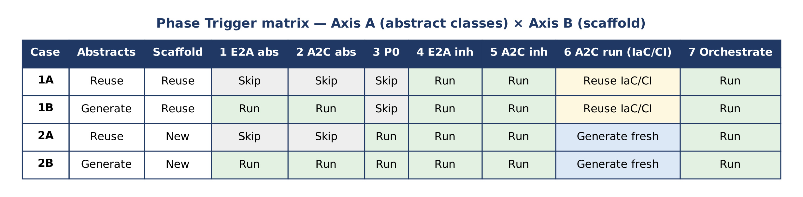

# G2C Framework — Phase Trigger Decision Reference

**End-to-End Framework Class Activation Guide**

| | |
|:---|:---|
| **Document Type** | Framework Extension Reference |
| **Framework Version** | G2C / E2A / A2C / P0 (Combined) |
| **Scope** | Monorepo & Multi-Repo Scenarios |
| **Classification** | Architect Reference — Internal Use |
| **Status** | Approved |

Subham Vikas | Staff Architect, SAP Labs India

## 1. Purpose and Scope

This reference document extends the G2C Framework suite by providing a formal, scenario-driven decision matrix that governs which framework phases must be triggered, skipped, reused, or freshly generated when bootstrapping or extending cloud-native services.

The G2C framework operates across four interleaved layers:

- **E2A (Enterprise-to-Abstract)** — generates base abstract classes: `BaseAgent`, `BaseWorkflow`, `BaseRAGPipeline`, `BaseToolService`, `BaseLLMAgentService`
- **A2C (Abstract-to-Class)** — generates SDLC agents: `SDLCAssistantAgent`, `IaCAgent`, `CICDAgent`, `CodeCriticAgent`
- **P0 (Project Bootstrapper)** — scaffolds the project directory, manifest, and environment templates
- **G2C Orchestrator** — coordinates all phases via `BootstrapAndGenerateWorkflow`

> **Names and v1.2.** The layer names above are this document's original wording. In the rest of the suite, E2A is the governed agentic AI framework (the `e2a` package) and A2C is the architecture-to-code layer. Since A2C v1.2.0, a Python service on the E2A v1.2 contract (the default) reuses the `e2a` package instead of generating base abstract classes, so the E2A abstract phase is always **[SKIP]** for it; the decision matrix applies unchanged to `"e2a_contract": "1.1"` and to Java. See the G2C Framework Reference, Section 18.

In practice, a team may already possess one or more of these layers from a prior service build. Blindly re-running all seven phases wastes compute, risks overwriting hand-tuned artifacts, and introduces unnecessary IaC drift. This document formalises the four canonical entry-point scenarios and specifies the exact phase activation pattern for each.

> **✔ TIP** This document is authoritative for phase-trigger decisions within portfolio projects: aws-reconciliation-engine, order-to-cash-agentic-ai, and financial-settlement-platform.

## 2. Seven-Phase Framework Architecture

The G2C pipeline decomposes project initialisation and code-generation into seven sequential phases. Understanding the role of each phase is a prerequisite for applying the trigger decision matrix correctly.

| Ph# | Phase Name | Framework | Primary Class | Responsibility |
|:---|:---|:---|:---|:---|
| 1 | E2A Abstract | G2C | `E2AAbstractClassGenerator` | Generates E2A base abstract classes (`BaseAgent`, `BaseWorkflow`, `BaseRAGPipeline`, `BaseToolService`). Defines all abstract hook methods. |
| 2 | A2C Abstract | G2C | `A2CAbstractClassGenerator` | Generates A2C abstract generator class with abstract hooks: `validate_request()`, `resolve_config()`, `build_system_prompt()`, `evaluate_output()`, `write_output()`. |
| 3 | P0 Scaffold | P0 | `BaseProjectBootstrapper` | Scaffolds the project directory tree, pyproject.toml / pom.xml, .env templates, and build manifest. Idempotency-safe. |
| 4 | E2A Inherited | G2C | `E2AInheritedClassGenerator` | Generates domain-specific concrete classes (e.g. `RefundAgent`, `SettlementWorkflow`) that override protected abstract methods with domain logic. |
| 5 | A2C Inherited | G2C | `A2CInheritedClassGenerator` | Generates concrete SDLC agents (`SDLCAssistantAgent`, `IaCAgent`, `CICDAgent`, `CodeCriticAgent`) by overriding protected A2C hooks. |
| 6 | A2C Complete | A2C | SDLC Agent Classes | Fully-implemented SDLC agents are invoked with a `DevRequest` to produce IaC (Terraform), CI/CD (GitHub Actions YAML), and NFR enforcement artifacts. TWO-PHASE mandatory. |
| 7 | Orchestration | G2C | `BootstrapAndGenerateWorkflow` | Top-level coordinator. Invokes `_invoke_p0()`, `_invoke_e2a()`, `_invoke_a2c()`, `_validate_output()`, `_log_observability()`, `_check_nfrs()` in correct dependency order. |

> **✖ IMPORTANT** Phase 6 (A2C Complete) ALWAYS requires a two-phase invocation: (1) run the A2C inherited generator to produce the Python class file; (2) instantiate that class and invoke it with a `DevRequest` to produce the actual IaC / CI-CD artifacts. Skipping Phase 2 of this invocation is the most frequent G2C adoption error.

## 3. Trigger Decision Axes

The phase-activation decision is controlled by exactly two binary axes evaluated before invoking `BootstrapAndGenerateWorkflow`:

### 3.1 Axis A — Abstract Class Availability

Determines whether E2A base classes (`BaseAgent`, `BaseWorkflow`, `BaseRAGPipeline`, `BaseToolService`, `BaseLLMAgentService`) and the A2C abstract generator class already exist in the repository or shared library.

*Note:* an existing `e2a_base.py` that does not define `BaseLLMAgentService` predates the decoupled LLM service. Treat it as stale — regenerate or upgrade it (Phase 1) before reuse, otherwise generated agents have no `config['llm_service']` to delegate to.

| Value | Condition | Implication |
|:---|:---|:---|
| **EXISTING** | Abstract classes confirmed present in git (branch, package, or shared lib) | Phases 1 and 2 are skipped. Inherited generators import from the existing base. |
| **NEW** | No abstract classes exist; first-time project or new domain taxonomy | Phases 1 and 2 must run in full before inherited generation can proceed. |

### 3.2 Axis B — Project Scaffold Availability

Determines whether the P0 project scaffold (directory layout, pyproject.toml or pom.xml, .env templates, build manifest) already exists.

| Value | Condition | Implication |
|:---|:---|:---|
| **EXISTING** | Project directory with manifest confirmed on disk or in repository | Phase 3 (P0 Scaffold) is skipped. IaC / CI-CD artifacts from prior run are reused. |
| **NEW** | No scaffold present; clean repository or new microservice module | Phase 3 must run. Fresh IaC and CI-CD artifacts will be generated in Phase 6. |

> **ℹ NOTE** Both axes are evaluated independently and combined to select one of the four canonical cases defined in Section 4. Evaluate them by inspecting the git repository state BEFORE invoking the orchestrator.

## 4. Phase Trigger Decision Matrix

The following matrix is the core deliverable of this document. Cross-reference Axis A (Abstract Classes) and Axis B (Scaffold) to determine the exact set of phases to activate.

| Scenario | Abstract Classes | Scaffold | Ph 1 E2A Abs | Ph 2 A2C Abs | Ph 3 P0 | Ph 4 E2A Inh | Ph 5 A2C Inh | Ph 6 A2C Complete / IaC | Ph 7 Orch |
|:---|:---|:---|:---|:---|:---|:---|:---|:---|:---|
| **Case 1A** Existing Abstracts + Existing Scaffold | Reuse | Reuse | Skip | Skip | Skip | Run | Run | Reuse existing IaC/CI/CD | Run |
| **Case 1B** New Abstracts + Existing Scaffold | Generate | Reuse | Run | Run | Skip | Run | Run | Reuse existing IaC/CI/CD | Run |
| **Case 2A** Existing Abstracts + New Scaffold | Reuse | New | Skip | Skip | Run | Run | Run | Generate fresh IaC/CI/CD | Run |
| **Case 2B** New Abstracts + New Scaffold | Generate | New | Run | Run | Run | Run | Run | Generate fresh IaC/CI/CD | Run |

**Matrix legend**

| Term | Meaning |
|:---|:---|
| **SKIP** | Phase not required — bypass entirely. |
| **RUN** | Phase must execute in this scenario. |
| **REUSE** | Existing artifact loaded and referenced — no regeneration. |
| **GENERATE** | New abstract class generated from scratch via the G2C generator. |
| **NEW** | Fresh scaffold created by P0 for this service. |
| **Reuse IaC** | Prior Terraform / GitHub Actions artifacts are carried forward unchanged. |

## 5. Case-by-Case Activation Detail

This section provides the architectural rationale, phase-activation narrative, and repository strategy for each of the four canonical trigger scenarios.

### CASE 1A — Existing Abstracts + Existing Scaffold

**Pre-conditions (Axis Check)**

| Axis | Value |
|:---|:---|
| Axis A — Abstracts | EXISTING — E2A and A2C abstract classes confirmed in repository or imported package |
| Axis B — Scaffold | EXISTING — P0 scaffold directory and build manifest already on disk |

**Rationale.** This is the most common day-two scenario: a new microservice module is added to an already-bootstrapped domain. Both the base abstractions and the project skeleton are present. Phases 1, 2, and 3 are wholly redundant and must be skipped to prevent overwriting tuned base classes or corrupting the existing manifest. The orchestrator enters directly at Phase 4 to generate domain-specific inherited classes, then runs Phase 5 to generate SDLC agents that consume the existing IaC and CI-CD artifacts.

**Phase-by-Phase Activation**

1. Phase 1 (E2A Abstract) — **[SKIP]** Base classes exist; importing from resolved package path.
2. Phase 2 (A2C Abstract) — **[SKIP]** A2C generator class exists; inherited generation imports it directly.
3. Phase 3 (P0 Scaffold) — **[SKIP]** Scaffold directory confirmed present; idempotency guard would block re-run anyway.
4. Phase 4 (E2A Inherited) — **[RUN]** `E2AInheritedClassGenerator` executes. Domain class overrides generated.
5. Phase 5 (A2C Inherited) — **[RUN]** `A2CInheritedClassGenerator` executes. SDLC agent overrides generated.
6. Phase 6 (A2C Complete) — **[REUSE]** Existing Terraform modules and GitHub Actions workflows carried forward. Two-phase `DevRequest` invocation references existing IaC state.
7. Phase 7 (Orchestration) — **[RUN]** `BootstrapAndGenerateWorkflow.run_workflow()` executes with P0 and abstract phases gated off via feature flags.

**Repository Strategy**

| | Monorepo | Multi-Repo |
|:---|:---|:---|
| **Approach** | Abstract classes sourced from shared module within same monorepo. Inherited classes written to service subdirectory. Single CI pipeline covers all modules. | Abstract classes sourced from a versioned shared library repository (e.g. e2a-base-lib). Inherited classes live in the service repo. Dependency pinned in pyproject.toml or pom.xml. |

### CASE 1B — New Abstracts + Existing Scaffold

**Pre-conditions (Axis Check)**

| Axis | Value |
|:---|:---|
| Axis A — Abstracts | NEW — No E2A or A2C abstract classes exist; this is the first service in a new domain taxonomy |
| Axis B — Scaffold | EXISTING — P0 scaffold directory and build manifest already on disk (created by a prior utility bootstrap) |

**Rationale.** This scenario occurs when an organisation has bootstrapped a project skeleton through a non-G2C means (e.g. Maven archetype, Cookiecutter) but has not yet established the E2A/A2C abstraction layer. The scaffold is preserved; all abstract classes must be freshly generated. Phases 1 and 2 run in sequence before inherited generation begins. Phase 3 is skipped. IaC and CI-CD from the existing scaffold are reused.

**Phase-by-Phase Activation**

1. Phase 1 (E2A Abstract) — **[RUN]** `E2AAbstractClassGenerator.run()` executes. `BaseAgent`, `BaseWorkflow`, `BaseRAGPipeline`, `BaseToolService`, `BaseLLMAgentService` generated.
2. Phase 2 (A2C Abstract) — **[RUN]** `A2CAbstractClassGenerator.generate()` executes. Abstract SDLC generator class produced.
3. Phase 3 (P0 Scaffold) — **[SKIP]** Scaffold confirmed present. P0 skipped to avoid overwriting existing manifest or env files.
4. Phase 4 (E2A Inherited) — **[RUN]** Domain concrete classes generated from newly produced base.
5. Phase 5 (A2C Inherited) — **[RUN]** Concrete SDLC agents generated from newly produced A2C abstract.
6. Phase 6 (A2C Complete) — **[REUSE]** Existing IaC and CI-CD artifacts referenced. `GeneratorCriticAgent` quality gate (score ≥ 0.75) applied before reuse acceptance.
7. Phase 7 (Orchestration) — **[RUN]** Full orchestrator run with P0 phase gated off.

**Repository Strategy**

| | Monorepo | Multi-Repo |
|:---|:---|:---|
| **Approach** | New abstract classes written into a shared module under the monorepo root. Existing scaffold service directories unmodified. | New abstract classes pushed to a new versioned shared library repo. Service repos update their dependency to consume the new library before running Phases 4–7. |

### CASE 2A — Existing Abstracts + New Scaffold

**Pre-conditions (Axis Check)**

| Axis | Value |
|:---|:---|
| Axis A — Abstracts | EXISTING — E2A and A2C abstract classes confirmed in repository or shared package |
| Axis B — Scaffold | NEW — No project scaffold; clean repository or first service in a new bounded context |

**Rationale.** This scenario applies when a proven abstract layer from an existing service domain is being reused to spin up a brand-new microservice or bounded context. The abstract classes are stable and must not be regenerated. P0 runs to create the new project structure, and Phases 5 and 6 generate fresh SDLC agents and IaC artifacts appropriate to the new service.

**Phase-by-Phase Activation**

1. Phase 1 (E2A Abstract) — **[SKIP]** Existing base classes imported. Phase 1 bypassed.
2. Phase 2 (A2C Abstract) — **[SKIP]** Existing A2C abstract imported. Phase 2 bypassed.
3. Phase 3 (P0 Scaffold) — **[RUN]** `BaseProjectBootstrapper.scaffold()` executes. New directory tree, pyproject.toml / pom.xml, .env templates, and build manifest created.
4. Phase 4 (E2A Inherited) — **[RUN]** Domain concrete classes generated for the new service context, inheriting from existing base.
5. Phase 5 (A2C Inherited) — **[RUN]** Fresh SDLC agent concrete classes generated for the new service.
6. Phase 6 (A2C Complete) — **[GENERATE]** New IaC (Terraform modules) and CI-CD (GitHub Actions) generated from scratch by invoking `IaCAgent` and `CICDAgent` with `DevRequest`. Two-phase invocation mandatory.
7. Phase 7 (Orchestration) — **[RUN]** Full orchestrator. Abstract phases gated off; P0 and Phases 4–7 active.

**Repository Strategy**

| | Monorepo | Multi-Repo |
|:---|:---|:---|
| **Approach** | New service directory created under monorepo root by P0. Abstract classes remain in shared monorepo module. Single pipeline extended to cover new service. | New service gets its own repository. Abstract classes imported from existing shared library. New Terraform workspace and GitHub Actions workflow generated for the service repo. |

### CASE 2B — New Abstracts + New Scaffold

**Pre-conditions (Axis Check)**

| Axis | Value |
|:---|:---|
| Axis A — Abstracts | NEW — No E2A or A2C abstract classes exist anywhere in the ecosystem |
| Axis B — Scaffold | NEW — No project scaffold exists; greenfield project |

**Rationale.** This is the greenfield scenario: the complete G2C pipeline runs end-to-end across all seven phases. It is the most compute-intensive path and is only correct when starting from an empty repository with no prior G2C artifacts. All phases run in strict dependency order. `GeneratorCriticAgent` quality gate (score ≥ 0.75) must be satisfied after Phase 2 before Phases 4 and 5 are permitted to proceed.

**Phase-by-Phase Activation**

1. Phase 1 (E2A Abstract) — **[RUN]** `E2AAbstractClassGenerator.run()` — all base classes generated (`BaseAgent`, `BaseWorkflow`, `BaseRAGPipeline`, `BaseToolService`, `BaseLLMAgentService`).
2. Phase 2 (A2C Abstract) — **[RUN]** `A2CAbstractClassGenerator.generate()` — abstract SDLC generator class produced. `GeneratorCriticAgent` evaluates output; proceed only if score ≥ 0.75.
3. Phase 3 (P0 Scaffold) — **[RUN]** `BaseProjectBootstrapper.scaffold()` — full project directory, manifest, and env templates created. Idempotency check runs.
4. Phase 4 (E2A Inherited) — **[RUN]** Domain concrete classes generated from Phase 1 output.
5. Phase 5 (A2C Inherited) — **[RUN]** Concrete SDLC agents generated from Phase 2 output.
6. Phase 6 (A2C Complete) — **[GENERATE]** Full IaC and CI-CD generated. Two-phase invocation: (1) `A2CInheritedClassGenerator` produces Python class; (2) class instantiated and invoked with `DevRequest` to produce Terraform + YAML.
7. Phase 7 (Orchestration) — **[RUN]** `BootstrapAndGenerateWorkflow.run_workflow()` — all internal phase methods execute in dependency order with full observability and NFR checks.

**Repository Strategy**

| | Monorepo | Multi-Repo |
|:---|:---|:---|
| **Approach** | Complete monorepo initialised from scratch. Abstract classes in shared module; service in dedicated subdirectory. Single CI pipeline bootstrapped. | Two repositories created: (1) shared-abstractions repo for E2A/A2C base classes; (2) service repo. Service repo's pyproject.toml / pom.xml pins shared-abstractions. Two independent CI pipelines created. |

### 5.5 Concurrent Runs of the Same Case

The case is selected by inspecting repository state, and that inspection is a check followed by an action. Two runs started close together against the same repository can each find "NEW", and each then run Phase 1, 2 or 3 into the same location. The remedies below keep the case-selection rules above unchanged.

- **One run per `generator_key`.** The generator claims its `generator_key` atomically before the first phase writes anything (see the G2C Framework Reference, Section 17). A second run with the same key receives a replay of the stored result, or an "in progress" outcome, rather than a second generation.
- **The Phase 3 idempotency guard is a directory check.** It is a fast path, not a mutual-exclusion mechanism, and (as E-03 already notes) it can miss a partially created scaffold. Concurrent runs rely on the atomic claim, not on the guard.
- **Shared abstract classes are never removed by a failed run** unless that run generated them fresh for its own request and no other `generator_key` references them. Cases 1A, 1B and 2A share their abstract classes by definition, so this rule governs how a failed Case 1B run (which generates them) is cleaned up.
- **Overload is a typed rejection.** A run that cannot obtain model capacity within its bounded wait stops without partial output. It is a retryable condition, not a failed case.

## 6. Phase Activation Quick Reference

Use this checklist before every `BootstrapAndGenerateWorkflow` invocation to determine the correct case and configure the phase-gate feature flags.

| # | Checklist Item | Outcome / Action |
|:---|:---|:---|
| 1 | Do E2A base classes (`BaseAgent` etc.) exist in the repo or a resolved package? | YES → Axis A = EXISTING (skip Phases 1–2). NO → Axis A = NEW (run Phases 1–2). |
| 2 | Does the P0 scaffold directory and build manifest exist on disk? | YES → Axis B = EXISTING (skip Phase 3). NO → Axis B = NEW (run Phase 3). |
| 3 | Cross-reference Axis A × Axis B against the decision matrix in Section 4. | Identify the case: 1A, 1B, 2A, or 2B. |
| 4 | Set `SKIP_E2A_ABSTRACT`, `SKIP_A2C_ABSTRACT`, `SKIP_P0_SCAFFOLD` flags in orchestrator config. | Flags must match the selected case exactly before `run_workflow()` is called. |
| 5 | Confirm `GeneratorCriticAgent` quality gate score ≥ 0.75 after Phase 2 (if Phase 2 runs). | If score < 0.75, remediate Phase 2 output before proceeding to Phase 4. |
| 6 | For Phase 6 (A2C Complete): execute BOTH the class generation AND the `DevRequest` invocation. | Skipping the `DevRequest` invocation means no IaC / CI-CD artifacts are produced. This is the most common adoption error. |
| 7 | Verify legacy branch is frozen before any G2C rebuild run. | Tag as `legacy-non-g2c` (or equivalent) in git before the first Phase 1 execution. |
| 8 | Confirm no other run is already generating the same `generator_key` against the same repository. | If one is, wait for its result or accept its replay; do not start a second run (Section 5.5). |

## 7. Common Trigger Errors and Remediation

The following errors have been observed during G2C adoption across the portfolio projects. Each is classified by severity and accompanied by a root-cause explanation and fix procedure.

| Error ID / Severity | Detail |
|:---|:---|
| **E-01** CRITICAL | **Skipping DevRequest Invocation in Phase 6.** *Symptom:* No Terraform or GitHub Actions YAML files produced after Phase 6. *Cause:* Phase 6 requires a two-phase invocation. Generating the Python class (Phase 5 output) is not sufficient; the class must be instantiated and invoked with a `DevRequest` to produce IaC/CI-CD artifacts. *Fix:* After `A2CInheritedClassGenerator` produces the class file, instantiate `IaCAgent` / `CICDAgent` and call `execute_pipeline(DevRequest(...))` explicitly. |
| **E-02** HIGH | **Running Phase 1 / 2 When Abstracts Already Exist.** *Symptom:* Hand-tuned base classes overwritten; downstream inherited classes lose custom hook implementations. *Cause:* Phase flag `SKIP_E2A_ABSTRACT` not set when Axis A = EXISTING. *Fix:* Inspect repository for existing abstract classes before run. Set `SKIP_E2A_ABSTRACT=true` and `SKIP_A2C_ABSTRACT=true` in orchestrator config. |
| **E-03** HIGH | **Running P0 Scaffold Over Existing Project.** *Symptom:* pyproject.toml overwritten; existing environment variables and build configuration lost. *Cause:* Phase flag `SKIP_P0_SCAFFOLD` not set when Axis B = EXISTING. P0 idempotency guard may not fire if the scaffold is partially corrupted. *Fix:* Set `SKIP_P0_SCAFFOLD=true` when Axis B = EXISTING. If P0 must re-run, back up existing manifest and env files first. |
| **E-04** MEDIUM | **GeneratorCriticAgent Score Below 0.75.** *Symptom:* Phase 4 / 5 produce low-quality or structurally invalid inherited classes. *Cause:* Phase 2 output not evaluated before proceeding; defective abstract class propagates to all inherited classes. *Fix:* After Phase 2, call `GeneratorCriticAgent.evaluate()`. If score < 0.75, remediate the abstract class (fix prompt, re-run Phase 2) before triggering Phase 4. |
| **E-05** MEDIUM | **Confusing DevRequest with GeneratorRequest.** *Symptom:* Phase 6 invocation raises `TypeError` or produces empty output. *Cause:* `DevRequest` is the payload type for SDLC agent execution. `GeneratorRequest` is used by the abstract generator classes. They are not interchangeable. *Fix:* Confirm the invocation uses `DevRequest` when calling `IaCAgent.execute_pipeline()` or `CICDAgent.deploy()`. Use `GeneratorRequest` only when calling `A2CAbstractClassGenerator.generate()`. |
| **E-06** LOW | **Forgetting to Freeze the Legacy Branch.** *Symptom:* G2C comparison report cannot be produced; no pre-G2C baseline for metrics. *Cause:* Legacy implementation overwritten before being preserved in a named branch. *Fix:* Before any Phase 1 execution, run: `git checkout -b legacy-non-g2c && git push origin legacy-non-g2c`. |
| **E-07** HIGH | **Starting a Second Run While One Is In Progress.** *Symptom:* Two runs write the same abstract class, scaffold or inherited class; output is interleaved or one run's files are overwritten. *Cause:* Case selection is a check-then-act, and the directory-based idempotency guard is not mutually exclusive. *Fix:* Rely on the atomic claim of the `generator_key`; a second run should receive a replay or an "in progress" outcome. If a run was interrupted, let the claim be reconciled before retrying, rather than starting over blindly (Section 5.5). |

## 8. Glossary

| Term | Definition |
|:---|:---|
| **A2C** | Abstract-to-Class. The G2C layer that generates SDLC agent classes (`SDLCAssistantAgent`, `IaCAgent`, `CICDAgent`, `CodeCriticAgent`) from abstract templates. |
| **A2CAbstractClassGenerator** | Phase 2 generator class. Produces the abstract SDLC generator with hooks: `validate_request()`, `resolve_config()`, `build_system_prompt()`, `evaluate_output()`, `write_output()`. |
| **A2CInheritedClassGenerator** | Phase 5 generator class. Produces concrete SDLC agent implementations by overriding A2C abstract hooks. |
| **Atomic claim** | An idempotency record created in one conditional operation, so that exactly one concurrent caller owns a `generator_key`; other callers receive a replay or an "in progress" outcome. |
| **BaseProjectBootstrapper** | P0 base class. `scaffold()` is the template method; `create_structure()`, `generate_manifest()`, `generate_env_files()` are abstract hooks. |
| **BootstrapAndGenerateWorkflow** | Phase 7 orchestrator class. Coordinates all phases via `_invoke_p0()`, `_invoke_e2a()`, `_invoke_a2c()`, `_validate_output()`, `_log_observability()`, `_check_nfrs()`. |
| **DevRequest** | Payload object passed to SDLC agents in Phase 6 to trigger IaC and CI-CD artifact generation. Distinct from `GeneratorRequest`. |
| **E2A** | Enterprise-to-Abstract. The G2C layer that generates the foundational abstract classes: `BaseAgent`, `BaseWorkflow`, `BaseRAGPipeline`, `BaseToolService`. |
| **E2AAbstractClassGenerator** | Phase 1 generator. Produces all E2A base abstract classes in a single `run()` invocation. |
| **E2AInheritedClassGenerator** | Phase 4 generator. Produces domain-specific concrete classes (e.g. `RefundAgent`, `SettlementWorkflow`) that override E2A abstract hooks. |
| **G2C** | Generate-to-Class. The overarching productivity framework encompassing E2A, A2C, P0, and the orchestration layer. |
| **GeneratorCriticAgent** | Quality-gate agent applied after Phase 2. Score ≥ 0.75 is required before proceeding to Phases 4 and 5. |
| **GeneratorRequest** | Payload type used by abstract generator classes (`A2CAbstractClassGenerator.generate()`). Not used in Phase 6 SDLC agent invocations. |
| **P0** | ProjectBootstrapper framework. Responsible for scaffolding the project directory, manifest, and environment templates. |
| **Phase Gate Flag** | Orchestrator configuration flags (`SKIP_E2A_ABSTRACT`, `SKIP_A2C_ABSTRACT`, `SKIP_P0_SCAFFOLD`) that control which phases execute during a given run. |
| **Two-Phase Invocation** | Mandatory pattern for Phase 6: (1) run `A2CInheritedClassGenerator` to produce the Python class; (2) instantiate and invoke with `DevRequest` to produce IaC/CI-CD artifacts. |

---

## Related Documents and Diagrams

The full high- and low-level design of G2C is in [`design/g2c/`](design/g2c/G2C_FRAMEWORK_DESIGN.md), with every diagram as PNG plus PlantUML or Graphviz source. This reference remains the contract; the design document explains how it fits together.

*Figure — Phase Trigger matrix*
