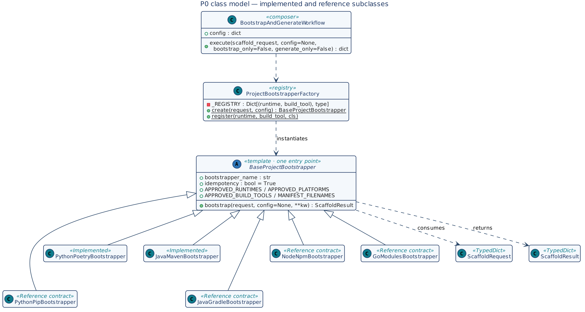
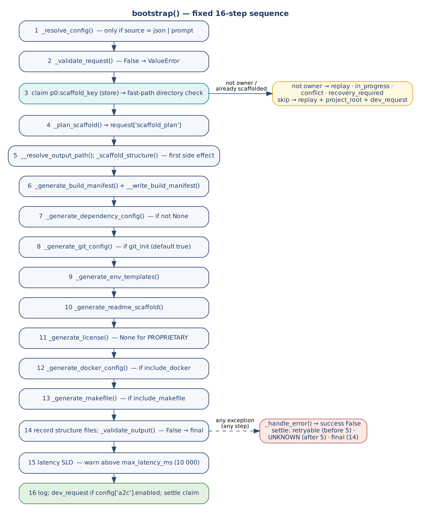

# P0 — Project Bootstrap Framework

**Extension for the A2C Architecture-to-Code Framework**

Phase Zero scaffolding: project structure, build manifest, git config, env templates, Docker, Makefile

Built on: A2C Framework | E2A Architecture Framework

github.com/subhamviky/a2c-framework

Author: Subham Gupta, Staff Architect & AI Architect

## 1. Executive Summary

The A2C Framework generates enterprise-grade microservice code, Terraform IaC, and GitHub Actions CI/CD pipelines using E2A-governed agents. However, before A2C's `RequirementsAgent` can begin, the target project must exist as a valid, compilable workspace: a Maven project with a pom.xml and correct directory tree, or a Poetry project with pyproject.toml and package structure. This Phase Zero bootstrapping was previously manual — a gap between specification and generation.

The P0 Framework fills this gap. It is a new abstract class alongside A2C — not an extension of it — that provides a single public entry point to generate everything a project needs before any AI-based code generation begins. The developer provides a `ScaffoldRequest` (from a JSON config file, a natural-language prompt, or an inline dict). P0 creates the entire project scaffold: directory tree, build manifest, dependency configuration, git rules, environment templates, README skeleton, LICENSE, Dockerfile, and Makefile.

> **Architecture Decision — New Class, Not Extension.** P0 and A2C are separate concerns on different lifecycles. Bootstrap runs once per project; A2C runs whenever a new service or component is generated. Making P0 an extension of A2C would force bootstrap to execute on every A2C call. The correct design: two independent classes composable via `BootstrapAndGenerateWorkflow`, each callable alone or in sequence.

| Aspect | P0 Framework | A2C Framework |
|:---|:---|:---|
| Purpose | Generate project structure, build manifest, git config, Docker, Makefile | Generate microservice code, Terraform IaC, GitHub Actions CI/CD |
| Input | `ScaffoldRequest` (runtime, build_tool, platform, dependencies) | `DevRequest` (project_type, mandatory_nfrs, target_cloud, context) |
| Public entry point | `bootstrapper.bootstrap(request, config)` | `sdlc_agent.run(dev_request, config)` |
| Output | `ScaffoldResult` (scaffolded_files, project_root, build_manifest_path) | `DevRequest` (generated_code, generated_iac, generated_cicd, critic_report) |
| Runs when | Once per project — at project creation | As needed — whenever a new component is generated |
| Lifecycle Phase | Phase Zero — before any business logic | Phase 2-7 — NFR-First development sequence |
| NFR enforcement | Structural: correct gitignore, non-root Docker, HEALTHCHECK, Makefile targets | Contract: `_apply_policy()` injects idempotency, circuit breakers, observability |
| Composable? | Yes — `BootstrapAndGenerateWorkflow` chains P0 -> A2C | Yes — chains from P0 result via dev_request handoff |

## 2. Framework Architecture

### 2.1 Class Hierarchy

P0 follows the same E2A Template Method Pattern as A2C and E2A. One PUBLIC method (`bootstrap`) contains the full orchestration sequence. All domain-specific behaviour is in PROTECTED methods that subclasses override. Infrastructure mechanics (file I/O, idempotency, config loading) are in PRIVATE methods that subclasses never touch.

```text
BaseProjectBootstrapper (ABC)  — abstract base, one public entry point
    |
    +-- PythonPoetryBootstrapper   — Python 3.x + Poetry
    +-- PythonPipBootstrapper      — Python 3.x + pip / setup.cfg
    +-- JavaMavenBootstrapper      — Java 21 + Maven / Spring Boot
    +-- JavaGradleBootstrapper     — Java 21 + Gradle (Kotlin DSL)
    +-- NodeNpmBootstrapper        — Node.js + npm / package.json
    +-- GoModulesBootstrapper      — Go + go.mod

ProjectBootstrapperFactory  — resolves subclass from ScaffoldRequest
BootstrapAndGenerateWorkflow — orchestrates P0 -> A2C in sequence
```

### 2.2 TypedDicts

**ScaffoldRequest — input to bootstrap()**

| Field | Type | Required | Description |
|:---|:---|:---|:---|
| `source` | str | No | `'json'` \| `'prompt'` \| `'inline'` (default: inline) |
| `config_path` | str | If source='json' | Path to scaffold-config.json |
| `prompt` | str | If source='prompt' | Free-text description for LLM parsing |
| `runtime` | str | Yes | `'python'` \| `'java'` \| `'node'` \| `'go'` |
| `runtime_version` | str | No | `'3.12'` \| `'21'` \| `'20'` \| `'1.22'` |
| `platform` | str | Yes | `'aws'` \| `'gcp'` \| `'azure'` \| `'standalone'` |
| `project_name` | str | Yes | PascalCase: `'SettlementEngine'` |
| `package_name` | str | Python only | snake_case: `'settlement_engine'` |
| `group_id` | str | Java only | `'com.company.domain'` |
| `artifact_id` | str | Java only | kebab-case: `'settlement-engine'` |
| `build_tool` | str | Yes | `'poetry'` \| `'pip'` \| `'maven'` \| `'gradle'` \| `'npm'` \| `'go_modules'` |
| `project_type` | str | No | `'fastapi_microservice'` \| `'spring_boot'` \| `'lambda'` \| `'langgraph_agent'` \| `'library'` |
| `dependencies` | List[str] | No | Runtime deps: `['fastapi>=0.111', 'pydantic>=2.7']` |
| `dev_dependencies` | List[str] | No | Dev/test deps: `['pytest>=8', 'ruff>=0.4']` |
| `spring_boot_version` | str | Java only | Default: `'3.3.0'` |
| `java_source_version` | str | Java only | Default: `'21'` |
| `output_path` | str | No | Base output dir (default: `'./'`) |
| `license` | str | No | `'Apache-2.0'` \| `'MIT'` \| `'PROPRIETARY'` (default: Apache-2.0) |
| `include_docker` | bool | No | Generate Dockerfile + .dockerignore (default: true) |
| `include_makefile` | bool | No | Generate Makefile (default: true) |

**ScaffoldResult — output from bootstrap()**

| Field | Type | Description |
|:---|:---|:---|
| `success` | bool | True if all required files were created and validated |
| `scaffold_key` | str | Business idempotency key: `name:runtime:build_tool:platform` |
| `project_root` | str | Absolute path to created project root directory |
| `scaffolded_files` | List[str] | Absolute paths of every file created |
| `build_manifest_path` | str | Path to pom.xml / pyproject.toml / go.mod |
| `readme_path` | str | Path to generated README.md |
| `trace_id` | str | UUID correlation ID for observability |
| `latency_ms` | float | Total execution time in milliseconds |
| `errors` | List[str] | Error messages if success=False |
| `dev_request` | dict \| None | A2C `DevRequest` — populated when `config['a2c']['enabled']=True` |

## 3. BaseProjectBootstrapper — Full Class Contract

### 3.1 Class Variables

| Variable | Type | Default | Purpose |
|:---|:---|:---|:---|
| `bootstrapper_name` | str | `'BaseProjectBootstrapper'` | Governance key — set in every subclass. Used in all structured log entries. |
| `idempotency` | bool | True | When True: skip if project directory already exists and is non-empty. Set False to re-scaffold. |
| `APPROVED_RUNTIMES` | List[str] | `['python','java','node','go']` | Governance allow-list for runtime field. |
| `APPROVED_PLATFORMS` | List[str] | `['aws','gcp','azure','standalone']` | Governance allow-list for platform field. |
| `APPROVED_BUILD_TOOLS` | Dict[str,List[str]] | See class | Per-runtime allow-list for build_tool field. |
| `MANIFEST_FILENAMES` | Dict[tuple,str] | See class | Maps (runtime, build_tool) to correct manifest filename. |

### 3.2 Method Contract Table

| Access | Method | Signature | Returns | Purpose / When to Override |
|:---|:---|:---|:---|:---|
| PUBLIC | `bootstrap` | `(request, config, **kwargs)` | ScaffoldResult | Single entry point. Never override. Full 16-step sequence. |
| ABSTRACT | `_validate_request` | `(request, config, **kwargs)` | bool | Check required fields, approved runtime/platform/build_tool. Return False to abort. |
| ABSTRACT | `_resolve_config` | `(request, config, **kwargs)` | ScaffoldRequest | Load from JSON file or LLM prompt. Merge into request dict. |
| ABSTRACT | `_plan_scaffold` | `(request, config, **kwargs)` | List[dict] | Build [{step, file, description}] task list for observability. |
| ABSTRACT | `_scaffold_structure` | `(request, config, root, **kwargs)` | None | Create all directories. Call `__create_directory()` per path. |
| ABSTRACT | `_generate_build_manifest` | `(request, config, **kwargs)` | str | Return pom.xml \| pyproject.toml \| go.mod content as string. |
| PROTECTED | `_generate_dependency_config` | `(request, config, **kwargs)` | str\|None | Return requirements.txt content or None. Default: None. |
| PROTECTED | `_dependency_file_name` | `(request)` | str | Filename for dep config. Default: `'requirements.txt'`. |
| ABSTRACT | `_generate_git_config` | `(request, config, **kwargs)` | Dict[str,str] | Return `{'.gitignore': content, '.gitattributes': content}`. |
| ABSTRACT | `_generate_env_templates` | `(request, config, **kwargs)` | Dict[str,str] | Return `{relative_path: content}` for env files. |
| ABSTRACT | `_generate_readme_scaffold` | `(request, config, **kwargs)` | str | Return README.md skeleton as string. |
| PROTECTED | `_generate_license` | `(request, config, **kwargs)` | str\|None | Return LICENSE text. Default: Apache-2.0. None for PROPRIETARY. |
| ABSTRACT | `_generate_docker_config` | `(request, config, **kwargs)` | Dict[str,str] | Return `{'Dockerfile': content, '.dockerignore': content}`. |
| PROTECTED | `_generate_makefile` | `(request, config, **kwargs)` | str\|None | Return Makefile content. Default: None. Override per runtime. |
| PROTECTED | `_validate_output` | `(result, config, **kwargs)` | bool | Confirm required files created. Default: checks manifest + README. |
| PROTECTED | `_handle_error` | `(error, request, result, config, **kwargs)` | ScaffoldResult | Log error, append to errors[], return safe result. |
| PRIVATE | `__load_json_config` | `(config_path)` | ScaffoldRequest | Read scaffold-config.json['scaffold']. Never override. |
| PRIVATE | `__load_prompt_config` | `(prompt, config)` | ScaffoldRequest | LLM-based config parsing. Never override. |
| PRIVATE | `__write_file` | `(root, relative_path, content)` | str | Write file + create parents. Returns absolute path. |
| PRIVATE | `__create_directory` | `(path)` | None | mkdir -p. Idempotent. |
| PRIVATE | `__generate_scaffold_key` | `(request)` | str | `name:runtime:build_tool:platform` — business idempotency key. |
| PRIVATE | `__is_already_scaffolded` | `(key, config)` | bool | True if project dir exists and is non-empty. |
| PRIVATE | `__resolve_output_path` | `(request, config)` | str | request > config > env `BOOTSTRAP_OUTPUT_PATH` > `'./'` |
| PRIVATE | `__write_build_manifest` | `(request, root, content)` | str | Write manifest to runtime-correct filename. |
| PRIVATE | `__build_dev_request` | `(request, a2c_cfg)` | dict | Build A2C `DevRequest` for P0 -> A2C handoff. |

## 4. Internal Execution Sequence — bootstrap()

The sequence below is fixed and enforced by the base class. Subclasses never modify it. Every step is logged. A failure at any step calls `_handle_error()` and returns `ScaffoldResult` with `success=False`.

| Step | Action | Calls | Condition |
|:---|:---|:---|:---|
| 1 | Resolve config from external source | `_resolve_config()` | Only if source = 'json' or 'prompt' |
| 2 | Validate `ScaffoldRequest` | `_validate_request()` | Always. Return False -> ValueError abort |
| 3 | Idempotency check | `__is_already_scaffolded()` | Only if self.idempotency = True |
| 4 | Build scaffold plan | `_plan_scaffold()` | Always. Result stored in `request['scaffold_plan']` |
| 5 | Create directory tree | `_scaffold_structure()` | Always |
| 6 | Generate + write build manifest | `_generate_build_manifest()` + `__write_build_manifest()` | Always |
| 7 | Generate dependency config | `_generate_dependency_config()` | Only if method returns non-None |
| 8 | Generate git config | `_generate_git_config()` | Only if `request['git_init'] != False` |
| 9 | Generate env templates | `_generate_env_templates()` | Always |
| 10 | Generate README | `_generate_readme_scaffold()` | Always |
| 11 | Generate LICENSE | `_generate_license()` | Only if license != 'PROPRIETARY' |
| 12 | Generate Docker config | `_generate_docker_config()` | Only if include_docker = True |
| 13 | Generate Makefile | `_generate_makefile()` | Only if include_makefile = True |
| 14 | Validate output | `_validate_output()` | Always. Return False -> ValueError abort |
| 15 | Latency SLO check | (internal) | Warn if > max_latency_ms (default 10,000 ms) |
| 16 | Structured observability log + A2C handoff | (internal) | Always. A2C handoff only if `config['a2c']['enabled'] = True` |

### 4.1 Concurrent Bootstrap

Step 3 is a check: it reads whether the target directory exists and is non-empty. That is correct for one caller. Two callers bootstrapping the same target at the same moment can both pass the check before either has written, and then interleave their writes — most visibly in `pyproject.toml` or `pom.xml`, which a half-finished second run can overwrite. The sequence above does not change; the guarantee behind Step 3 does.

> **Status.** This subsection is implemented in `base_project_bootstrapper.py` of the `a2c-framework` repository, using the claim store in `a2c_concurrency.py`, and is exercised by `smoke_test_generator_concurrency.py` and `smoke_test_g2c_contract.py` against in-memory test doubles. Nothing has been validated against a live distributed store or production load. The store is read from `config['scaffold_idempotency_store']` or `config['idempotency_store']` and accepts any object with E2A's `claim`/`complete`/`fail` surface (Implementation Playbook, Section 2.19).

- **Atomic claim before Step 5.** When a distributed idempotency store is configured, `bootstrap()` claims `scaffold_key` (`name:runtime:build_tool:platform`) atomically before the first directory is created. The claim key is namespaced `p0:<scaffold_key>` so a composing caller that claims a similarly shaped key in the same store (the AI-DLC pipeline's `project:runtime:build_tool:platform`) never collides with P0. The directory check stays as a fast path beneath the claim: it is consulted only after the claim is won, so a half-written directory from a concurrent run is never mistaken for a finished scaffold. Without a store, the directory check is the only guard and the guarantee is single-process. In a multi-tenant deployment the key is scoped by tenant.
- **Outcomes.** The caller that claims the key proceeds. A caller that finds the key already succeeded receives the stored `ScaffoldResult` without writing anything. A caller that finds it in progress receives an "in progress" outcome promptly rather than waiting without a bound. A caller that presents the same key with a different request fingerprint is rejected as a conflict.
- **Settlement.** The claim is settled on every exit path: succeeded after Step 14 (the stored result includes `dev_request`), retryable when a step fails before any file is written, final when output validation fails at Step 14, and unknown when any other step fails after Step 5 began (a partial scaffold may exist, so it is parked for reconciliation). No automatic rollback is implemented, so "retryable after a clean rollback" applies only if a subclass's `_handle_error` performs one. A claim that expires without settling is left for reconciliation; it is not re-run blindly, because a partially created scaffold is exactly the state E-03 of the Phase Trigger Decision Reference warns about.
- **`idempotency=False`.** Re-scaffolding on purpose (Pattern 4) still takes the claim (under the key `p0:<scaffold_key>#rescaffold`), so two deliberate re-scaffolds of the same target are also serialised. The claim then acts as mutual exclusion only: it settles retryable on completion, so a later deliberate re-scaffold can run again. The existing "back up the manifest and env files first" advice applies unchanged.
- **Composition is unchanged.** `BootstrapAndGenerateWorkflow` still runs P0 followed by A2C. The A2C phase is the explicit second phase: the workflow runs `DevPlatformValidationService.validate('SDLCWorkflow', dev_request, config)` first (a failed validation returns status `INVALID` and stops), then `SDLCWorkflow(config).execute(dev_request, config)`; with `config['a2c']['handoff_only']` set it stops after P0 and returns `{status: 'ready', dev_request}`. The idempotent skip now returns the project root and, when enabled, the same `dev_request`, so a replay still feeds the A2C phase. A replay of the P0 result simply feeds the same `dev_request` into the A2C phase.

## 5. NFR Enforcement — Correct by Structure

P0 enforces Non-Functional Requirements structurally, not through prompts. Every generated artifact is correct by construction:

| NFR | How P0 Enforces It | Artifact |
|:---|:---|:---|
| Security — non-root container | Dockerfile uses multi-stage build + `RUN useradd/adduser` (UID 1001) | Dockerfile |
| Security — no secrets in git | `.gitignore` excludes .env, *.key, chroma_db/, *.zip, .venv/ | .gitignore |
| Security — health probes | Dockerfile includes HEALTHCHECK pointing to /health or /actuator/health | Dockerfile |
| Observability — env-driven config | All model IDs, endpoints and NFR thresholds are central registry keys; .env.example is generated from them (`src/settings.py` + `e2a_base.py`) | env.example |
| Portability — multi-cloud | .env.example includes platform-specific vars for AWS/GCP/Azure | env.example |
| Clean Architecture — directory structure | `src/{pkg}/models/`, `services/`, `routers/`, `tools/` matches E2A layers | Directory tree |
| CI/CD readiness | `.github/workflows/` directory created; Makefile targets match pipeline stages | Makefile + .github/ |
| Idempotency — same project not re-created | `__is_already_scaffolded()` checks project dir before any file writes; under concurrent callers the atomic claim of `scaffold_key` is the authority (Section 4.1) | `bootstrap()` Step 3 |
| Dev workflow — standard commands | Makefile: install, test, lint, build, run, docker-build, clean | Makefile |
| Dependency pinning | pyproject.toml/pom.xml includes all declared deps with version ranges | Build manifest |
| E2A attribution | README scaffold includes E2A framework link and Clean Architecture layer map | README.md |

## 6. Configuration Resolution — Three Input Sources

`ScaffoldRequest` can be provided from three sources. All three produce the same `ScaffoldRequest` TypedDict. The resolution chain for any individual field follows the same priority as E2A:

| Priority | Source | How to use |
|:---|:---|:---|
| 1 (highest) | Inline dict (`source='inline'`) | Pass `ScaffoldRequest` directly to `bootstrap(request, config)` |
| 2 | JSON config file (`source='json'`) | Set `request['source']='json'`, `request['config_path']='./scaffold-config.json'` |
| 3 | Natural language prompt (`source='prompt'`) | Set `request['source']='prompt'`, `request['prompt']='Create a FastAPI service on AWS...'` |

### 6.1 JSON Configuration File — scaffold-config.json

The JSON config file contains two top-level sections: `scaffold` (required, drives P0) and `a2c` (optional, drives A2C handoff via `BootstrapAndGenerateWorkflow`). Both can be present in the same file to run the full pipeline with one command.

```json
# scaffold-config.json — Python/Poetry example (FastAPI on AWS)
{
  "scaffold": {
    "source": "json",
    "runtime": "python",
    "runtime_version": "3.12",
    "platform": "aws",
    "build_tool": "poetry",
    "project_type": "fastapi_microservice",
    "project_name": "SettlementEngine",
    "package_name": "settlement_engine",
    "output_path": "./generated/",
    "license": "Apache-2.0",
    "include_docker": true,
    "include_makefile": true,
    "dependencies": [
      "fastapi>=0.111.0", "uvicorn[standard]>=0.30.0", "pydantic>=2.7.0",
      "structlog>=24.1.0", "opentelemetry-sdk>=1.24.0", "boto3>=1.34.0",
      "langgraph>=0.1.0", "pybreaker>=1.0.1", "tenacity>=8.3.0"
    ],
    "dev_dependencies": ["pytest>=8.2.0", "pytest-asyncio>=0.23.0", "ruff>=0.4.0"]
  },
  "a2c": {
    "enabled": true,
    "project_type": "FastAPI Microservice",
    "mandatory_nfrs": ["Idempotency", "Observability"],
    "target_cloud": "aws",
    "context": "Financial settlement microservice with saga orchestration"
  }
}
```

```json
# scaffold-config.json — Java/Maven example (Spring Boot on AWS)
{
  "scaffold": {
    "source": "json",
    "runtime": "java",
    "runtime_version": "21",
    "platform": "aws",
    "build_tool": "maven",
    "project_type": "spring_boot",
    "project_name": "FinancialSettlementPlatform",
    "group_id": "com.subhamviky",
    "artifact_id": "financial-settlement-platform",
    "spring_boot_version": "3.3.0",
    "java_source_version": "21",
    "packaging": "jar",
    "output_path": "./generated/",
    "license": "Apache-2.0",
    "include_docker": true,
    "include_makefile": true,
    "dependencies": ["web", "data-jpa", "kafka", "actuator", "data-redis"]
  },
  "a2c": {
    "enabled": true,
    "project_type": "Spring Boot",
    "mandatory_nfrs": ["Idempotency", "Observability", "CircuitBreaker"],
    "target_cloud": "aws",
    "context": "Java settlement platform: Saga, @Idempotent AOP, double-entry ledger"
  }
}
```

## 7. Generated Directory Structures

### 7.1 Python FastAPI Microservice (Poetry)

```text
SettlementEngine/
  pyproject.toml          Poetry build manifest with all dependencies
  .gitignore              Python-specific: __pycache__, .venv, .env, chroma_db, *.zip
  .env.example            AWS/GCP/Azure env vars + E2A NFR config
  README.md               E2A spike framing + stack badges + structure tree
  LICENSE                 Apache-2.0
  Dockerfile              Multi-stage Python build, non-root UID 1001, HEALTHCHECK
  .dockerignore           .venv, __pycache__, .env, .git, tests
  Makefile                install, test, lint, build, run, docker-build, clean
  .github/
    workflows/            CI/CD workflow directory (A2C fills this in Phase 4)
  src/
    settlement_engine/
      __init__.py
      main.py             FastAPI app entry point placeholder
      config/             Configuration classes
        __init__.py
      models/             Pydantic BaseModel domain entities (E2A: AgentState equivalent)
        __init__.py
      services/           Business logic classes (E2A: BIMP / @Service equivalent)
        __init__.py
      routers/            FastAPI APIRouter (E2A: OData Service Binding equivalent)
        __init__.py
      tools/              MCP tool classes (E2A: BaseToolService subclasses)
        __init__.py
  tests/
    __init__.py
    conftest.py           Pytest fixtures
```

### 7.2 Python LangGraph Agent (Poetry)

Same base structure as FastAPI microservice plus:

```text
SettlementEngine/
  ... (all files above)
  src/settlement_engine/
    agents/               BaseAgent subclasses (RouterAgent, KnowledgeAgent, etc.)
      __init__.py
    rag/                  BaseRAGPipeline subclasses
      __init__.py
    workflows/            BaseWorkflow subclasses (LangGraph StateGraph)
      __init__.py
```

### 7.3 Java Spring Boot (Maven)

```text
FinancialSettlementPlatform/
  pom.xml                 Maven POM with Spring Boot parent, all dependencies
  .gitignore              Java: target/, *.class, .idea/, *.jar, .gradle/
  README.md               E2A spike framing + Spring Boot stack badges
  LICENSE                 Apache-2.0
  Dockerfile              Multi-stage eclipse-temurin build, non-root, HEALTHCHECK
  .dockerignore           target/, .git, .idea, *.md
  Makefile                build, test, run, docker-build, clean
  .github/
    workflows/            CI/CD directory (A2C fills in Phase 4)
  src/
    main/
      java/com/subhamviky/
        config/           Spring @Configuration classes
        domain/           JPA @Entity classes (E2A: CDS View Entity equivalent)
        service/          @Service classes (E2A: BIMP equivalent)
        controller/       @RestController (E2A: OData Service Binding equivalent)
        repository/       Spring Data JPA repositories
      resources/
        application.yml       Default Spring Boot config with actuator, logging
        application-dev.yml   Dev profile (show-sql: true)
        application-prod.yml  Prod profile (logging WARN)
    test/
      java/com/subhamviky/
        FinancialSettlementPlatformApplicationTests.java
```

## 8. Concrete Implementations — Quick Reference

| Class | Runtime | Build Tool | Project Types Supported | Key Overrides |
|:---|:---|:---|:---|:---|
| `PythonPoetryBootstrapper` | Python 3.x | Poetry | fastapi_microservice, lambda, langgraph_agent, library | All abstract methods. `_generate_makefile()`: poetry commands. |
| `PythonPipBootstrapper` | Python 3.x | pip | fastapi_microservice, lambda, library | `_generate_build_manifest()`: setup.cfg. `_generate_dependency_config()`: requirements.txt. |
| `JavaMavenBootstrapper` | Java 21+ | Maven | spring_boot, library | All abstract methods. pom.xml with spring-boot-starter-parent. |
| `JavaGradleBootstrapper` | Java 21+ | Gradle | spring_boot, library | `_generate_build_manifest()`: build.gradle.kts. `_generate_makefile()`: gradle wrapper commands. |
| `NodeNpmBootstrapper` | Node.js 20+ | npm | express_api, next_app, library | `_generate_build_manifest()`: package.json with scripts. |
| `GoModulesBootstrapper` | Go 1.22+ | go_modules | http_service, cli, library | `_generate_build_manifest()`: go.mod. `_scaffold_structure()`: cmd/, internal/, pkg/ layout. |

### 8.1 Factory — ProjectBootstrapperFactory

The factory resolves the correct subclass from a `ScaffoldRequest` without the caller knowing which class to instantiate. It follows the same approved-list governance pattern as E2A agent routing.

```python
# Resolve and run — single call
bootstrapper = ProjectBootstrapperFactory.create(request, config)
result = bootstrapper.bootstrap(request, config)

# Register a new bootstrapper (call at module import time)
ProjectBootstrapperFactory.register('go', 'go_modules', GoModulesBootstrapper)
```

## 9. BootstrapAndGenerateWorkflow — Composing P0 with A2C

`BootstrapAndGenerateWorkflow` orchestrates the complete pipeline: P0 scaffold followed by A2C code generation. It reads a single scaffold-config.json that contains both the `scaffold` section (for P0) and the `a2c` section (for A2C). Three operating modes:

| Mode | How to invoke | What runs |
|:---|:---|:---|
| Bootstrap only | `execute(request, config, bootstrap_only=True)` | P0 only — creates project structure, exits |
| Generate only | `execute(request, config, generate_only=True)` | A2C only — assumes project already bootstrapped |
| Full pipeline (default) | `execute(request, config)` | P0 scaffold -> A2C code generation in sequence |

### 9.1 Full Pipeline Execution Sequence

```text
BootstrapAndGenerateWorkflow.execute(scaffold_request, config)

  Step A — P0 Phase (BaseProjectBootstrapper.bootstrap)
    1  resolve config (JSON/prompt/inline)
    2  validate ScaffoldRequest
    3  idempotency check
    4  create directory structure
    5  generate build manifest (pom.xml / pyproject.toml)
    6  generate git config, env templates, README, LICENSE, Dockerfile, Makefile
    7  validate output
    8  build dev_request for A2C handoff

  Step B — A2C Phase (SDLCAssistantAgent.run) — only if a2c.enabled=true
    1  RequirementsAgent validates project_type, mandatory_nfrs
    2  IaCAgent generates Terraform (ECS/EKS/Cloud Run)
    3  CodeGenAgent generates Clean Architecture microservice code
    4  CICDAgent generates GitHub Actions with OIDC, RAGAS, Trivy
    5  CodeCriticAgent validates NFR completeness score >= 0.75

  Output: {scaffold_result: ScaffoldResult, generation_result: DevRequest}
```

### 9.2 A2C Handoff — dev_request Population

When `config['a2c']['enabled']` is True, `bootstrap()`'s Step 16 (observability log) calls the private `__build_dev_request()` method, which maps `ScaffoldRequest` fields to A2C's `DevRequest` TypedDict. Fields from both the scaffold section and the a2c section contribute to the handoff payload:

| DevRequest field | Source |
|:---|:---|
| `project_name` | From `ScaffoldRequest['project_name']` |
| `language` | From `ScaffoldRequest['runtime']` (python/java) |
| `target_cloud` | From `ScaffoldRequest['platform']` (aws/gcp/azure) |
| `project_type` | From `config['a2c']['project_type']` |
| `mandatory_nfrs` | From `config['a2c']['mandatory_nfrs']` (A2C adds missing mandatory ones) |
| `context` | From `config['a2c']['context']` |
| `tenant_id` | From `ScaffoldRequest['tenant_id']` or `config['tenant_id']`; required by `SDLCWorkflow.execute()` |
| `project_root` | The resolved project directory; A2C writes its artifacts here |

## 10. Usage Patterns

**Pattern 1 — Bootstrap only (inline request)**

```python
from base_project_bootstrapper import ProjectBootstrapperFactory

request = {
    'source': 'inline',
    'runtime': 'python',
    'runtime_version': '3.12',
    'platform': 'aws',
    'build_tool': 'poetry',
    'project_type': 'fastapi_microservice',
    'project_name': 'SettlementEngine',
    'package_name': 'settlement_engine',
    'license': 'Apache-2.0',
    'include_docker': True,
    'dependencies': ['fastapi>=0.111', 'pydantic>=2.7', 'structlog>=24.1'],
    'dev_dependencies': ['pytest>=8', 'ruff>=0.4'],
}
bootstrapper = ProjectBootstrapperFactory.create(request)
result = bootstrapper.bootstrap(request)
print(result['project_root'])             # /abs/path/SettlementEngine
print(len(result['scaffolded_files']))    # e.g. 18
print(result['success'])                  # True
```

**Pattern 2 — Bootstrap from JSON file**

```python
request = { 'source': 'json', 'config_path': './scaffold-config.json' }
bootstrapper = ProjectBootstrapperFactory.create(
    {'runtime': 'python', 'build_tool': 'poetry'}   # factory needs these to route
)
result = bootstrapper.bootstrap(request)
```

**Pattern 3 — Full pipeline: P0 scaffold + A2C generation**

```python
from base_project_bootstrapper import BootstrapAndGenerateWorkflow

config = {
    'output_path': './generated/',
    'a2c': {
        'enabled': True,
        'project_type': 'FastAPI Microservice',
        'mandatory_nfrs': ['Idempotency', 'Observability'],
        'target_cloud': 'aws',
        'context': 'Financial settlement with saga orchestration'
    }
}
request = {
    'source': 'json',
    'config_path': './scaffold-config.json',
    'runtime': 'python',
    'build_tool': 'poetry',
}
workflow = BootstrapAndGenerateWorkflow(config=config)
result = workflow.execute(request, config)
print(result['scaffold_result']['scaffolded_files'])
print(result['generation_result']['dev_request'])
```

**Pattern 4 — Disable idempotency (re-scaffold existing project)**

```python
bootstrapper = PythonPoetryBootstrapper(config=config)
bootstrapper.idempotency = False   # override: re-scaffold even if dir exists
result = bootstrapper.bootstrap(request, config)
```

**Pattern 5 — Prompt-driven scaffolding (LLM config resolution)**

```python
request = {
    'source': 'prompt',
    'prompt': 'Create a Python FastAPI microservice on AWS for payment reconciliation.'
              ' Use Poetry. Include Docker and Makefile. License: Apache-2.0.',
    'runtime': 'python',        # factory routing still needs these
    'build_tool': 'poetry',
}
config = { 'model_id': 'anthropic.claude-3-5-sonnet-20241022-v2:0' }
bootstrapper = PythonPoetryBootstrapper(config=config)
result = bootstrapper.bootstrap(request, config)
```

## 11. Implementation Checklist — New Bootstrapper Subclass

Follow this checklist when adding a new runtime or build tool. All items are mandatory except those marked optional.

| # | Task | Mandatory? |
|:---|:---|:---|
| 1 | Define `bootstrapper_name` class attribute (e.g. `'NodeNpmBootstrapper'`) | Yes |
| 2 | Call `ProjectBootstrapperFactory.register(runtime, build_tool, MyBootstrapper)` | Yes |
| 3 | Override `_validate_request()`: check required fields for this runtime | Yes |
| 4 | Override `_resolve_config()`: handle source='json' + source='prompt' loading | Yes |
| 5 | Override `_plan_scaffold()`: return [{step, file, description}] task list | Yes |
| 6 | Override `_scaffold_structure()`: call `__create_directory()` for every dir in the tree | Yes |
| 7 | Override `_generate_build_manifest()`: return full file content as string | Yes |
| 8 | Override `_generate_git_config()`: runtime-correct .gitignore (exclude build artifacts, .env, IDE) | Yes |
| 9 | Override `_generate_env_templates()`: {relative_path: content} for all env config files | Yes |
| 10 | Override `_generate_readme_scaffold()`: project name, badges, E2A link, structure tree, get-started | Yes |
| 11 | Override `_generate_docker_config()`: multi-stage, non-root UID 1001, HEALTHCHECK | Yes |
| 12 | Override `_generate_dependency_config()` + `_dependency_file_name()` if deps not in manifest | If pip/yarn |
| 13 | Override `_generate_makefile()`: standard targets (install, test, lint, build, run, docker-build, clean) | Recommended |
| 14 | Override `_validate_output()`: add runtime-specific checks beyond manifest + README | Recommended |
| 15 | Override `_generate_license()` only to add full license text; default Apache-2.0 is provided | Optional |
| 16 | Override `_handle_error()` to add alerting, cleanup, or partial-state recovery | Recommended |
| 17 | DO NOT override `bootstrap()` — the 16-step sequence is enforced by the base class | Never |
| 18 | DO NOT call any private method (`__write_file` etc.) from outside the class | Never |
| 19 | Keep the claim on `scaffold_key` and its settlement on every exit path in the base class; a subclass must not bypass it (Section 4.1) | Never |

## 12. Environment Variable Reference

Central configuration: every key in this document is defined once, in the `E2A_CONFIG` registry at the top of `e2a_base.py` (Implementation Playbook Section 5). Resolution order is call-time kwargs > config dict > environment variable > registered default, performed only by `resolve_config()`. Projects add their own keys with `register_config_key()` in `src/settings.py`. `.env.example` and the Playbook configuration table are generated from the registry (`env_example()`, `config_reference_markdown()`), so they cannot drift from the code. For P0, the scaffold it generates ships the registry (`e2a_base.py`) and a generated `.env.example`; the P0-specific variables below are registered by P0 through `register_config_key()`. The idempotency claim in Section 4.1 uses the framework's existing idempotency keys (for example `IDEMPOTENCY_STORE_URL` and `IDEMPOTENCY_LEASE_SECONDS`) rather than introducing P0-specific ones.

| Variable | Used in | Default | Controls |
|:---|:---|:---|:---|
| `BOOTSTRAP_OUTPUT_PATH` | `__resolve_output_path()` | `'./'` | Base directory for all generated projects |
| `BOOTSTRAP_MAX_LATENCY_MS` | `bootstrap()` Step 15 | 10000 | Latency SLO threshold in milliseconds |
| `LLM_MODEL_ID` | `__load_prompt_config()` | `'default'` | LLM model for prompt-based config resolution |
| `TOOL_TIMEOUT` | `BaseToolService` (A2C) | 5.0 | HTTP timeout for A2C tool calls (inherited) |
| `MIN_CONFIDENCE` | `BaseAgent` (A2C) | 0.85 | RAGAS groundedness gate (inherited from E2A) |

## 13. P0 in the Full E2A / A2C / P0 Framework Context

The three frameworks form a layered stack. Each addresses a distinct concern. All follow the same E2A Template Method Pattern.

| Framework | Concern | Entry point | Input | Output |
|:---|:---|:---|:---|:---|
| E2A | Build governed agentic AI systems | `agent.run(state, config)` | AgentState | Updated AgentState with response, tokens, trace_id |
| A2C | Generate governed microservice code using E2A agents | `sdlc_agent.run(dev_request, config)` | DevRequest | generated_code, generated_iac, generated_cicd, critic_report |
| P0 (this document) | Generate project structure before A2C runs | `bootstrapper.bootstrap(request, config)` | ScaffoldRequest | project_root, pom.xml/pyproject.toml, Dockerfile, Makefile, README |

```text
Developer has an idea for a new microservice
        |
        v
  [P0]  ProjectBootstrapperFactory.create(request)
        bootstrapper.bootstrap(request, config)
        |
        |  generates: pyproject.toml / pom.xml, directory tree,
        |             Dockerfile, Makefile, .gitignore, .env.example
        |
        v
  [A2C] SDLCWorkflow.execute(dev_request, config)
        RequirementsAgent -> CodeGenAgent -> IaCAgent -> CICDAgent -> CodeCriticAgent
        |
        |  generates: service classes, RAG pipeline, Terraform, GitHub Actions
        |
        v
  [E2A] All generated agent/service code inherits BaseAgent, BaseRAGPipeline,
        BaseToolService — NFRs enforced as structural contracts at runtime
```

*P0 Project Bootstrap Framework · Extension for A2C · Built on E2A · github.com/subhamviky/a2c-framework · Subham Gupta*

---

## Related Documents and Diagrams

The full high- and low-level design of P0 is in [`design/p0/`](design/p0/P0_FRAMEWORK_DESIGN.md), with every diagram as PNG plus PlantUML or Graphviz source. This reference remains the contract; the design document explains how it fits together.



*Figure — P0 class model*



*Figure — bootstrap(): fixed 16-step sequence*

The family-level design (how E2A, P0, G2C, A2C and AI-DLC fit together, claim namespaces and open cross-framework gaps) is in the `e2a-framework` repository: [`docs/design/system/E2A_FAMILY_SYSTEM_DESIGN.md`](https://github.com/subhamviky/e2a-framework/blob/main/docs/design/system/E2A_FAMILY_SYSTEM_DESIGN.md).
