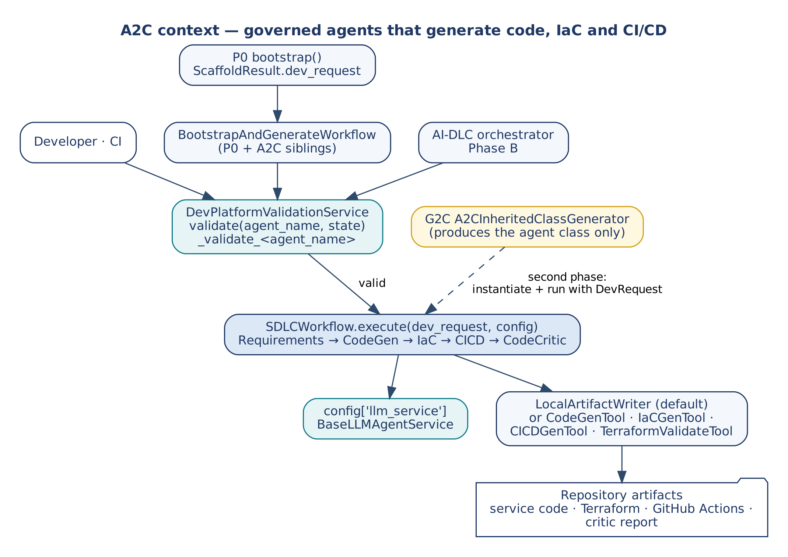
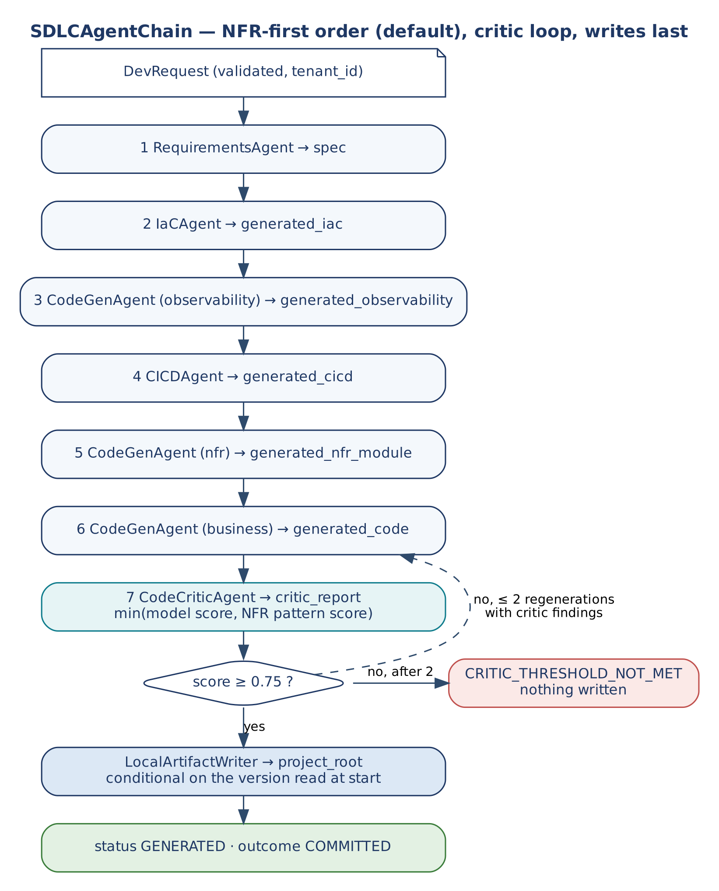
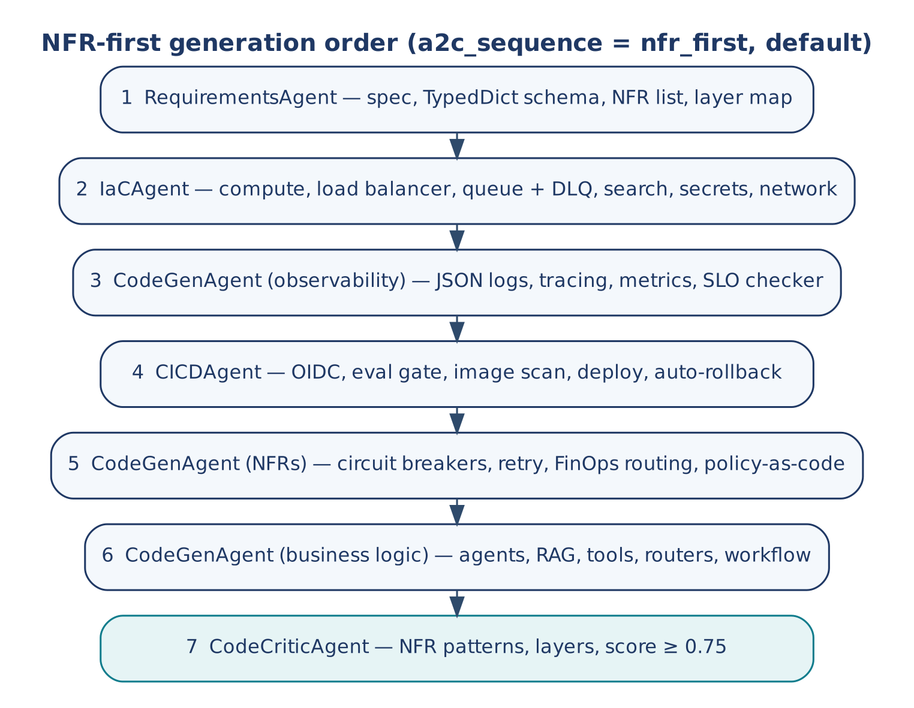
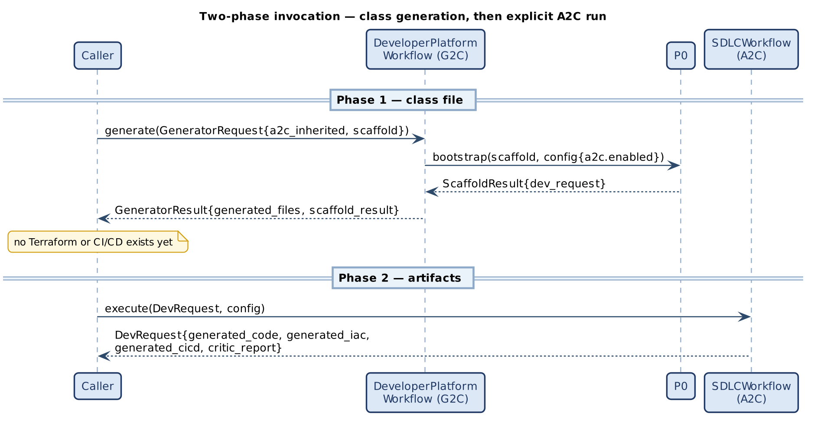
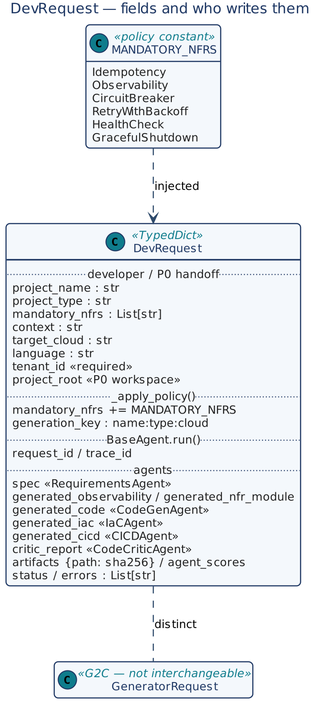
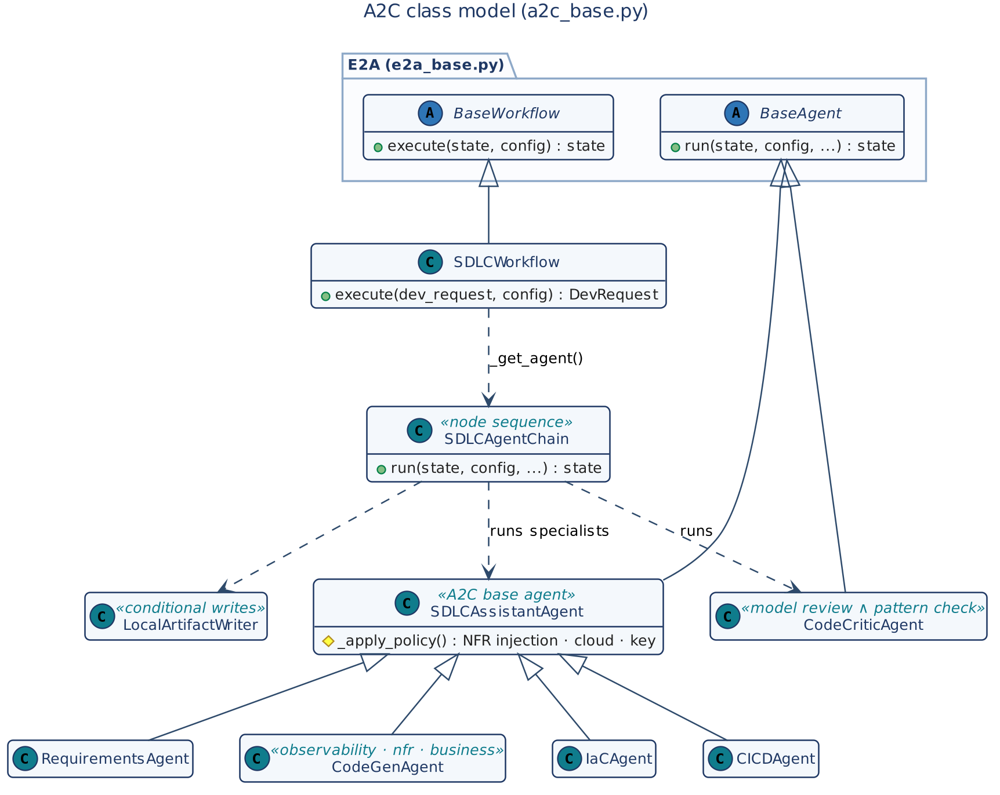
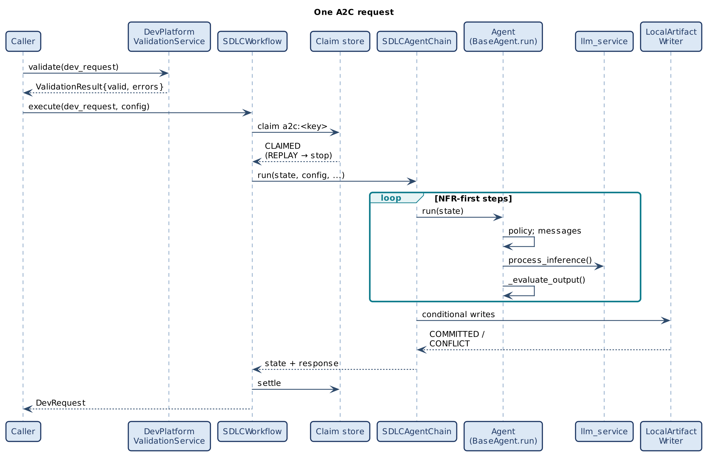
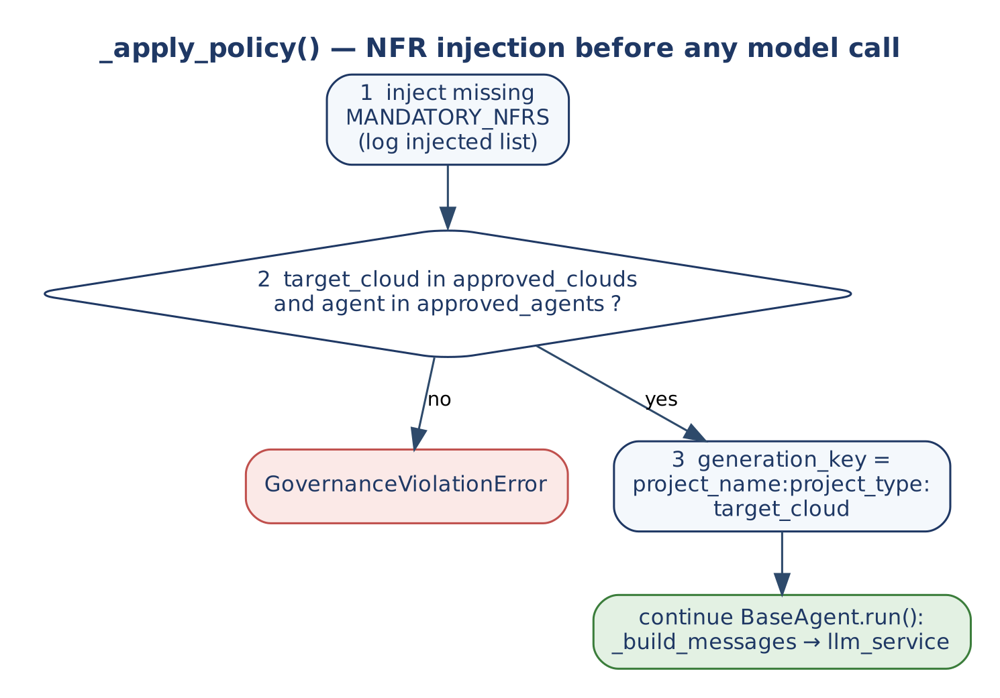
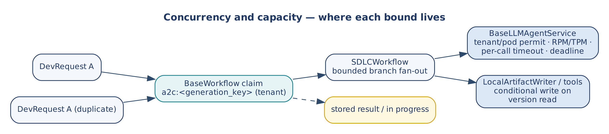

# A2C Architecture-to-Code Framework

### High-Level and Low-Level Design

*This document describes A2C, the framework that uses E2A-governed agents to generate production-grade service code, infrastructure-as-code and CI/CD pipelines with mandatory NFRs injected before any model call. It covers the problem, use cases, HLD, the DevRequest contract, the agent, workflow, validation, artifact and tool contracts, the NFR-first generation order, the two-phase invocation with G2C and P0, and the concurrency rules, so that a reader can form a complete mental model of A2C without opening the Python source.*

| | |
|---|---|
| Framework | A2C — Architecture-to-Code (developer-platform framework built on E2A) |
| Document type | Design Document (HLD + LLD) |
| Author | Subham Gupta, Principal Platform Architect |
| Source baseline | `subhamviky/a2c-framework` branch `fix/g2c-p0-a2c-contracts` @ c0583ac — `a2c_base.py` (664 lines), on `subhamviky/e2a-framework` @ 32c99c0 `reference/e2a_base.py` |
| Date | 7 November 2026 |
| Status | Baseline design, aligned to the reference implementation and its smoke tests |

## 1. Introduction

### 1.1 Purpose

**A2C (Architecture-to-Code)** applies E2A's governance mechanism to code generation. E2A defines how governed agentic systems are built; A2C uses governed agents — each a `BaseAgent` subclass with an inherited `run()` — as the engine of a developer platform. A developer states *what* to build in a `DevRequest` (project name, type, context, target cloud, language); A2C's agents decide *how* it must be built: they inject mandatory NFRs, generate Clean Architecture code, Terraform and GitHub Actions workflows, pass everything through a `CodeCriticAgent` quality gate and write the artifacts into the P0 workspace.

The design principle is that architecture is a constraint, not a prompt. `SDLCAssistantAgent._apply_policy()` adds every missing mandatory NFR to the generation contract before the model is called, so a generated service cannot lack idempotency or observability merely because the developer forgot to ask; and the critic checks those NFRs in the code itself, with comments removed.

### 1.2 Audience

| Reader | Read first | Use the document to |
|---|---|---|
| Platform architect | Sections 2, 4, 5 | Place A2C beside P0 and under G2C and AI-DLC. |
| Framework author | Sections 6–8, 12 | Extend agents, the workflow, validators and tools. |
| Platform engineer | Sections 6.4, 9–11 | Wire validation, the gateway, the claim store and the workspace. |
| Reviewer | Sections 4, 13, 14 | Check invariants, evidence and gaps. |

### 1.3 Status

All A2C classes are **implemented** in `a2c_base.py` on top of E2A's `e2a_base.py` (which must be on the import path; it is deliberately not copied into the A2C repository). Two contracts are worth naming:

**Table 1 — Contract provenance**

| Element | Provenance |
|---|---|
| `SDLCWorkflow.execute(dev_request, config) → DevRequest` | Inherited from E2A `BaseWorkflow.execute()`. The A2C Reference describes the workflow but publishes no method table for it; this signature is the one its callers (`BootstrapAndGenerateWorkflow`, the AI-DLC orchestrator) use, and it is now implemented. |
| Specialist agents' hooks, `DeliveryState` | The Reference names the agents' responsibilities only. The hooks are defined here (Section 8.3). The workflow returns the enriched `DevRequest`; `DeliveryState` is not a separate type. |

### 1.4 Related documents

| Document | Relationship |
|---|---|
| A2C Framework Reference | Normative intent and contracts. |
| E2A Framework Design Document | `BaseAgent`, `BaseWorkflow`, `BaseToolService`, `BaseValidationService`, `BaseLLMAgentService`, `BaseIdempotencyStore`, config registry. |
| P0 Framework Design Document | Produces `dev_request` (with `tenant_id`, `project_root`); composed with A2C by `BootstrapAndGenerateWorkflow`. |
| G2C Framework Design Document | Generates `a2c_base.py` (template mode emits this file) and team `SDLCAssistantAgent` subclasses. |
| E2A AI-DLC Profile Design Document | Runs `SDLCWorkflow` as Phase B. |

## 2. Problem Statement and Motivation

### 2.1 The problem

**Table 2 — Failure modes of unconstrained code generation**

| Failure mode | Description | Consequence |
|---|---|---|
| NFR amnesia | No idempotency, circuit breakers, retry or structured logging unless asked. | Duplicate writes, cascading failures, silent errors. |
| Architecture drift | Business logic in route handlers; no service layer or contracts. | Untestable, tightly coupled code. |
| Governance gap | No approval gates, policy-as-code, PII redaction or tool allow-lists. | Compliance failures found in production. |
| IaC afterthought | Infrastructure configured by hand. | Environment drift, no audit trail. |
| CI/CD bolted on | Pipelines added after the code works. | No evaluation gate, scan or rollback. |

### 2.2 Approach

A2C makes NFRs, IaC and CI/CD mandatory generation targets. Each concern has its own specialist agent; every agent inherits idempotency, latency SLO, token budget, governance and observability from `BaseAgent.run()`; every model call goes through the E2A inference gateway; every request is validated before the workflow and claimed once by `BaseWorkflow.execute()`; artifacts are written only after review, each write conditional on what was read.

### 2.3 Design goals

| ID | Goal |
|---|---|
| G-1 | Mandatory NFRs injected structurally before any model call. |
| G-2 | Separation of concerns: one specialist agent per artifact kind, in NFR-first order. |
| G-3 | Generated code verified by a review that a comment cannot satisfy (≥ 0.75). |
| G-4 | Input validation outside the agents, before the workflow starts. |
| G-5 | Every write idempotent and, where writers compete, conditional. |
| G-6 | Model capacity governed only at the gateway. |
| G-7 | A2C is self-hosting: its agents follow the patterns they generate. |

## 3. Core Use Cases

### 3.1 Actors

| Actor | Interaction |
|---|---|
| Developer | Submits a `DevRequest` (directly or via `scaffold-config.json`'s `a2c` section). |
| P0 | Produces `dev_request` when `config['a2c'].enabled`. |
| `BootstrapAndGenerateWorkflow` | Runs P0, validates the `dev_request`, runs A2C. |
| G2C | Generates the A2C classes; does not run them. |
| AI-DLC orchestrator | Runs `SDLCWorkflow` in Phase B. |

### 3.2 Use-case catalogue

**Table 3 — A2C use cases**

| ID | Use case | Outcome |
|---|---|---|
| UC-1 | Python FastAPI service on AWS | Spec, observability and NFR modules, service code, Terraform with a DLQ, GitHub Actions with OIDC, scan and deploy — written into the P0 workspace. |
| UC-2 | LangGraph agent | As UC-1 with `BaseAgent`, `BaseRAGPipeline`, `BaseToolService` subclasses in the service code. |
| UC-3 | Spring Boot service | Java artifacts (`src/generated/*.java`), Terraform, workflow. |
| UC-4 | The platform itself | `a2c_base.py` is A2C's own reference implementation. |
| UC-5 | Team SDLC agent | A G2C-generated subclass of `SDLCAssistantAgent` adds team NFRs on top of the mandatory set. |
| UC-6 | Duplicate request | One generation; the second caller gets the stored result (`replayed`) or `IN_PROGRESS`. |
| UC-7 | Code with NFRs only in comments | Critic fails; business code regenerated with the findings (≤ 2), else `CRITIC_THRESHOLD_NOT_MET` with nothing written. |
| UC-8 | Competing writer on an artifact path | Typed conflict; never a silent overwrite. |

### 3.3 Non-goals

- Project scaffolding (P0) and class-file generation (G2C).
- Applying Terraform or executing pipelines; A2C produces and checks artifacts.
- Input-shape validation inside agents.

## 4. Design Principles and Invariants

### 4.1 Principles

| Principle | Application |
|---|---|
| Meta-application of E2A | Same contract (`run()`, protected hooks, private steps); SDLC domain. |
| Policy before inference | `_apply_policy()` runs inside `run()` before the model call. |
| Specialist agents | Requirements, code (three modes), IaC, CI/CD and critique are separate runs. |
| Validation outside agents | `BaseValidationService` with `_validate_<agent_name>`; no `_validate_state` hook. |
| Review that comments cannot pass | Critic score = min(model review, deterministic NFR-pattern check on comment-free code). |
| Writes last, conditionally | Artifacts are written only after the critic passes, each conditional on the version read at the start. |
| Gateway capacity | `config['llm_service']` owns permits, quotas and timeouts. |
| Composable siblings | P0 and A2C are independent; `BootstrapAndGenerateWorkflow` composes them. |

### 4.2 Invariants

| ID | Invariant |
|---|---|
| INV-01 | No agent overrides `run()`; `SDLCWorkflow` does not override `execute()`. |
| INV-02 | After `_apply_policy()`, `mandatory_nfrs` ⊇ `MANDATORY_NFRS`. |
| INV-03 | A `target_cloud` outside `approved_clouds` (or an agent outside `approved_agents`) raises `GovernanceViolationError` before any model call. |
| INV-04 | The workflow receives only state that passed `DevPlatformValidationService` and carries `tenant_id`. |
| INV-05 | No A2C agent holds a semaphore, rate limiter or provider SDK. |
| INV-06 | Two identical `DevRequest`s produce one generation (claim on `a2c:<generation_key>`, tenant-scoped). |
| INV-07 | Nothing is written unless the critic score is ≥ the threshold; two writers on one path never silently overwrite each other. |
| INV-08 | Class generation (G2C) never produces IaC or CI/CD; `SDLCWorkflow` must be run explicitly. |
| INV-09 | `CodeCriticAgent` (A2C) and `GeneratorCriticAgent` (G2C) are separate gates; `DevRequest` and `GeneratorRequest` are separate contracts. |

## 5. High-Level Design

### 5.1 Context



*Figure 1 — A2C context*

### 5.2 E2A to A2C mapping

| Layer | E2A | A2C |
|---|---|---|
| Data model | `AgentState` | `DevRequest` |
| Agent contract | `BaseAgent` | `SDLCAssistantAgent` and its specialists; `CodeCriticAgent` |
| Quality gate | `CriticAgent` (groundedness ≥ 0.85) | `CodeCriticAgent` (NFR patterns ≥ 0.75) |
| Tool layer | HTTP microservice calls | `LocalArtifactWriter` (default), `CodeGenTool`, `IaCGenTool`, `CICDGenTool`, `TerraformValidateTool` |
| Orchestration | `BaseWorkflow` | `SDLCWorkflow` + `SDLCAgentChain` |
| Validation | `BaseValidationService` | `DevPlatformValidationService` |
| Configuration | `E2A_CONFIG` registry | A2C keys registered with `register_config_key()` |

### 5.3 Workflow



*Figure 2 — SDLCAgentChain: NFR-first order, critic loop, writes last*

`BaseWorkflow.execute()` runs exactly one agent per request; `SDLCWorkflow._get_agent()` therefore returns an `SDLCAgentChain` — the workflow's node sequence, which exposes `run()` with the agent signature and runs each specialist through its own inherited `BaseAgent.run()`. The claim, propagation fields, deadline, telemetry, DLQ and claim settlement stay in the unmodified `execute()`.

### 5.4 Generation order



*Figure 3 — NFR-first generation order*

| `a2c_sequence` | Order | Model calls (no regeneration) |
|---|---|---|
| `nfr_first` (default) | Requirements → IaC → CodeGen (observability) → CI/CD → CodeGen (NFR module) → CodeGen (business) → Critic | 7 |
| `topology` | Requirements → CodeGen (business) → IaC → CI/CD → Critic | 5 |

The NFR-first order implements Section 5 of the Reference (production-readiness priority); the topology order is the five-agent graph of its Section 3.2.

### 5.5 Two-phase invocation



*Figure 4 — Class generation, then an explicit A2C run*

## 6. Data Contracts



*Figure 5 — DevRequest fields and writers*

### 6.1 DevRequest

**Table 4 — DevRequest fields**

| Field | Type | Written by | Meaning |
|---|---|---|---|
| `project_name` | str | Developer / P0 | Service name. |
| `project_type` | str | Developer / P0 `a2c` block | `FastAPI Microservice`, `Spring Boot`, `LangGraph Agent`. |
| `mandatory_nfrs` | List[str] | Developer; extended by `_apply_policy` | Requested plus injected NFRs. |
| `context` | str | Developer / P0 `a2c` block | Domain context. |
| `target_cloud` | str | Developer / P0 (`platform`) | `aws`, `gcp`, `azure`, `standalone`. |
| `language` | str | Developer / P0 (`runtime`) | `python`, `java` (also `node`, `go` for file extensions). |
| `tenant_id` | str | Developer / P0 | Required by `execute()`; scopes the claim. |
| `project_root` | str | P0 | Workspace where artifacts are written; absent → nothing written. |
| `generation_key` | str | `_apply_policy` | `project_name:project_type:target_cloud`. |
| `spec` | str | `RequirementsAgent` | Schema, NFR list, layer map, E2A mapping. |
| `generated_observability`, `generated_nfr_module`, `generated_code` | str | `CodeGenAgent` | The three code modules. |
| `generated_iac`, `generated_cicd` | str | `IaCAgent`, `CICDAgent` | Terraform, workflow YAML. |
| `critic_report` | dict | `CodeCriticAgent` | `{score, model_score, pattern_check, missing, passed, regenerations}`. |
| `artifacts` | dict | Chain | Relative path → SHA-256 of what was written. |
| `agent_scores` | dict | Agents | Per-agent evaluation score. |
| `status` | str | Chain | `GENERATED`, `AGENT_FAILED`, `CRITIC_THRESHOLD_NOT_MET`, `ARTIFACT_CONFLICT`; on duplicates `REPLAYED`, `IN_PROGRESS`, `CONFLICT`, `RECOVERY_REQUIRED`, `FAILED_FINAL` (from `BaseWorkflow`). |
| `response`, `outcome` | — | Chain | Run summary (all artifacts) and physical outcome; what a replay restores. |
| `correlation_id`, `idempotency_key`, `message_log`, `failed_keys`, `errors` | — | `BaseWorkflow` / agents | Propagation fields and errors. |

### 6.2 MANDATORY_NFRS and the pattern check

| NFR | Code pattern (case-insensitive, comments and docstrings removed) |
|---|---|
| Idempotency | `idempot`, `request_id`, `conditional write`, `put_if_version`, `claim(` |
| Observability | `structlog`, `opentelemetry`, `otel`, `logging.getLogger`, `logger.` |
| CircuitBreaker | `circuit`, `breaker`, `pybreaker`, `resilience4j` |
| RetryWithBackoff | `retry`, `backoff`, `tenacity` |
| HealthCheck | `/health`, `healthcheck`, `actuator` |
| GracefulShutdown | `sigterm`, `signal.`, `graceful`, `shutdown` |

`nfr_pattern_report(code, nfrs)` returns `{score, passed, missing}`, where the score is the share of requested NFRs that have a known pattern and appear in the code. Team NFRs without a pattern do not count against the score.

### 6.3 ValidationResult

`{valid, errors, agent_name, correlation_id}`. A failure is a normal return value (an HTTP 400 body), not an exception.

### 6.4 Configuration

**Table 5 — Configuration**

| Key (env) | Default | Used by |
|---|---|---|
| `a2c_min_confidence` (`A2C_MIN_CONFIDENCE`) | 0.75 | Agent fallback threshold and critic threshold |
| `a2c_max_latency` (`A2C_MAX_LATENCY`) | 30 s | Per-agent latency SLO |
| `a2c_max_tokens` (`A2C_MAX_TOKENS`) | 32 000 | Per-agent token budget |
| `a2c_max_regenerations` (`A2C_MAX_REGENERATIONS`) | 2 | Business-code regenerations after a failed review |
| `a2c_sequence` (`A2C_SEQUENCE`) | `nfr_first` | Agent order |
| `a2c_write_artifacts` (`A2C_WRITE_ARTIFACTS`) | true | Write into `project_root` |
| `critic_model_id` (`CRITIC_MODEL_ID`) | — | Model for `CodeCriticAgent` (passed as that run's `model_id`) |
| `a2c_artifact_paths` | see Section 8.6 | Override artifact locations |
| `approved_clouds`, `approved_agents` | `aws, gcp, azure, standalone` / none | `_apply_policy` |
| `llm_service`, `idempotency_store` | — | Gateway; claim store |
| `tool_base_url` | E2A default | Remote tools |

The A2C keys are registered in the E2A configuration registry at import time and resolved with `resolve_config()` (kwargs › config › env › default).

## 7. Low-Level Design — Class Model



*Figure 6 — A2C class model*

| Class | Base | Role |
|---|---|---|
| `SDLCAssistantAgent` | `BaseAgent` | A2C base agent; alone it generates service code in one call. |
| `RequirementsAgent`, `CodeGenAgent`, `IaCAgent`, `CICDAgent` | `SDLCAssistantAgent` | Specialists sharing the policy. |
| `CodeCriticAgent` | `BaseAgent` | Quality gate. |
| `SDLCAgentChain` | — | Node sequence run by `BaseWorkflow.execute()`. |
| `SDLCWorkflow` | `BaseWorkflow` | Entry point; claim; settlement. |
| `DevPlatformValidationService` | `BaseValidationService` | Validators and entitlement hook. |
| `LocalArtifactWriter` | — | Conditional local writes. |
| `CodeGenTool`, `IaCGenTool`, `CICDGenTool`, `TerraformValidateTool` | `BaseToolService` | Remote write/validate endpoints. |
| `GovernanceViolationError` | `NFRViolationError` | Unapproved cloud or agent. |

## 8. Low-Level Design — Class Contracts

### 8.1 SDLCAssistantAgent

**Table 6 — SDLCAssistantAgent methods**

| Method | Kind | Signature → returns | Contract |
|---|---|---|---|
| `run` | inherited | `(state, config, correlation_id, io_config, idempotency_key, tenant_id, message_log, failed_keys, **kw) → state` | E2A lifecycle: messages, policy (or governance engine), gateway call, token tracking, evaluation, fallback below `min_confidence`, latency SLO. Errors go to `_handle_error`. |
| `_apply_policy` | hook | `(state, config, **kw)` | Inject missing `MANDATORY_NFRS` (logged); check `approved_clouds` and `approved_agents` → `GovernanceViolationError`; set `generation_key`. |
| `_system_prompt` | helper | `(state) → str` | Clean Architecture, NFRs as code, JSON logging, tracing, `/health`, template method, gateway-only model access. Specialists override. |
| `_build_messages` | hook | `(state, config, **kw) → list` | System prompt; user prompt with context, `spec` and, on regeneration, the critic's findings. |
| `_evaluate_output` | hook | `(response, state, config, **kw) → float` | Store the text in `artifact_field`; score with `nfr_pattern_report`; record `agent_scores`. |
| `_fallback` | hook | `(state, config, **kw) → dict` | Degraded response naming the missing patterns (the artifact stays in state for the critic). |
| `_handle_error` | hook | `(error, state, config, **kw) → state` | Log with project; append `"<agent>: <error>"` to `errors`. |

### 8.2 CodeCriticAgent

| Method | Kind | Signature → returns | Contract |
|---|---|---|---|
| `_apply_policy` | hook | `(state, config, **kw)` | `approved_agents` check. The cheaper model is selected by the chain (`model_id=critic_model_id`). |
| `_build_messages` | hook | `(state, config, **kw) → list` | Senior-architect rubric over the three code modules; JSON `{score, missing, passed}`. |
| `_evaluate_output` | hook | `(response, state, config, **kw) → float` | Parse the model score (parse error → 0); run `nfr_pattern_report` on the same code; score = minimum; store `critic_report`. |
| `_fallback`, `_handle_error` | hook | — | Degraded response; append to `errors`. |

### 8.3 Specialist agents

**Table 7 — Specialist agents**

| Agent | Writes | `_evaluate_output` score |
|---|---|---|
| `RequirementsAgent` | `spec` | Share of: non-empty; every mandatory NFR named; layers/architecture described. |
| `CodeGenAgent` | `generated_observability` / `generated_nfr_module` / `generated_code` by `codegen_mode` | `nfr_pattern_report` against the mode's NFRs (observability: Observability; nfr: CircuitBreaker, RetryWithBackoff, Idempotency; business: all mandatory). |
| `IaCAgent` | `generated_iac` | Share of: > 100 chars; `resource`/`module` blocks; DLQ/redrive present; no literal secret or password. |
| `CICDAgent` | `generated_cicd` | Share of: `on:`; `jobs:`; `id-token: write` (OIDC); deploy step; scan (Trivy). |

### 8.4 SDLCAgentChain

| Method | Signature → returns | Contract |
|---|---|---|
| `run` | `(state, config, **propagation) → state` | Resolve A2C settings; pass `min_confidence`, `max_latency`, `max_tokens` and an idempotency key `<key>:<agent>:<mode>` to each agent run; check the deadline before every step; stop on the first agent error (`AGENT_FAILED`). Then, while the critic score is below the threshold and regenerations remain, rerun CodeGen (business) with the findings and the critic. Below threshold after that → `CRITIC_THRESHOLD_NOT_MET`, nothing written. Otherwise write artifacts (Section 8.6), set `GENERATED`, and put the run summary in `response`. Every failure appends the key to `failed_keys` so the workflow settles the claim as failed. |
| `_write` | `(state, config, root, versions, failed_keys, key)` | Write each present artifact with `LocalArtifactWriter`; a conflict stops writing, sets `ARTIFACT_CONFLICT`, and sets `outcome='UNKNOWN'` if an earlier artifact was committed (parked for reconciliation). All good → `outcome='COMMITTED'` when anything changed. |

### 8.5 SDLCWorkflow

| Method | Kind | Signature → returns | Contract |
|---|---|---|---|
| `__init__` | ctor | `(config=None, agents=None, writer=None)` | Default agent set; injectable agents and writer (tests, teams). |
| `execute` | inherited | `(dev_request, config) → DevRequest` | Requires `tenant_id` (`ValueError` otherwise). Claim `a2c:<project_name>:<project_type>:<target_cloud>` (tenant-scoped) when `config['idempotency_store']` is an E2A `BaseIdempotencyStore`; duplicates short-circuit with a typed status. Runs the chain; settles: `UNKNOWN` outcome → parked; failed keys → retryable fail; else complete. |
| `_build_workflow` / `_validate_workflow` | hook | — | Node list and sequence; all five agents must be present. |
| `_get_agent` | hook | `(intent, config) → SDLCAgentChain` | The chain. |
| `_generate_idempotency_key` | hook | `(state, config) → str` | `a2c:<generation_key>`. |
| `_replayable_result` | hook | `(state, config) → dict` | `{response, outcome}` — `response` holds every artifact, because `BaseWorkflow` restores only `response` on replay. |
| `_physical_outcome` | hook | `(state, config) → PhysicalOutcome or None` | From `state['outcome']`. |
| `_handle_error` | hook | `(error, state, config) → state` | Append to `errors`. |

### 8.6 Artifacts, LocalArtifactWriter and tools

| Field | Default path in `project_root` |
|---|---|
| `spec` | `docs/a2c/spec.md` |
| `generated_observability` / `generated_nfr_module` / `generated_code` | `src/generated/observability.<ext>` / `nfr.<ext>` / `service.<ext>` |
| `generated_iac` | `infra/main.tf` |
| `generated_cicd` | `.github/workflows/a2c-ci.yml` |

`LocalArtifactWriter.write(root, rel, content, expected_version)` reads the file's current SHA-256 under a per-path lock: equal to the new content → `UNCHANGED`; different from the version read at the start of the run → `CONFLICT`; otherwise write → `COMMITTED`.

**Table 8 — Remote tools (BaseToolService)**

| Tool | Endpoint | Idempotency key | Input validation |
|---|---|---|---|
| `CodeGenTool` | `/codegen/write` | `project_name:file_path` (+ `expected_version`) | `project_name, file_path, content` |
| `IaCGenTool` | `/iac/write` | `project_name:resource_type` | `terraform_hcl` > 100 chars |
| `CICDGenTool` | `/cicd/write` | `project_name:workflow_name` | OIDC, jobs and deploy present |
| `TerraformValidateTool` | `/terraform/validate` | none (read) | `terraform_hcl` present |

Endpoints are relative to `tool_base_url`. The default chain writes locally; the tools are for a deployment where a write service owns the repository.

### 8.7 DevPlatformValidationService

| Method | Signature → returns | Contract |
|---|---|---|
| `__init__` | `(entitlement_policy=None)` | Registry: `SDLCAssistantAgent` and `SDLCWorkflow` → `_validate_sdlc_assistant_agent`; `CodeCriticAgent` → `_validate_code_critic_agent`. |
| `validate` | inherited `(agent_name, state, config, correlation_id) → ValidationResult` | Unregistered agent → `strict_mode` decides; validator failure → result; then entitlement. |
| `_validate_sdlc_assistant_agent` | `(state, config) → (bool, errors)` | `project_name, project_type, mandatory_nfrs, target_cloud, tenant_id`; `mandatory_nfrs` must be a list. |
| `_validate_code_critic_agent` | `(state, config) → (bool, errors)` | `generated_code, mandatory_nfrs`. |
| `_enforce_entitlement_gate` | `(agent_name, state, config) → ValidationResult` | ABAC hook: `entitlement_policy(agent_name, state, config) → (ok, reason)`; default allow. |

Runtime-configuration policy (`approved_clouds`) stays in `_apply_policy`, because it is governance, not input shape.

## 9. Dynamic Behaviour

### 9.1 Request lifecycle



*Figure 7 — Validation, claim and the chain of governed agent runs*

### 9.2 Policy injection



*Figure 8 — _apply_policy(): NFR injection before any model call*

Resolution example: a developer supplies `mandatory_nfrs = ['Audit']`; `_apply_policy` adds the six mandatory NFRs and sets `generation_key = 'SettlementEngine:FastAPI Microservice:aws'`; the workflow claim adds `idempotency_key = 'a2c:SettlementEngine:FastAPI Microservice:aws'`; `run()` adds `correlation_id`.

### 9.3 Quality gate and regeneration

The critic reviews the observability, NFR and business modules together, so an NFR implemented in its dedicated module counts for the service. Below the threshold, CodeGen (business) runs again with the critic's `missing` list in the prompt, followed by the critic, at most `a2c_max_regenerations` times. Fleet model capacity must be sized including these retries.

## 10. Concurrency and Capacity



*Figure 9 — Where each bound lives*

| Concern | Rule |
|---|---|
| Model capacity | Gateway only: tenant/pod permit, RPM/TPM, per-call timeout, deadline. Rejections are typed and retryable; quota is refunded. |
| Duplicates | `BaseWorkflow` claims `a2c:<generation_key>` per tenant; the second identical request gets `REPLAYED` (artifacts in `response`) or `IN_PROGRESS`. The `a2c:` namespace keeps it apart from P0 (`p0:`), G2C (`g2c:`) and AI-DLC keys in a shared store. |
| Fan-out | Sequential; no parallel branches. |
| Competing writes | Conditional on the version read; typed `CONFLICT`. |
| Partial writes | `outcome='UNKNOWN'` → claim parked for reconciliation, never blindly re-run. |
| Cancellation | The deadline is checked before every agent run and caps each gateway call. |

## 11. Non-Functional Design

| NFR | Mechanism |
|---|---|
| Correctness of output | Mandatory NFR injection; critic ≥ 0.75 on comment-free code; writes only after review. |
| Latency | 30 s per agent call SLO (`NFRViolationError` on breach, from `BaseAgent`). |
| Cost | Token budgets; cheaper critic model; deterministic pattern check. |
| Security | Validation and entitlement before the workflow; no credentials in agents; OIDC required in generated pipelines; literal secrets in Terraform lower the IaC score. |
| Auditability | `correlation_id`, `generation_key`, `critic_report`, `agent_scores`, artifact hashes. |

## 12. Extension Guide

| # | Rule |
|---|---|
| 1 | Set `agent_name`; add it to `approved_agents` when that list is used. |
| 2 | Add `_validate_<agent_name>` to the validation service; never a `_validate_state` hook. |
| 3 | Override `_apply_policy` (call `super()` first in team subclasses), `_system_prompt` or `_build_messages`, `_evaluate_output`, `_fallback`, `_handle_error`. |
| 4 | Never override `run()` or `execute()`. |
| 5 | Completions only through `config['llm_service']`; no local semaphores or provider calls. |
| 6 | Pass a custom agent set or writer to `SDLCWorkflow(agents=..., writer=...)` rather than editing the chain. |

```python
TEAM_NFRS = ['DoubleEntryLedgerInvariant', 'SagaCompensation']

class FinancialSettlementSDLCAgent(SDLCAssistantAgent):
    agent_name = 'FinancialSettlementSDLCAgent'

    def _apply_policy(self, state, config=None, **kwargs) -> None:
        super()._apply_policy(state, config, **kwargs)        # mandatory NFRs, cloud, key
        for nfr in TEAM_NFRS:
            if nfr not in state['mandatory_nfrs']:
                state['mandatory_nfrs'].append(nfr)

agents = {'RequirementsAgent': RequirementsAgent(), 'CodeGenAgent': CodeGenAgent(),
          'IaCAgent': IaCAgent(), 'CICDAgent': CICDAgent(), 'CodeCriticAgent': CodeCriticAgent()}
workflow = SDLCWorkflow(config=config, agents=agents)
```

## 13. Verification

**Table 9 — Evidence at the baseline**

| Suite | What it shows |
|---|---|
| `smoke_test_a2c.py` (25 checks, real `e2a_base`) | Validation result vs exception; happy path in NFR-first order (7 runs); mandatory NFRs injected; `generation_key`; critic = min(model, pattern); critic on the cheaper model; artifacts in the workspace; claim `SUCCEEDED`; replay without a model call with artifacts in `response`; unapproved cloud stops before any model call; comment-only NFRs fail the pattern check; one regeneration fixes them; persistent failure stops after 2 with nothing written; conflict on the first write → retryable; conflict after earlier writes → `UNKNOWN`; topology order (5 runs); `tenant_id` required; P0 → A2C through `BootstrapAndGenerateWorkflow`; `a2c_base.py` passes G2C's `a2c_abstract` critic. |
| `smoke_test_aidlc_integration.py` (6 checks) | AI-DLC Phase B runs the real `SDLCWorkflow`; six artifacts written into the P0 workspace; the build reaches `E2A_VERIFIED`. |

## 14. Implementation Reality, Gaps and Design Observations

At the earlier baseline no A2C code existed: `BootstrapAndGenerateWorkflow`'s A2C phase was a placeholder and the AI-DLC orchestrator imported `SDLCWorkflow` from a module that did not exist. Both now run the implementation described here. The earlier naming drift (`SDLCBaseAgent`, `CriticAgent`) is resolved in favour of `SDLCAssistantAgent` and `CodeCriticAgent`; the two orders (topology vs NFR-first) are both implemented, NFR-first by default.

**Table 10 — Remaining observations**

| ID | Observation | Effect | Recommendation |
|---|---|---|---|
| O-1 | Agent-level scores are heuristics (keywords, block presence). | A response can match patterns without being correct code. | Add compilers/linters (`terraform validate`, `actionlint`, language parsers) as tools in CI. |
| O-2 | A governance violation is settled retryable (E2A's workflow settles a caught agent error as retryable). | Redelivery repeats a request that cannot pass. | Classify `GovernanceViolationError` as final in E2A's settlement. |
| O-3 | Three business keys coexist: P0 `scaffold_key`, G2C `generator_key`, A2C `generation_key` (no runtime). | Python and Java variants of one project share an A2C key. | Add `language` to `generation_key`, or document one project per key. |
| O-4 | `BaseWorkflow` restores only `response` on replay. | Top-level `generated_*` fields are absent on a replayed result; callers read `response`. | Read artifacts from `response`, or extend E2A's replay contract. |
| O-5 | The AI-DLC orchestrator passes its `dev_request` object straight to `execute()`, which enriches it in place. | The orchestrator's `result['dev_request']` shows generated content. | Pass a copy in AI-DLC (E2A change). |
| O-6 | Artifact paths are fixed defaults (`src/generated/…`). | Teams with other layouts must override `a2c_artifact_paths`. | Derive paths from the P0 tree per project type. |
| O-7 | All tests use in-memory doubles. | Not validated against a live gateway, store or load. | Add adapter tests. |

## Appendix A. Glossary

| Term | Definition |
|---|---|
| A2C | Architecture-to-Code. |
| `DevRequest` | A2C input and output contract; distinct from G2C's `GeneratorRequest`. |
| `generation_key` | `project_name:project_type:target_cloud`; claimed as `a2c:<generation_key>`. |
| Mandatory NFRs | Six NFRs injected by `_apply_policy`. |
| NFR-first order | Infrastructure and observability before business logic. |
| Second phase | Explicit `SDLCWorkflow` run after G2C class generation. |

## Appendix B. Traceability

| Goal / invariant | Element | Anchor (`a2c_base.py`) |
|---|---|---|
| G-1, INV-02/03 | `SDLCAssistantAgent._apply_policy` | L163 |
| G-2 | `NFR_FIRST`, `TOPOLOGY`, `SDLCAgentChain.run` | L412, L415, L431 |
| G-3, INV-07 | `CodeCriticAgent._evaluate_output`, `nfr_pattern_report` | L337, L130 |
| G-4, INV-04 | `DevPlatformValidationService` | L570 |
| G-5, INV-07 | `LocalArtifactWriter`, `SDLCAgentChain._write` | L363, L491 |
| INV-01, INV-06 | `SDLCWorkflow` (inherits `execute`) | L523 |
| Configuration | A2C keys registered | L48–71 |
| Tools | `CodeGenTool` … `TerraformValidateTool` | L606–664 |
