# G2C Generate-to-Class Framework

### High-Level and Low-Level Design

*This document describes G2C, the framework of E2A-governed generator agents that produce E2A abstract classes, A2C abstract classes and their inherited concrete classes, scaffolding the project through P0 inline. Since v1.2 it generates Python agents for the E2A v1.2 contract and, from one request, the whole agent layer of a service: several agents, their workflow, governance, validation, tool stubs and tests. It covers the problem, use cases, HLD, data contracts, class and method contracts, the Phase Trigger decision model and the concurrency contract, so that a reader can form a complete mental model of G2C without opening the Python source.*

| | |
|---|---|
| Framework | G2C — Generate-to-Class (top layer of the E2A / A2C / P0 framework stack) |
| Document type | Design Document (HLD + LLD) |
| Author | Subham Gupta, Principal Platform Architect |
| Source baseline | `subhamviky/a2c-framework` `v1.2.1` — `g2c_v12.py` (v1.2), `g2c_java12.py` (v1.2.1), `base_generator_agent.py`, `inherited_generator.py`, the four generators, `generator_critic_agent.py`, `generator_templates.py`, `generator_factory.py`, `developer_platform_workflow.py`, `generator_api_router.py`, `typedicts.py`, `a2c_concurrency.py` |
| Date | 13 November 2026 (v1.2.1; v1.2.0 the same day; baseline 7 November 2026) |
| Status | Aligned to A2C v1.2.1 and its smoke tests (wave C, design note C-01; wave D, design note D-01) |

## 1. Introduction

### 1.1 Purpose

E2A defines how governed agentic services are built; A2C uses governed agents to generate software; P0 scaffolds projects. **G2C (Generate-to-Class)** sits on top of all three: a developer supplies one `GeneratorRequest` (inline or `generator-config.json`) and G2C produces the **class files** — the E2A abstract base (`e2a_base.py` / `E2ABase.java` / `e2aBase.ts` / `e2a_base.go`), the A2C abstract base (`a2c_base.py`), or a concrete inherited class inside a P0-scaffolded project.

G2C is self-referential: every generator is itself an E2A-style agent. `BaseGeneratorAgent` follows the same three-layer contract as E2A's `BaseAgent` — one public entry point (`generate()`), protected hooks, private framework steps — and calls a model only through the E2A inference gateway (`config['llm_service']`, a `BaseLLMAgentService`). A `GeneratorCriticAgent` quality gate scores every output structurally before it is written. Without a gateway the generators run in **template mode**: they emit deterministic skeletons that pass the same critic, so the whole sequence works offline (CI, tests, air-gapped scaffolding).

**Since v1.2** a Python `e2a_inherited` request targets the **E2A v1.2 contract** by default (`e2a_contract: "1.2"`): each generated hook declares only the parameters it uses (`_prepare(state, ctx, io_read)`, `_build_messages(state, ctx)`, `_act(state, ctx, io_modify)`, …), and the class imports the installed `e2a` package. A request may declare several agents, the workflow that runs them and the governance stages (`harness.agents`, `harness.workflow`, `harness.governance`); G2C then writes all of them, with validation, tool stubs and tests (Section 5.6). Java and A2C's own SDLC agents stay on the v1.1 contract.

G2C always produces a class file. It never produces Terraform, CI/CD YAML or other infrastructure artifacts; those come from running A2C's `SDLCWorkflow` (with `IaCAgent` and `CICDAgent`) in an explicit second phase against a `DevRequest`.

### 1.2 Audience

| Reader | Read first | Use the document to |
|---|---|---|
| Platform architect | Sections 2, 4, 5, 9.4 | Place G2C in the stack and choose the correct phase-trigger case. |
| Framework author | Sections 6–8, 12 | Implement or extend generators against the contract. |
| Platform engineer | Sections 5.5, 6, 10, 11 | Configure models, prompts, stores and the API. |
| Reviewer | Sections 4, 13, 14 | Check invariants, evidence and gaps. |

### 1.3 Status

Every G2C class in this document is **implemented** at the baseline and exercised by the smoke tests in Section 13. Where a capability of the G2C Framework Reference is not implemented it is named in Section 14.

**Table 1 — G2C elements and files**

| Element | File | Note |
|---|---|---|
| `GeneratorRequest`, `GeneratorResult` | `typedicts.py` | Full field set (Section 6). |
| `BaseGeneratorAgent` | `base_generator_agent.py` | 12-step `generate()`; claim; template mode. |
| `BaseInheritedClassGenerator` | `inherited_generator.py` | Abstract chain, P0 inline, base copy, class placement. |
| Four generators | `e2a_/a2c_*_class_generator.py` | Real files with runtime-correct names. |
| Skeletons | `generator_templates.py` | Python, Java, Node, Go (v1.1 contract). |
| E2A v1.2 generation | `g2c_v12.py` | Agents, workflow, governance, validation, tools and tests from the declaration (v1.2). |
| `GeneratorCriticAgent` | `generator_critic_agent.py` | Structural rules per critic type + concurrency rules. |
| `GeneratorFactory` | `generator_factory.py` | `create(request, config)`, `register()`. |
| `DeveloperPlatformWorkflow` | `developer_platform_workflow.py` | Flat `GeneratorResult`; shared-artifact registry; compensation. |
| `GeneratorAPIRouter` | `generator_api_router.py` | Five POST endpoints + health. |
| Claims, deadlines, artifact registry | `a2c_concurrency.py` | Mirrors E2A's claim/complete/fail and `Deadline`. |

### 1.4 Related documents

| Document | Relationship |
|---|---|
| G2C Framework Reference | Normative contract. |
| G2C Phase Trigger Decision Reference | Which phases to run per case; reconciled to canonical names in Section 9.4. |
| P0 Framework Design Document | Called inline by inherited generators. |
| A2C Framework Design Document | Content of `a2c_base.py`; the second-phase `SDLCWorkflow` run. |
| E2A Framework Design Document | `BaseAgent` contract the generated classes follow; `BaseLLMAgentService`. |
| E2A AI-DLC Profile Design Document | Calls `DeveloperPlatformWorkflow(config).generate(request, config)` in Phase A. |

## 2. Problem Statement and Motivation

### 2.1 The problem

- **Framework adoption is copy-paste.** Teams that want an E2A agent copy `e2a_base.py`, guess which hooks to override and drift from the template.
- **Unconstrained code generation ignores architecture.** A model asked for "a refund agent" produces working code with no idempotency, no SLO, no governance and overridden entry points.
- **Language spread.** The same abstract layer is needed in Python, Java, Node and Go.
- **Order of operations.** An inherited class needs its abstract base and a scaffolded project first; doing these by hand in the wrong order overwrites tuned artifacts.
- **Shared bases.** Several services reference one abstract class; deleting it during a failed build breaks the others.

### 2.2 Approach

G2C turns the framework specifications into versioned system prompts, runs them through governed generator agents, and enforces structure with a critic that checks required classes, inheritance, overridden hooks, untouched entry points and the shared-gateway rules. The inherited generator resolves the order itself (abstract base, then P0, then the class) after its claim, so one call produces a consistent result and a repeat call is a no-op.

### 2.3 Design goals

| ID | Goal |
|---|---|
| G-1 | One public entry point per generator with a fixed 12-step sequence. |
| G-2 | Runtime-agnostic output from Python generators (`python`, `java`, `node`, `go`). |
| G-3 | Every output passes a structural quality gate (score ≥ 0.75) or fails explicitly. |
| G-4 | Model calls only through the E2A inference gateway; no provider SDKs in generators. |
| G-5 | One call from request to inherited class, including abstract-class resolution and P0 scaffolding. |
| G-6 | Idempotent under concurrency: one owner per `generator_key`; repeats replay. |
| G-7 | Safe sharing of abstract-class artifacts across generator keys. |
| G-8 | Usable offline: template mode needs no gateway. |

## 3. Core Use Cases

### 3.1 Actors

| Actor | Interaction |
|---|---|
| Developer | `generator-config.json` or API call. |
| UI / agentic orchestrator | `POST /api/v1/g2c/*`. |
| AI-DLC orchestrator | `DeveloperPlatformWorkflow(config).generate(request, config)` in Phase A. |
| P0 | Called by inherited generators. |
| Inference gateway | Serves generation calls. |

### 3.2 Use-case catalogue

**Table 2 — G2C use cases**

| ID | Scenario | `generator_type` / source | Output |
|---|---|---|---|
| UC-1 | E2A base class only | `e2a_abstract` | `e2a_base.py` / `E2ABase.java` / `e2aBase.ts` / `e2a_base.go`; no scaffold. |
| UC-2 | A2C base class only | `a2c_abstract` | `a2c_base.*`; the E2A base is generated first (or read from a path) and given as context. |
| UC-3 | New E2A app, no base | `e2a_inherited` / `generate` (default for non-Python and `e2a_contract: "1.1"`) | E2A base + P0 scaffold + inherited class inside the scaffold; base copied to the project's `common/`. |
| UC-4 | New E2A app, base in repo | `e2a_inherited` / `path` | P0 scaffold + inherited class. |
| UC-5 | New E2A app, base as package | `e2a_inherited` / `package` | Inherited class importing from `package_name`; no base file. |
| UC-6 | Team SDLC agent | `a2c_inherited` / `generate` | E2A and A2C bases + scaffold + `SDLCAssistantAgent` subclass with team NFRs. |
| UC-7 | Second service in the same tenant | inherited / `generate` | Shared base reused (replayed), referenced, copied into the new project. |
| UC-8 | Re-request the same key | any | Stored `GeneratorResult` replayed; no model call, no write. |
| UC-9 | Offline scaffolding | any, no `llm_service` | Deterministic skeleton (template mode). |
| UC-10 | Stub-to-real regeneration | any, `idempotency=False` | Output regenerated rather than hand-edited. |
| UC-11 | Python agent on E2A v1.2 (default) | `e2a_inherited`, `e2a_contract: "1.2"` | An agent with v1.2 hooks importing `e2a`; no base file (the source is forced to `package`). |
| UC-12 | Several agents in one workflow (v1.2) | `e2a_inherited` with `agents`, `workflow`, `governance` | Every agent, the workflow (`Steps`), governance (stages, `tool_policy`), validation, tool stubs and tests, inside the scaffold. |

### 3.3 Non-goals

- Terraform, CI/CD YAML, NFR artifacts (A2C second phase).
- Executing, compiling or importing generated code.
- Publishing abstract classes as packages (a CI/CD concern).

## 4. Design Principles and Invariants

### 4.1 Principles

| Principle | Application |
|---|---|
| Self-referential governance | Generators are E2A-style agents with the same three-layer contract. |
| Template method | `generate()` owns order, guards and settlement; subclasses supply prompts, validation and file layout. |
| Specification as versioned prompt | `prompts/<generator>_system_v<N>.txt`; additions never remove the base specification. |
| Structural quality gate | `GeneratorCriticAgent` (distinct from A2C's `CodeCriticAgent`) checks structure, not style. |
| Gateway-only model access | `_infer()` → `config['llm_service']`; capacity is bounded at the gateway, not in generators. |
| Embedded scaffold | The `scaffold` field rides in the `GeneratorRequest`; P0 runs inside the inherited generator, never as a separate manual step. |
| Chain after claim | Abstract generation and P0 run after the claim, so a replay costs nothing. |

### 4.2 Invariants

| ID | Invariant |
|---|---|
| INV-01 | `generate()` is never overridden; its 12 steps run in order. |
| INV-02 | No output is written unless the critic score is ≥ 0.75 (after at most two regenerations). |
| INV-03 | A generator never calls a model SDK directly. |
| INV-04 | G2C outputs are class files and P0 scaffolds only. |
| INV-05 | Generated inherited classes do not override `run()`/`execute()`/`retrieve()`, do not use name-mangled private access, and do not define `_validate_state` (input validation lives in the `BaseValidationService` subclass as `_validate_<agent_name>`). |
| INV-06 | One owner per `(tenant, g2c:generator_key)`; a settled success is replayed, never regenerated (unless `idempotency=False`). |
| INV-07 | An abstract-class artifact is removed during compensation only if this run created it fresh and no other `generator_key` references it; artifacts from `path` or `package` are never removed. |
| INV-08 | `GeneratorRequest` (G2C input) and `DevRequest` (A2C input) are never interchanged. |
| INV-09 | A replay returns the result as settled (a deep copy is stored). |
| INV-10 | A v1.2 Python agent passes E2A's Governed Entry Point rules (no R1 finding); generated projects pass `e2a.conformance --strict`. |
| INV-11 | `e2a_contract: "1.2"` is accepted only for Python `e2a_inherited`; anything else is refused before generation. |

## 5. High-Level Design

### 5.1 Context

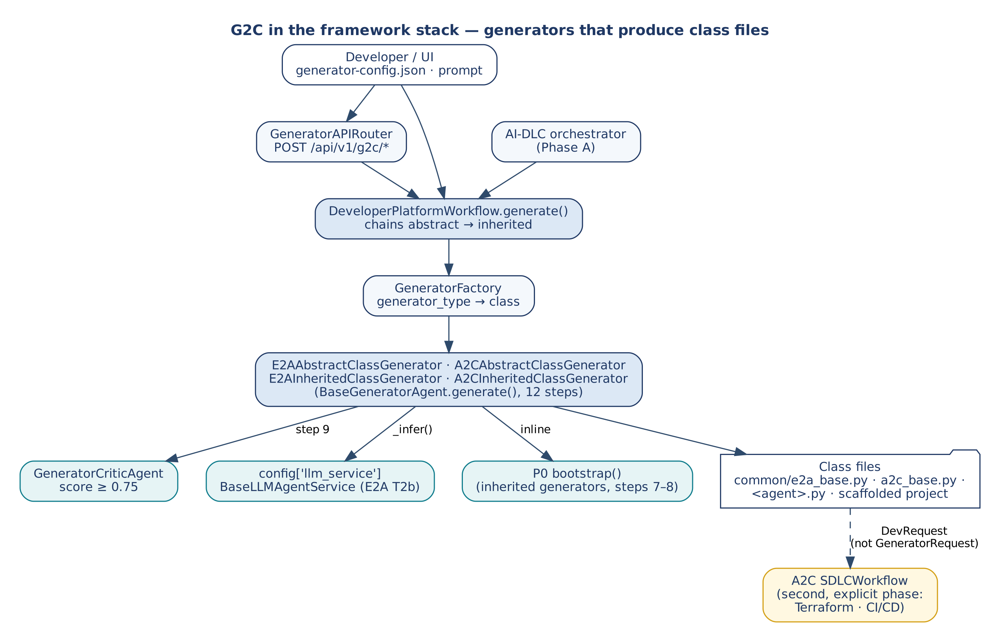

*Figure 1 — G2C in the framework stack*

| Layer | Framework | Entry point | Produces |
|---|---|---|---|
| 1 | E2A | `agent.run()` | Governed agents, RAG pipelines, tool services |
| 2 | A2C | `SDLCWorkflow.execute()` | Code, Terraform, CI/CD |
| 3 | P0 | `bootstrapper.bootstrap()` | Project structure, manifests, Docker, Makefile |
| 4 | G2C | `generator.generate()` / `DeveloperPlatformWorkflow.generate()` | Abstract and inherited class files, scaffolded projects |

### 5.2 Components

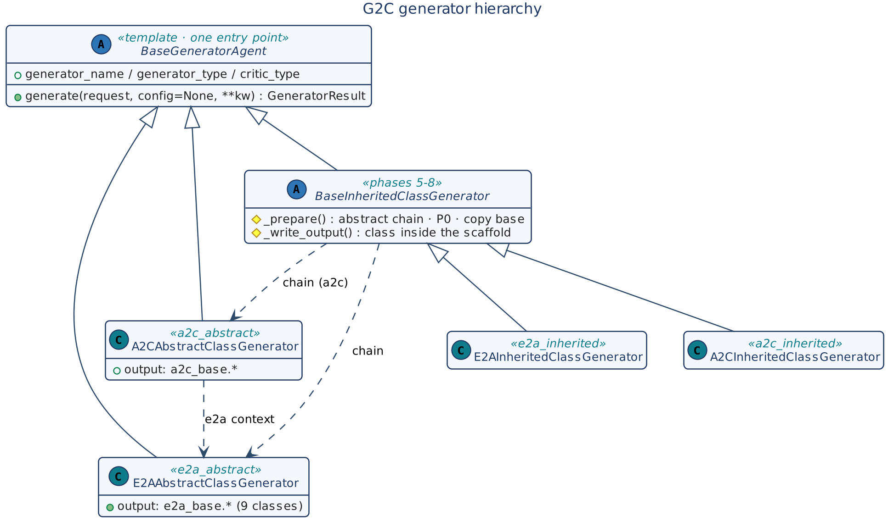

*Figure 2 — G2C generator hierarchy*

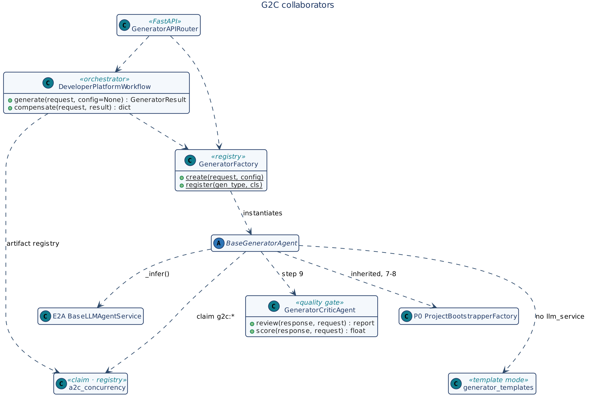

*Figure 3 — G2C collaborators*

| Component | Responsibility |
|---|---|
| `BaseGeneratorAgent` | 12-step sequence, policy, claim, token budget, inference delegation or template output, critic loop, writing, SLO, logging. |
| `BaseInheritedClassGenerator` | Abstract chain, P0 inline, base copy, class placement inside the scaffold. |
| Four generators | Prompts, validation, file names and skeletons per output kind. |
| `GeneratorCriticAgent` | Structural scoring with `critic_type` rules. |
| `GeneratorFactory` | `generator_type` → generator class. |
| `DeveloperPlatformWorkflow` | Defaults, the flat result, the shared-artifact registry and compensation. |
| `GeneratorAPIRouter` | FastAPI exposure; no business logic. |
| `a2c_concurrency` | Claim guard, deadline, artifact registry. |

### 5.3 Generation chain

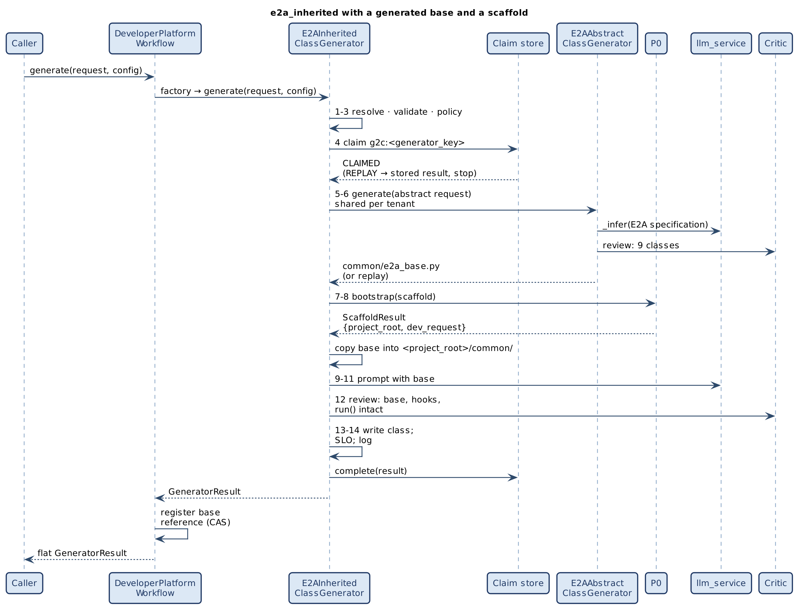

*Figure 4 — e2a_inherited with a generated base and a scaffold*

### 5.4 Abstract-class sources

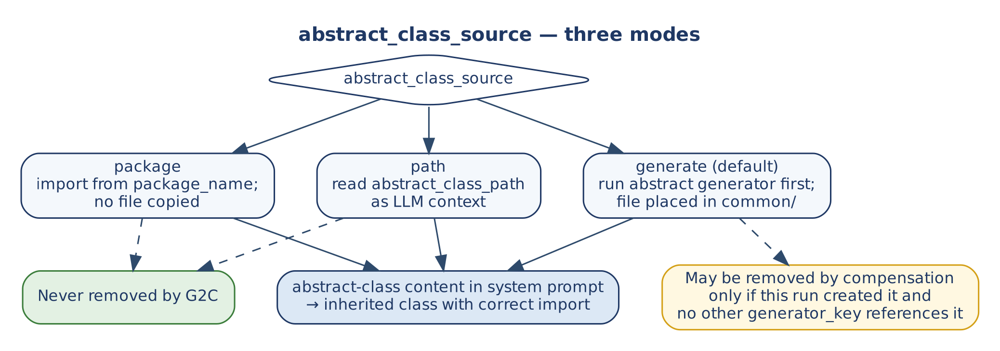

*Figure 5 — abstract_class_source modes and artifact ownership*

| Mode | When | Effect |
|---|---|---|
| `generate` (default) | No base exists | Abstract generator(s) run after the claim; output goes to `config['abstract_class_output_path']` or `<output_path>/common/`; its fingerprint excludes `output_path`, so the base is shared per tenant; the request switches to `path`. |
| `path` | Base file exists | Content read from `abstract_class_path` as model context; copied into `<project_root>/common/`. |
| `package` | Base published as a package | Inherited class imports from `package_name`; no file copied. With `e2a_contract: "1.2"` the source is always `package` with `package_name = 'e2a'` (E2A v1.2 is the installed package). |

### 5.5 API

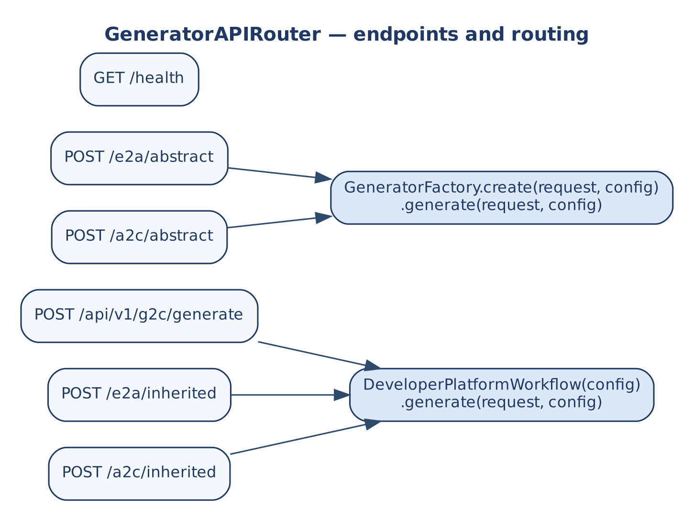

*Figure 6 — GeneratorAPIRouter endpoints*

| Endpoint | Routes to |
|---|---|
| `GET /api/v1/g2c/health` | `{status: ok}` |
| `POST /api/v1/g2c/generate` | `DeveloperPlatformWorkflow.generate(request, config)` |
| `POST /api/v1/g2c/e2a/abstract`, `/a2c/abstract` | `GeneratorFactory.create(request, config).generate(request, config)` |
| `POST /api/v1/g2c/e2a/inherited`, `/a2c/inherited` | `DeveloperPlatformWorkflow.generate(request, config)` |

The type-specific endpoints set `generator_type`. Config is bound once with `configure_generator(config)` and injected with `Depends(get_generator_config)`; one workflow instance is kept so its artifact registry outlives single requests. Endpoints are synchronous, so FastAPI runs each long generation in its threadpool. `ValueError` and `PermissionError` map to HTTP 400.

### 5.6 E2A v1.2 generation and several agents (v1.2)

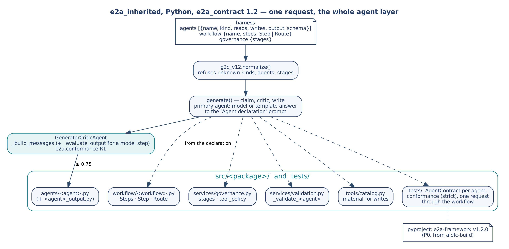

*Figure 7 — One request, the whole agent layer*

The request's `harness` may declare:

- **`agents`:** each with `name`, `kind` (`model` or `deterministic`), `reads`, `writes` and an optional `output_schema` (model agents only).
- **`workflow`:** `{name, steps}`. A step is `{step, agent}` or `{step, route_by, agents: {value: agent}}`, optionally `material`.
- **`governance`:** `{stages}` drawn from `capacity`, `token_budget`, `firewall`, `approval`, `sandbox` and `redaction`.

The first agent is the primary one. It goes through `generate()` as before (claim, model or template, critic, write), with its declaration in the user prompt. Every other file is written from the declaration by `g2c_v12.files()`:

**Table 3 — What a declaration generates (Python, E2A v1.2)**

| Declaration | Generated |
|---|---|
| `kind: model` | `_build_messages(state, ctx)`, `_evaluate_output(response, state, ctx)`, `_fallback(state, ctx)` |
| `kind: deterministic` | `_build_messages` returns `None` (no model step); no `_evaluate_output` |
| `reads: [tool]` | `_prepare(state, ctx, io_read)` with one `io_read.call()` per tool; the tool stub is a read |
| `writes: [tool]` | `_act(state, ctx, io_modify)` returning the typed outcomes; the tool stub has `material = True` |
| `output_schema` | `<agent>_output.py`, a Pydantic model (A2C's contract generator) that `_evaluate_output` validates |
| `workflow` | `workflow/<name>.py`: `_build_workflow(self, ctx)` returning `Steps(Step(...), Route(...))`; `_generate_idempotency_key` raises until you decide what makes two requests the same |
| `governance.stages` | `services/governance.py`: the stages in order, `tool_policy` = each agent's reads and writes |
| always | `services/validation.py` (a `_validate_<agent>` stub per agent), `tools/catalog.py`, `tests/test_agents_contract.py` (E2A `AgentContract`), `tests/test_conformance.py` (strict), and with a workflow `tests/test_workflow.py` (one request with the simulated model) |

The `approved_agents` check of v1.1 skeletons is no longer generated: E2A v1.2's governance stages cover it. `aidlc-build` adds `e2a-framework` `v1.2.0` to the project's dependencies, because the generated code and tests import `e2a`.

### 5.7 Java on e2a-java (v1.2.1)

Design note D-01 (G-4). E2A v1.2.2 ships e2a-java, the E2A runtime for Java. G2C generates Java code against it, from the same declaration as Python (`harness.agents`, `workflow`, `governance`). A Java request opts in with `"e2a_contract": "1.2"`; the Java default stays `1.1` until v1.3.

**Table 4 — What a Java v1.2 request generates (`g2c_java12.py`)**

| File | Content |
|---|---|
| `agents/<Agent>.java`, one per agent | extends `com.subhamviky.e2a.agent.BaseAgent`. `kind: model`: `buildMessages`, plus an `evaluateOutput` that parses the JSON and checks the `output_schema`'s required fields and enums, and `fallback`. `kind: deterministic`: `buildMessages` returns `null`. `reads`: `prepare(state, ctx, io)`. `writes`: `act(state, ctx, io)`. |
| `workflow/<Workflow>.java` | `buildWorkflow(ctx)` returns `Steps.of(Step…, Route….materialStep())`; a `generateIdempotencyKey` stub |
| `governance/ServiceGovernance.java` | `Governance` with the declared stages (e2a-java has `capacity`, `firewall` and `approval`; any other is refused, naming these) and each agent's tools |
| `tools/<Tool>Tool.java` | a `ToolService` stub per tool, `material()` for writes |
| `src/test/java/.../<Agent>ContractTest.java` | an `AgentContract` (e2a-test) per agent, with fake tools and a simulated model answering the schema's example |

- **No `E2ABase.java` is generated:** this is Case 2A for Java, so the base is reused.
- **What P0 adds:**
  - `com.subhamviky.e2a:e2a-core` and `e2a-test` (test), as Maven coordinates;
  - a step in the generated CI and Dockerfile that installs e2a-java from E2A's tag.
- **The critic:**
  - checks the hooks (`buildMessages`; with a model step, also `evaluateOutput` and `fallback`) and the e2a-java base;
  - leaves compilation to the project's `mvn verify`, because e2a-java is not on a standalone `javac`'s classpath.
- **R1 and R2 need no checker in Java:** `run()` is `final` and the hooks are `protected`, so the compiler enforces both.
- **Verification:** `smoke_test_java12.py` (14 checks). It includes `mvn verify` of a generated three-agent project, whose 14 tests pass.

## 6. Data Contracts

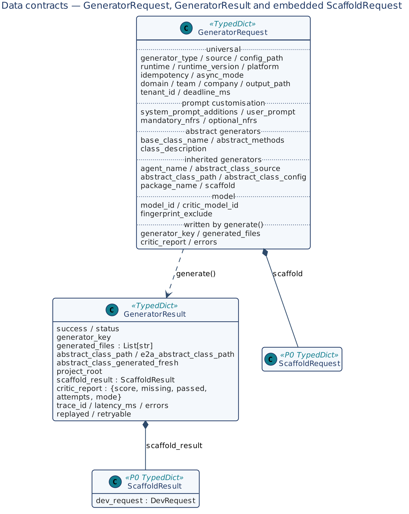

*Figure 8 — GeneratorRequest, GeneratorResult and the embedded P0 contracts*

### 6.1 GeneratorRequest

**Table 5 — GeneratorRequest fields**

| Group | Fields and meaning |
|---|---|
| Universal | `generator_type` (`e2a_abstract`, `a2c_abstract`, `e2a_inherited`, `a2c_inherited`); `source` (`inline` default, `json`); `config_path`; `runtime`; `runtime_version`; `idempotency`; `async_mode`; `platform` (part of the key; default `standalone`); `domain`; `team`; `company`; `output_path`; `tenant_id` (claim scope; required with a gateway); `deadline_ms` (remaining budget). |
| Prompt customisation | `system_prompt_additions` (added to, never replacing, the base spec); `user_prompt`; `mandatory_nfrs` (checked against `config['approved_nfrs']` when set); `optional_nfrs`. |
| Abstract generators | `base_class_name` (also names the key); `abstract_methods`; `class_description`. |
| Inherited generators | `agent_name` (defaults to the first of `agents`); `abstract_class_source`; `abstract_class_path`; `abstract_class_config`; `package_name`; `scaffold` (P0 `ScaffoldRequest`; missing identity fields default from the request). |
| E2A v1.2 (v1.2) | `e2a_contract` (`"1.2"` default for Python `e2a_inherited`, else `"1.1"`); `agents`; `workflow`; `governance`; `project_package` (set by `aidlc-build` when no scaffold result carries the package). |
| Model | `model_id`; `critic_model_id`. |
| Advanced | `fingerprint_exclude` (fields left out of the claim fingerprint). |
| Written by `generate()` | `generator_key`; `generated_files`; `critic_report`; `errors` (on the internal copy). |

Minimum requests: abstract generators need `runtime, output_path`; inherited generators also need `agent_name`, plus `abstract_class_path` for `path` and `package_name` for `package`.

### 6.2 GeneratorResult

| Field | Meaning |
|---|---|
| `success` | Overall outcome. |
| `status` | `generated`, `replay`, `in_progress`, `conflict`, `recovery_required`, `failed_final`, `inference_rejected`, `deadline_exceeded`, `critic_threshold_not_met`, `scaffold_failed`. |
| `generator_key` | `name:type:runtime:platform`, where name is `agent_name`, else `base_class_name`, else the generator name. |
| `generated_files` | All files written (copied base, class file). |
| `abstract_class_path`, `e2a_abstract_class_path` | Bases used (the second only for `a2c_inherited`). |
| `abstract_class_generated_fresh` | This request created the base (read by AI-DLC's artifact ownership). |
| `project_root`, `scaffold_result` | P0 workspace and `ScaffoldResult` (incl. `dev_request`). |
| `critic_report` | `{score, missing, passed, findings, attempts, mode}`. |
| `trace_id`, `latency_ms`, `errors`, `replayed`, `retryable` | Observability and typed retry hint. |

### 6.3 generator-config.json

```json
{
  "generator": {
    "generator_type": "e2a_inherited", "runtime": "python", "platform": "aws",
    "tenant_id": "acme", "domain": "financial", "agent_name": "SettlementAgent",
    "abstract_class_config": { "base_class_name": "BaseSettlementAgent" },
    "user_prompt": "Charge-to-settlement reconciliation agent",
    "system_prompt_additions": "Additional NFR: double-entry ledger invariant",
    "output_path": "./generated/"
  },
  "scaffold": { "project_name": "SettlementEngine", "package_name": "settlement_engine",
                "project_type": "langgraph_agent" }
}
```

With `source='json'`, the `generator` section is merged under the inline fields and a top-level `scaffold` section becomes `request['scaffold']`. The schema is `schemas/generator-config-schema.json`.

### 6.4 Configuration keys

| Key | Used in | Default |
|---|---|---|
| `llm_service` | `_infer()`; absent → template mode | — |
| `idempotency_store`, `claim_lease_seconds` | Step 4 claim | none / 300 |
| `tenant_id` | Claim scope (if not in the request) | — |
| `max_tokens` / `GENERATOR_MAX_TOKENS` | Step 7 | 32 000 |
| `min_critic_score` / `GENERATOR_MIN_CRITIC_SCORE` | Steps 9–10 | 0.75 |
| `max_latency_ms` / `GENERATOR_MAX_LATENCY_MS` | Step 12 | 60 000 |
| `prompt_dir` / `GENERATOR_PROMPT_DIR` | `__load_prompt_file` | `prompts/` |
| `approved_nfrs` | `_apply_policy` | none |
| `abstract_class_output_path` | Abstract chain | `<output_path>/common/` |
| `critic_config` | `_critic_review` | `{critic_type}` |
| `deadline` | Deadline when no `deadline_ms` | none |

Resolution order is config › environment › default.

## 7. Low-Level Design — Class Model

| Class | `generator_type` / `critic_type` | Output | Prompt file | P0 |
|---|---|---|---|---|
| `E2AAbstractClassGenerator` | `e2a_abstract` | E2A base: 5 abstract classes + 4 foundation interfaces | `e2aabstractclassgenerator_system_v1.txt` | No |
| `A2CAbstractClassGenerator` | `a2c_abstract` | A2C base | `a2cabstractclassgenerator_system_v1.txt` | No |
| `E2AInheritedClassGenerator` | `e2a_inherited` | Base (if needed) + scaffold + inherited class | `e2ainheritedclassgenerator_system_v1.txt` | Yes |
| `A2CInheritedClassGenerator` | `a2c_inherited` | E2A + A2C bases (if needed) + scaffold + `SDLCAssistantAgent` subclass | `a2cinheritedclassgenerator_system_v1.txt` | Yes |

## 8. Low-Level Design — Class Contracts

### 8.1 BaseGeneratorAgent

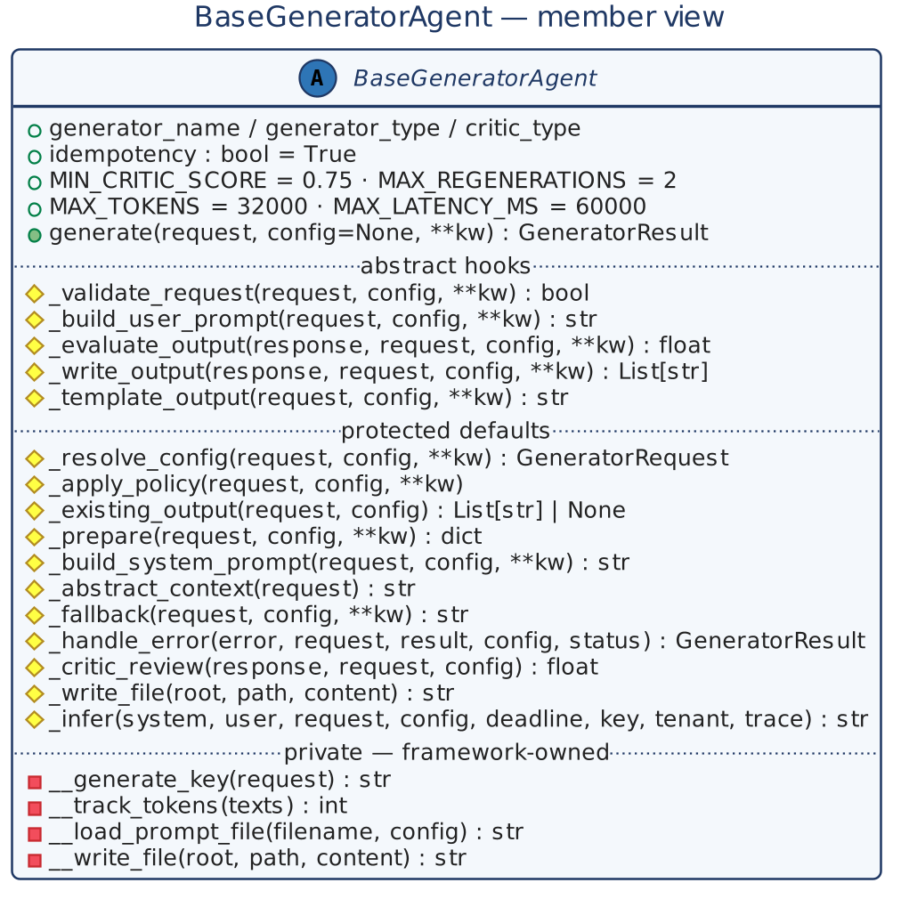

*Figure 9 — BaseGeneratorAgent member view*

| Aspect | Detail |
|---|---|
| Class attributes | `generator_name`, `generator_type`, `critic_type`; `idempotency = True`; `APPROVED_RUNTIMES`; `APPROVED_GENERATOR_TYPES`; `PROMPT_DIR`; `MIN_CRITIC_SCORE = 0.75`; `MAX_REGENERATIONS = 2`; `MAX_TOKENS = 32000`; `MAX_LATENCY_MS = 60000`. |
| Module data | `RUNTIME_PATTERNS[runtime]` — `abstract_base`, `abstract_method`, `private_prefix`, `protected_prefix`, `type_hints`, `extension`. |
| Invariants | INV-01 to INV-06, INV-09. |

**Table 6 — BaseGeneratorAgent methods**

| Method | Kind | Signature → returns | Contract |
|---|---|---|---|
| `generate` | entry | `(request, config=None, **kw) → GeneratorResult` | Copies the request; runs the 12 steps of Section 9.1. Validation/policy failures raise `ValueError`/`PermissionError`; typed outcomes are returned; an unexpected exception propagates after the claim is settled. |
| `_validate_request` | abstract | `(request, config, **kw) → bool` | Required fields. `False` → `ValueError`. |
| `_build_user_prompt` | abstract | `(request, config, **kw) → str` | Developer-facing prompt. |
| `_evaluate_output` | abstract | `(response, request, config, **kw) → float` | Score via `_critic_review`; store `critic_report`. |
| `_write_output` | abstract | `(response, request, config, **kw) → List[str]` | Write with runtime-correct names; return paths. |
| `_template_output` | abstract | `(request, config, **kw) → str` | Deterministic skeleton for template mode. |
| `_resolve_config` | default | `(request, config, **kw) → GeneratorRequest` | `json`: merge `generator` (+ `scaffold`) under inline fields; `prompt`: rejected (free text goes in `user_prompt`). |
| `_apply_policy` | default | `(request, config, **kw)` | Approved runtime and type; `approved_nfrs`; `tenant_id` required with a gateway. |
| `_existing_output` | default | `(request, config) → List[str] or None` | Earlier output, consulted only without a store (`local` mode). |
| `_prepare` | default | `(request, config, **kw) → dict` | Hook after the claim: `{result}`, `{files_before}` or `{abort: {status, errors, retryable}}`. |
| `_build_system_prompt` | default | `(request, config, **kw) → str` | Prompt file + `RUNTIME_PATTERNS` + additions + `_abstract_context()`; unknown placeholders render empty. |
| `_abstract_context` | default | `(request) → str` | Base content given as context (inherited and A2C abstract generators). |
| `_fallback` | default | `(request, config, **kw) → str` | Stricter addendum naming the critic's missing items. |
| `_handle_error` | default | `(error, request, result, config, status, error_text) → GeneratorResult` | Log, append to `errors`, typed status, safe result. |
| `_critic_review` | helper | `(response, request, config) → float` | `GeneratorCriticAgent(critic_config).review()`. |
| `_write_file` | helper | `(root, path, content) → str` | Base-owned writer for subclasses. |
| `_infer` | base-owned | `(system, user, request, config, deadline, key, tenant, trace) → str` | `llm_service.process_inference(messages, tenant_id, deadline, correlation_id, idempotency_key[, model_id])`; non-`SUCCESS` → `InferenceRejected`; no gateway → `_template_output()`; strips code fences. |
| `__generate_key` | private | `(request) → str` | `name:type:runtime:platform`. |
| `__track_tokens` | private | `(texts) → int` | ~4 characters per token. |
| `__load_prompt_file` | private | `(filename, config) → str` | From `prompt_dir`, then the package's `prompts/`. |
| `__write_file` | private | `(root, path, content) → str` | `mkdir -p`; UTF-8; absolute path. |

### 8.2 E2AAbstractClassGenerator

| Hook | Contract |
|---|---|
| `_validate_request` | `runtime` and `output_path`. |
| `_build_user_prompt` | Runtime, optional `base_class_name`, `abstract_methods`, `class_description`, `user_prompt`. |
| System prompt | Full E2A specification: one public entry point per class, nine classes (`BaseAgent`, `BaseWorkflow`, `BaseRAGPipeline`, `BaseToolService`, `BaseLLMAgentService` with `process_inference` + `process_inference_stream`, and the interfaces `BaseInfraProvisioner`, `BaseObservability`, `BasePipeline`, `BaseGovernanceFramework`), NFRs in code, concurrency rules, validation in `BaseValidationService`. |
| `_write_output` / `_existing_output` | `<output_path>/e2a_base.py | E2ABase.java | e2aBase.ts | e2a_base.go`. |
| `_template_output` | Skeleton of the nine classes per runtime (Java as nested types of `E2ABase`, matching `import com.company.common.E2ABase.BaseAgent`). |

### 8.3 A2CAbstractClassGenerator

| Hook | Contract |
|---|---|
| `_prepare` | With `generate` and no path, run `E2AAbstractClassGenerator` first (shared fingerprint) and switch to `path`; a failed base aborts with its status. |
| `_abstract_context` | E2A base content (or a package note). |
| `_write_output` | `<output_path>/a2c_base.*`. |
| `_template_output` | Python: this repository's `a2c_base.py` (the A2C reference); other runtimes: skeletons with `DevRequest`, `SDLCAssistantAgent`, `CodeCriticAgent`, `SDLCWorkflow`, `MANDATORY_NFRS`. |

### 8.4 BaseInheritedClassGenerator and the two inherited generators

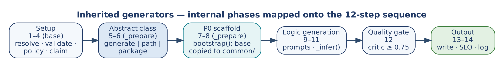

*Figure 10 — Inherited generators: internal phases*

**Table 7 — BaseInheritedClassGenerator methods**

| Method | Contract |
|---|---|
| `_v12` | `(request) → bool`: sets the default `e2a_contract` (`"1.2"` only for Python `e2a_inherited`) and says whether this request targets E2A v1.2. |
| `_validate_request` | `runtime, agent_name, output_path` (`agent_name` defaults to the first declared agent); `path` needs `abstract_class_path`, `package` needs `package_name`. v1.2: refuses `1.2` outside Python `e2a_inherited` and forces `abstract_class_source='package'`, `package_name='e2a'`. |
| `_prepare` | Phases 5–8 after the claim: `_generate_abstracts()` for `generate`; `_scaffold()` when `scaffold` is set (failure aborts as `scaffold_failed`, retryable unless P0 returned `conflict`/`failed_final`); copy the base(s) into `<project_root>/common/`. Both steps are idempotent, so a later model failure still settles retryable. |
| `_generate_abstracts` | E2A abstract (plus A2C abstract for `a2c_inherited`) with `fingerprint_exclude=['output_path']`; sets `abstract_class_path`, `e2a_abstract_class_path`, `abstract_class_generated_fresh` (false when replayed). |
| `_scaffold` | P0 inline. Defaults from the request: `runtime`, `platform`, `build_tool` (poetry/maven/npm/go_modules), `project_name` (`<agent_name>Service`), Python `package_name`, `output_path`, `tenant_id`. Java identity (`group_id`, `artifact_id`, `project_type`) must be supplied. |
| `_abstract_context` | E2A and A2C base content, or a package note. |
| `_build_user_prompt` | v1.1: class, base, import line, domain, requirement, NFRs. v1.2: the E2A v1.2 hook contract plus `Agent declaration: {json}` of the primary agent. |
| `_write_output` | Python `src/<pkg>/agents/<snake>.py`; Java `src/main/java/<group>/service/<Agent>.java`; Node `src/agents/<Agent>.ts`; Go `internal/agents/<snake>.go`; without a scaffold, under `output_path`. v1.2 with a project: the primary agent from the response, then every other file of `g2c_v12.files()`; returns all paths. |
| `_template_output` | v1.1 skeleton: E2A → extends `BaseAgent` with `_build_messages`, `_apply_policy`, `_evaluate_output`, `_fallback`, `_handle_error`; A2C → extends `SDLCAssistantAgent`, calls `super()._apply_policy()` then adds the request's `mandatory_nfrs`. v1.2: `g2c_v12.agent_source()` of the primary agent's declaration. |

`E2AInheritedClassGenerator` and `A2CInheritedClassGenerator` set only `generator_name`, `generator_type`, `critic_type` and `kind`.

### 8.5 GeneratorCriticAgent

| Method | Signature → returns | Contract |
|---|---|---|
| `review` | `(response, request) → {score, critic_type, missing, passed, findings}` | Rules of Table 8 for `config['critic_type']` or `request['generator_type']`; Python is parsed with `ast` (a syntax error scores 0). |
| `score` | `(response, request) → float` | `review()['score']`. |
| `concurrency_findings` | `(source) → List[str]` | Shared-gateway rule violations. |

**Table 8 — Critic rules**

| critic_type | Checks | Deduction |
|---|---|---|
| all | Agent-level `_validate_state`; own semaphore; own rate limiter; provider SDK import; direct provider call | 0.25 each |
| `e2a_abstract` | Nine E2A classes present; Python uses `@abstractmethod` | 0.10 per class; 0.15 |
| `a2c_abstract` | `SDLCAssistantAgent`, `DevRequest`, `SDLCWorkflow`, `CodeCriticAgent`, `_apply_policy`, mandatory-NFR injection | 0.15 each |
| `e2a_inherited`, `a2c_inherited` | Class `<agent_name>` exists (else 0.5); has a base (`SDLCAssistantAgent` for A2C); `_build_messages` and `_evaluate_output` overridden; no `run`/`execute`/`retrieve` override; no name-mangled private access | 0.15 each |
| `e2a_inherited` with `e2a_contract: "1.2"` | As above, but `_evaluate_output` is required only for an agent with a model step; each `e2a.conformance` R1 finding in the source | 0.15 each |

The critic is deterministic and makes no model call; `GeneratorCriticAgent` checks generated class structure, A2C's `CodeCriticAgent` checks NFR patterns in generated business code.

### 8.6 g2c_v12 (v1.2)

| Function | Signature → returns | Contract |
|---|---|---|
| `normalize` | `(harness) → {agents, workflow, stages}` | One agent from `agent_name` when no `agents`; PascalCase, unique names; `kind` in (`model`, `deterministic`); `output_schema` only for model agents; workflow steps unique and naming declared agents; known stages. Else `HarnessError` (a `ValueError`). |
| `agent_source` | `(agent, package) → str` | The agent module (Table 3). |
| `output_model` | `(agent) → str or None` | Pydantic model of `output_schema`, through A2C's contract generator. |
| `workflow_source`, `governance_source`, `validation_source`, `tools_source` | `(spec, …) → str` | The modules of Table 3. |
| `tests` | `(spec, package) → {path: source}` | Contract, conformance and workflow tests. |
| `example` | `(schema) → value` | A minimal valid instance, used as the simulated model's answer in the workflow test. |
| `files` | `(harness, package) → {path: source}` | Everything above, relative to the project root. |

### 8.7 GeneratorFactory

| Method | Signature → returns | Contract |
|---|---|---|
| `create` | `(request or type, config=None) → BaseGeneratorAgent` | Look up `generator_type`; unknown → `ValueError` listing registered types; instantiate with `config`. |
| `register` | `(gen_type, cls)` | Register at import time; the type must also be approved by the generator's policy. |

### 8.8 DeveloperPlatformWorkflow

| Method | Signature → returns | Contract |
|---|---|---|
| `__init__` | `(config=None, artifact_registry=None)` | Registry from the argument, `config['artifact_registry']`, or in-memory. |
| `generate` | `(request, config=None) → GeneratorResult` | Copy the request; default `abstract_class_source='generate'` for inherited types; `GeneratorFactory.create(request, config).generate(request, config)`; on success register this key's reference on each base (creator only when fresh). Returns the flat result. |
| `compensate` | `(request, result) → {released, removed, removed_paths, may_delete, path}` | Release this key's references; delete a base only where the registry allows (creator, last reference, not deleted). Accepts the flat result or a wrapped `{output: ...}`. |

## 9. Dynamic Behaviour

### 9.1 generate() sequence

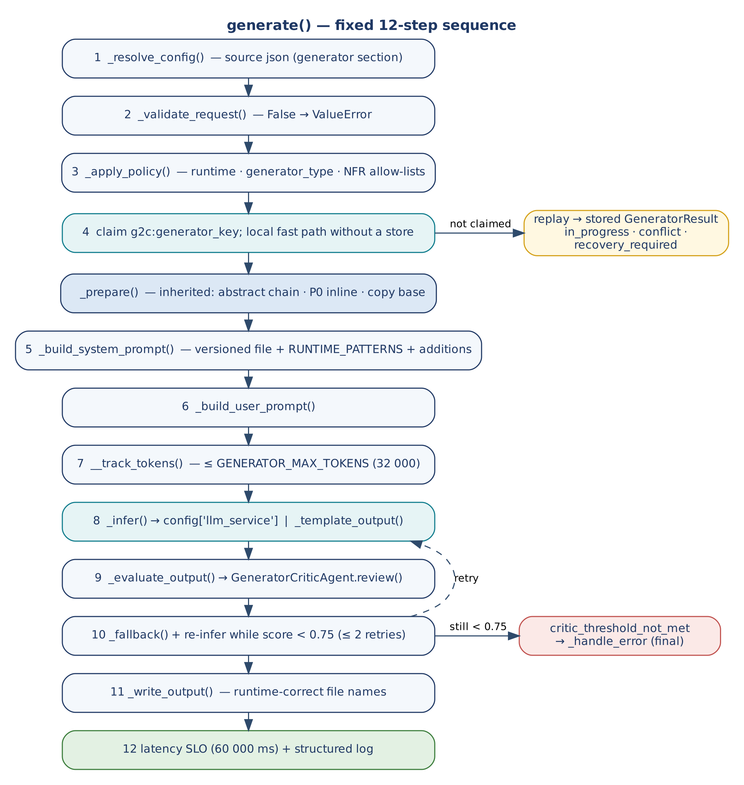

*Figure 11 — generate(): fixed 12-step sequence*

| Step | Action | Condition |
|---|---|---|
| 1 | `_resolve_config()` | `source='json'` |
| 2 | `_validate_request()` | Always; `False` raises |
| 3 | `_apply_policy()` | Always |
| 4 | Claim `g2c:<key>`; local fast path | Claim with a store; fast path without one |
| — | `_prepare()` (inherited phases 5–8) | Inherited generators, A2C abstract |
| 5 | `_build_system_prompt()` | Always |
| 6 | `_build_user_prompt()` | Always |
| 7 | `__track_tokens()` ≤ `max_tokens` | Always; over budget → `ValueError`, settled final |
| 8 | `_infer()` or `_template_output()` | Always |
| 9 | `_evaluate_output()` | Always |
| 10 | `_fallback()` + re-infer | Score < threshold, ≤ 2 regenerations |
| 11 | `_write_output()` | Score ≥ threshold |
| 12 | SLO + log (trace_id, latency, tokens, score, attempts, mode) | Always |

### 9.2 Critic routing

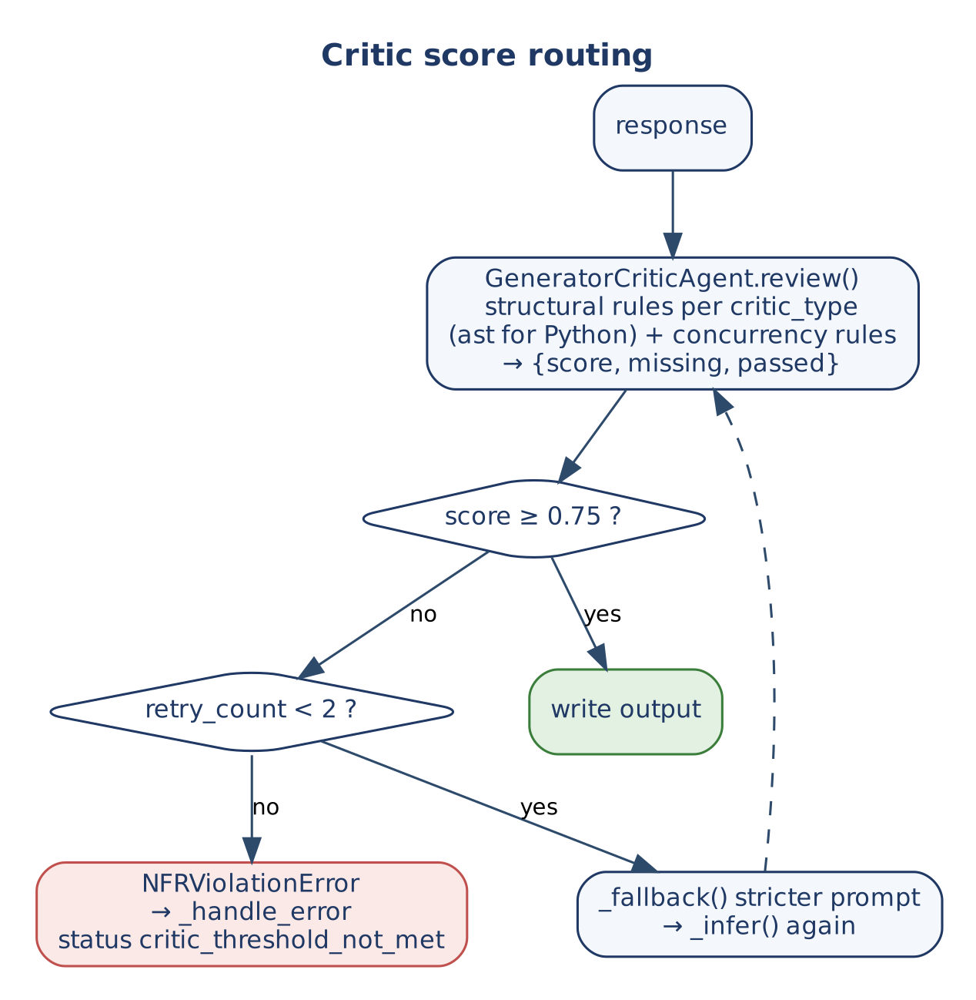

*Figure 12 — Critic score routing*

### 9.3 The second phase

G2C ends at a class file. When `config['a2c'].enabled`, the P0 result inside `scaffold_result` carries a `dev_request` (with `tenant_id` and `project_root`); producing Terraform and CI/CD requires an explicit run of A2C's `SDLCWorkflow.execute(dev_request, config)`. Omitting it is the most common adoption error (E-01).

### 9.4 Phase Trigger decision model

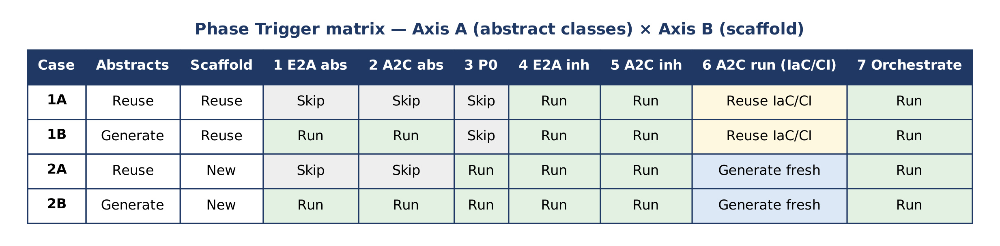

*Figure 13 — Phase Trigger matrix*

Two axes are evaluated from repository state before any generation: **Axis A** — do the E2A and A2C abstract classes exist (an `e2a_base.py` without `BaseLLMAgentService` is stale and must be regenerated); **Axis B** — does a P0 scaffold with a build manifest exist.

| Case | Situation | Canonical way to express it |
|---|---|---|
| 1A | Day-two module in a bootstrapped domain | Inherited generators with `abstract_class_source='path'` or `'package'`; omit `scaffold` (or rely on P0's replay); reuse IaC/CI. |
| 1B | Skeleton made outside G2C, no abstractions | `abstract_class_source='generate'` (v1.1 contract); omit `scaffold`; the critic gates the bases before the inherited class. With E2A v1.2 (Python) there is no base to generate: the source is the `e2a` package. |
| 2A | Proven abstractions, new service | `path`/`package` with `scaffold`; then the A2C second phase for fresh IaC/CI. |
| 2B | Greenfield | `generate` with `scaffold`; then the A2C second phase. |

**Table 9 — Phase Trigger errors**

| ID | Severity | Error | Remedy |
|---|---|---|---|
| E-01 | Critical | Second phase skipped | Run `SDLCWorkflow` with the `DevRequest` after the class is generated. |
| E-02 | High | Abstract generation over existing bases | Use `path`/`package`; regenerate only with intent (`idempotency=False`). |
| E-03 | High | P0 over an existing project | Omit `scaffold`; P0's claim and fast path make a repeat a replay, and a partial scaffold is parked, not overwritten. |
| E-04 | Medium | Defective base propagates | Bases pass the critic before inherited generation (built into the chain). |
| E-05 | Medium | `DevRequest` / `GeneratorRequest` confused | `GeneratorRequest` for generators; `DevRequest` for A2C. |
| E-06 | Low | Legacy branch not frozen | Tag `legacy-non-g2c` before the first run; it is the counterfactual baseline. |

**Table 10 — Reconciling Phase Trigger terminology with canonical contracts**

| Phase Trigger Reference wording | Canonical contract |
|---|---|
| "E2A (Enterprise-to-Abstract)", "A2C (Abstract-to-Class)" layers | E2A is the Enterprise-to-Agentic architecture framework; A2C is Architecture-to-Code. Abstract and inherited class generation belong to G2C. |
| Phase 3 as a separate P0 step; `BaseProjectBootstrapper.scaffold()` | P0 runs inline in inherited generators (phases 7–8) through `bootstrap()`. |
| Phase 7 `BootstrapAndGenerateWorkflow.run_workflow()` with `_invoke_p0/_invoke_e2a/_invoke_a2c` and `SKIP_*` flags | G2C chaining is `DeveloperPlatformWorkflow.generate()`. `BootstrapAndGenerateWorkflow.execute()` composes P0 and A2C. Full-stack orchestration is the AI-DLC orchestrator. Skips are expressed by `abstract_class_source` and the presence of `scaffold`. |
| `E2AAbstractClassGenerator.run()` | `generate()`. |
| `GeneratorCriticAgent.evaluate()` | `score()` / `review()`. |
| A2C abstract generator class with hooks `validate_request()` … `write_output()` | Those are `BaseGeneratorAgent` hooks (`_validate_request()` …). `A2CAbstractClassGenerator` produces `a2c_base.py`. |
| `IaCAgent.execute_pipeline()`, `CICDAgent.deploy()` | `SDLCWorkflow.execute(dev_request, config)` running `IaCAgent` and `CICDAgent`. |

## 10. Concurrency and Failure

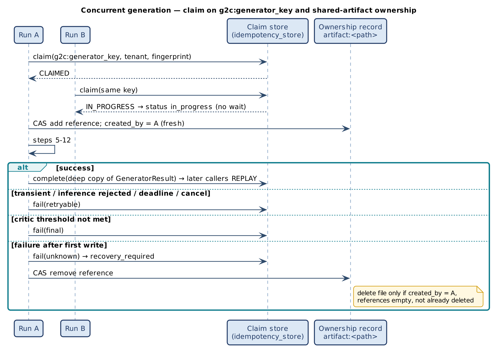

*Figure 14 — Claim on g2c:generator_key and shared-artifact ownership*

| Outcome of claim | Meaning | `generate()` |
|---|---|---|
| Claimed | This run owns the key | Proceeds; settles on every exit path |
| Replay | Key already succeeded | Returns stored result (`replayed`); no writes, no model call, no chain |
| In progress | Another run holds it | Returns `in_progress` promptly |
| Conflict | Same key, different fingerprint | Returns `conflict` |
| Recovery required | Expired claim or unknown outcome | Returns `recovery_required`; never blindly re-run |
| Failed final | Earlier deterministic failure | Returns `failed_final` |

Settlement: succeeded on success (a deep copy is stored); retryable on model rejection, deadline or cancellation before any write; final on deterministic errors (validation, token budget) and when the critic threshold is not met after two regenerations; `UNKNOWN` when failing after the first write began. The claim key is namespaced `g2c:` so it never collides with P0 (`p0:`), A2C (`a2c:`) or a composing caller's key in a shared store.

Shared abstract classes carry an ownership record (references, creator, deleted flag) updated by compare-and-set, so only one releasing run can delete a file and only when no reference remains. Capacity is bounded by the gateway's tenant/pod permits and RPM/TPM quotas; generators add no semaphores. The deadline (`deadline_ms`) is checked at every step boundary and passed to the gateway (it converts to E2A's `Deadline`).

## 11. Non-Functional Design

| NFR | Mechanism |
|---|---|
| Quality | Structural critic ≥ 0.75; ≤ 2 regenerations; final failure is typed. |
| Latency | 60 s SLO per generation (warning). |
| Cost | 32 000-token budget before the model call; deterministic critic (no model call). |
| Security | No credentials in generators; DLP, quota and model choice at the gateway; policy allow-lists; prompt-injection rules at the API edge. |
| Reproducibility | Versioned prompt files; template mode is deterministic. |
| Observability | trace_id, latency, tokens, score, attempts, mode per call. |

## 12. Extension Guide

| # | Rule |
|---|---|
| 1 | Set `generator_name`, `generator_type`, `critic_type`; register with `GeneratorFactory` and add the type to `APPROVED_GENERATOR_TYPES`. |
| 2 | Override the five abstract hooks; `_prepare`, `_existing_output`, `_fallback`, `_handle_error` as needed. |
| 3 | Never call a model SDK; use `_infer()`. |
| 4 | Never override `generate()` or call private methods. |
| 5 | Add `prompts/<generator>_system_v<N>.txt` with `{runtime}`, `{runtime_patterns}`, `{idempotency}`, `{async_mode}`, `{domain}`, `{agent_name}`, `{abstract_class_content}`, `{system_prompt_additions}`; verify critic ≥ 0.75 before committing. |
| 6 | Keep claim, settlement and artifact-ownership rules in the base class. |

```python
class E2AToolServiceGenerator(BaseInheritedClassGenerator):
    generator_name = 'E2AToolServiceGenerator'
    generator_type = 'e2a_tool'
    critic_type = 'e2a_inherited'
    kind = 'e2a_inherited'
    APPROVED_GENERATOR_TYPES = BaseInheritedClassGenerator.APPROVED_GENERATOR_TYPES + ['e2a_tool']

    def _build_user_prompt(self, request, config=None, **kw) -> str:
        return (f"Generate tool service {request['agent_name']} extending BaseToolService: "
                f"{request.get('user_prompt', '')}\nReturn only the source file.")

GeneratorFactory.register('e2a_tool', E2AToolServiceGenerator)
```

## 13. Verification

**Table 11 — Evidence (v1.2.0)**

| Suite | What it shows |
|---|---|
| `smoke_test_generator_concurrency.py` (55 checks) | Generation through the gateway double; key format; claim `SUCCEEDED`; replay without a model call; conflict; tenant scoping; 8 concurrent duplicates → one generation; rejection → retryable then success; deadline before any call; critic regeneration and final failure; `UNKNOWN` after a write failure; stale owner cannot settle; tenant required with a gateway; CAS artifact ownership including 200 racing releases; workflow chain, replay and compensation; critic concurrency rules; the P0 concurrency checks. |
| `smoke_test_g2c_contract.py` (35 checks; its requests pin `e2a_contract: "1.1"`, the abstract-class path) | Template mode writes critic-passing files for all four runtimes; a structurally bad model reply is regenerated twice then fails final with nothing written; inherited generation with P0 inline (manifest, class inside the scaffold, base in `common/`, `dev_request` handoff, fresh flag); second project shares the base (two references, one creator) and compensation keeps it; `a2c_inherited` chain; package source; Java placement; P0 failure typed; factory config/register/unknown; runtime and NFR policy; JSON source; deadline interop; router endpoints and HTTP 400. |
| `smoke_test_aidlc_integration.py` (15 checks) | E2A's AI-DLC orchestrator calls `DeveloperPlatformWorkflow(config=...)` on the real module and reaches `E2A_VERIFIED`. |
| `smoke_test_g2c_v12.py` (17 checks) | Refusals (kind, unknown agent, stage, schema on a deterministic agent); a three-agent request builds with the critic at 1.0; v1.2 hooks; deterministic agent without a model step, writes through `io_modify`; output schema validated; material tools; no application service; generated tests; strict conformance; one request through the generated workflow routes to the right agent; the E2A dependency; Java with `1.2` refused; a single-agent request defaults to v1.2. |
| CI job `declarations` (gcp) | The three-agent example passes its own generated tests. |

## 14. Implementation Reality, Gaps and Design Observations

The stubs recorded against the earlier baseline are replaced on this branch: public hook names and a five-step `generate()`; no model call; critic and generator scores fixed at 1.0; nothing written; `DeveloperPlatformWorkflow()` without config and with a wrapped result; no abstract chain and no P0; a factory without config or `register`; a health-only router; incomplete typedicts; and the missing `a2c_concurrency` module.

**Table 12 — Remaining observations**

| ID | Observation | Effect | Recommendation |
|---|---|---|---|
| O-1 | The critic is deterministic and structural; the Reference's model-assisted critic (`critic_model_id`) is not used. | Semantic defects that keep the structure pass. | Add an optional model review whose score is combined with the structural one (lower wins), as A2C's `CodeCriticAgent` does. |
| O-2 | Non-Python outputs are checked by patterns, not parsed. | Weaker evidence for Java, Node and Go. | Add parsers per runtime in CI. |
| O-3 | `source='prompt'` is rejected by the generators. | Free text goes in `user_prompt`; no structured extraction of the request from prose. | Add prompt resolution through the gateway if needed. |
| O-4 | Template-mode skeletons are minimal. | Useful for structure and offline runs, not as finished code. | Treat template output as a starting point; regenerate with a gateway. |
| O-5 | The `local` fast path (no store) reuses any existing file at the abstract output location. | Two different `base_class_name`s targeting one directory share a file. | Use distinct `abstract_class_output_path`s, or a store. |
| O-6 | The Phase Trigger Reference uses legacy names and flags. | Readers may look for methods that do not exist. | Use Table 10; the reference carries a v1.2 note. |
| O-7 | All tests use in-memory doubles. | Not validated against a live store, gateway or load. | Add adapter tests. |
| O-8 | Only the primary agent passes through the model and the critic; the other generated files come from deterministic templates. | They are correct skeletons with TODOs, not domain code. | Fill the TODOs; or declare each agent in its own request to have each one generated by the model. |
| O-9 | Java, Node and Go stay on the v1.1 contract. | No E2A v1.2 runtime outside Python. | `e2a-java` is wave D (G-4). |
| O-10 | Generated tool stubs raise `NotImplementedError` and the workflow's `_generate_idempotency_key` raises until written. | The generated workflow test passes a client idempotency key; a material call returns `UNKNOWN` until the tool is implemented. | Implement the tools and the key first. |

## Appendix A. Glossary

| Term | Definition |
|---|---|
| G2C | Generate-to-Class: generators that produce class files. |
| `generator_key` | `name:type:runtime:platform`; claimed as `g2c:<generator_key>`. |
| Abstract class source | `generate`, `path` or `package`. |
| Template mode | Generation without a gateway, from deterministic skeletons. |
| `e2a_contract` | `"1.2"` (default for Python `e2a_inherited`) or `"1.1"`: the E2A hook contract generated agents follow. |
| Declaration (v1.2) | `harness.agents`, `workflow`, `governance`: what G2C generates the agent layer from. |
| Second phase | Explicit A2C `SDLCWorkflow` run with a `DevRequest`. |
| Case 1A/1B/2A/2B | Phase Trigger cases from Axis A × Axis B. |

## Appendix B. Traceability

| Goal / invariant | Element | Anchor |
|---|---|---|
| G-1, INV-01 | `generate()` | `base_generator_agent.py` L87–206 |
| G-6, INV-06 | Claim `g2c:` and local fast path | `base_generator_agent.py` L113–132 |
| G-4, INV-03 | `_infer()` | `base_generator_agent.py` L331 |
| G-3, INV-02 | Critic loop; `_critic_review` | `base_generator_agent.py` L384, L317; `generator_critic_agent.py` L65 |
| INV-05 | Inherited rules | `generator_critic_agent.py` L161 |
| G-5 | Abstract chain, P0 inline | `inherited_generator.py` L62, L96, L155 |
| G-8 | Skeletons | `generator_templates.py` |
| INV-10, INV-11, UC-11/12 (v1.2) | `_v12`, `_validate_request`, `_write_output`, `_template_output`; `g2c_v12.files`; critic v1.2 rule | `inherited_generator.py` L36, L43, L212, L239; `g2c_v12.py` L64, L348; `generator_critic_agent.py` L191 |
| G-7, INV-07 | Registry and compensation | `developer_platform_workflow.py` L35, L50; `a2c_concurrency.py` L321, L344 |
| Factory | `create`, `register` | `generator_factory.py` L20, L31 |
| API | Router | `generator_api_router.py` L49–81 |
