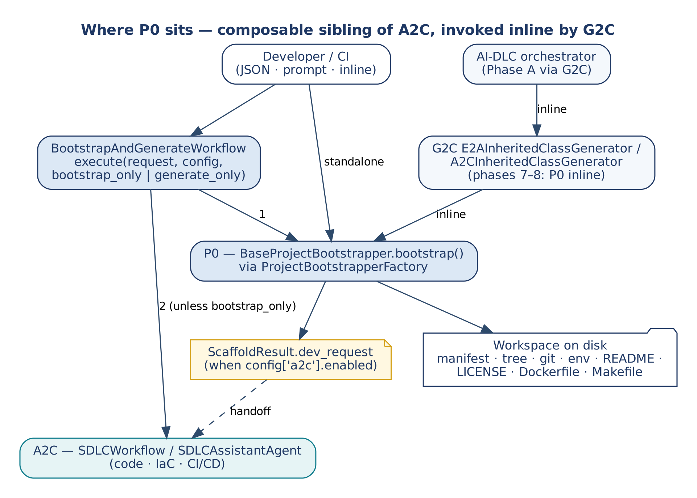
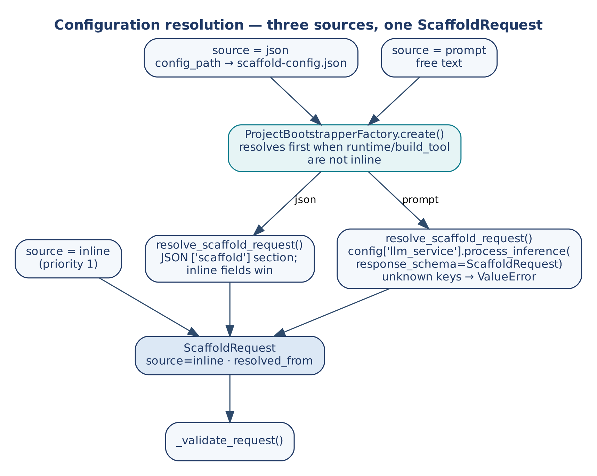
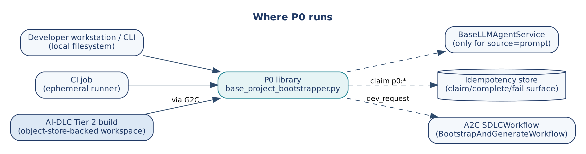
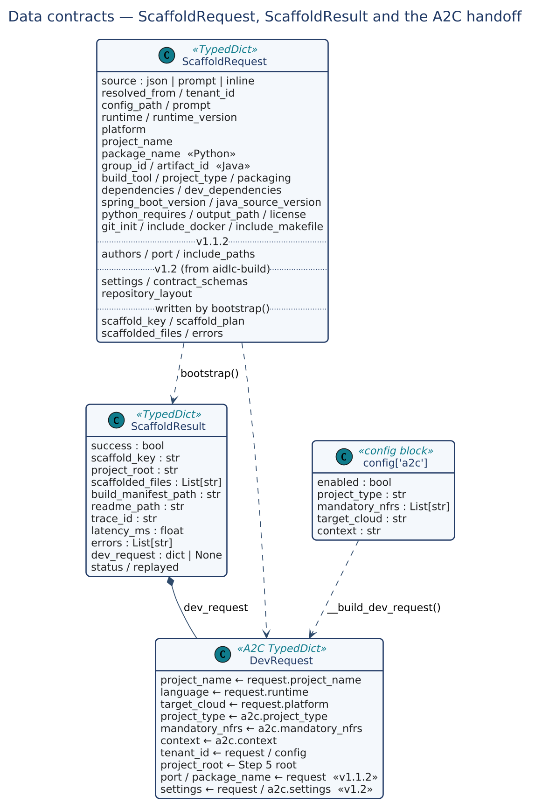
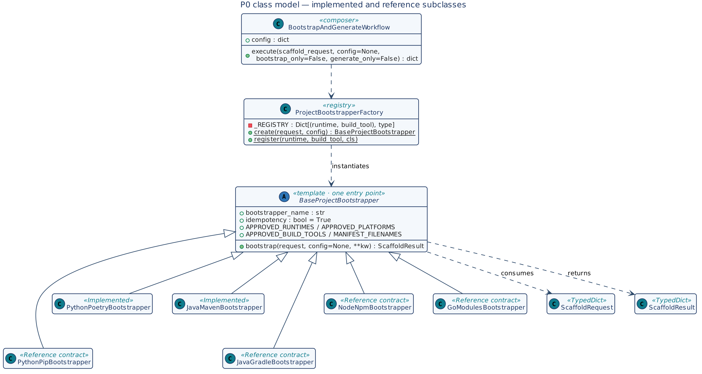
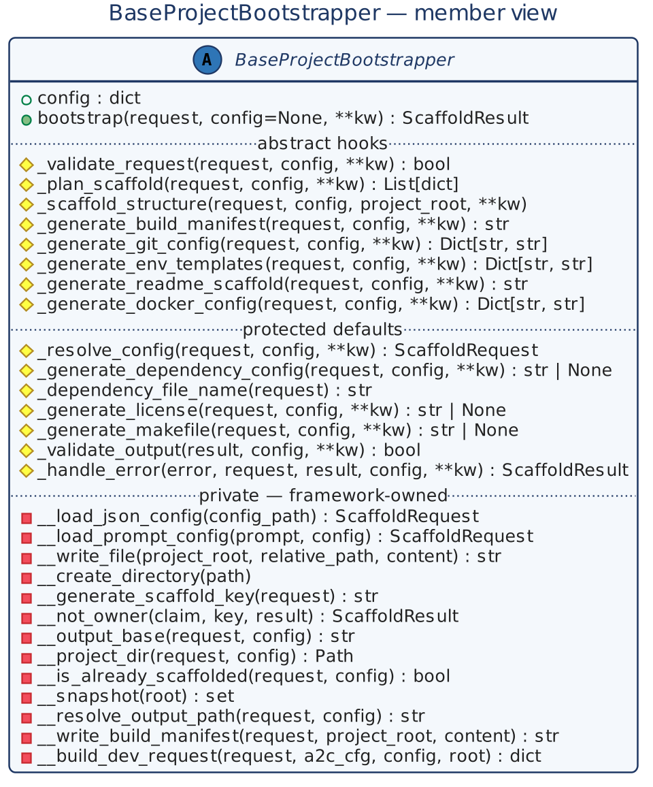
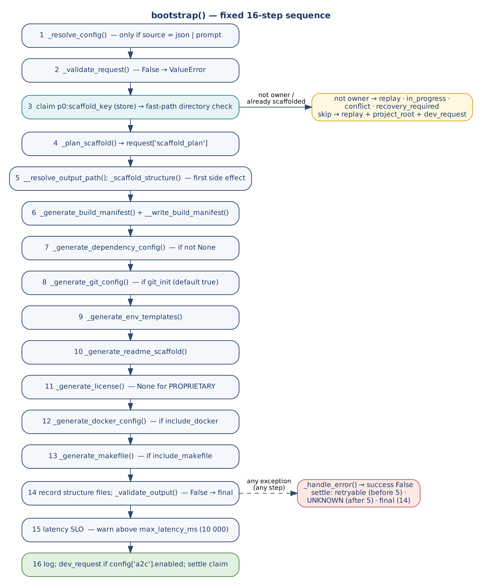
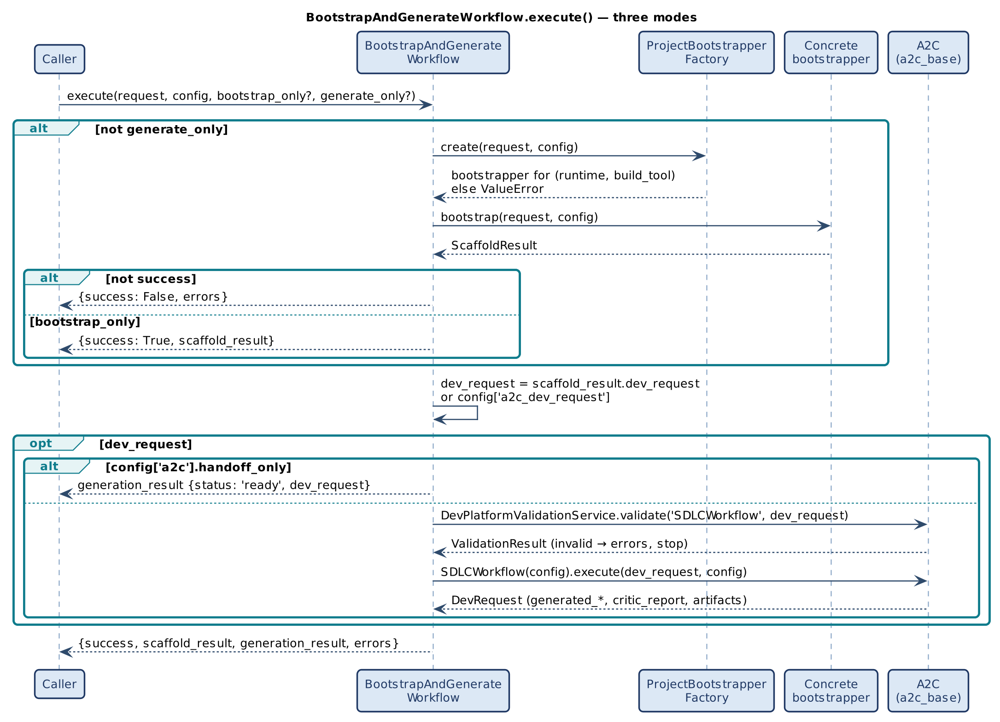
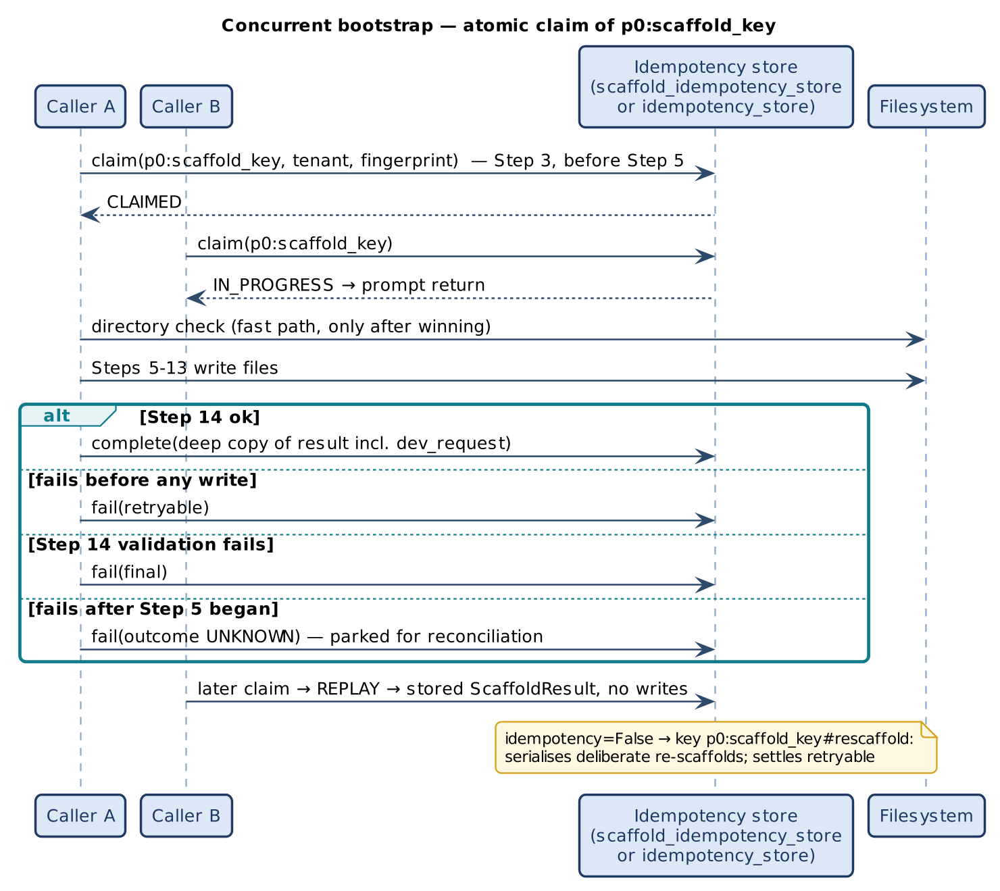

# P0 Project Bootstrap Framework

### High-Level and Low-Level Design

*This document describes P0, the Phase Zero project bootstrap framework, from problem statement to method-level contract. P0 turns one declarative ScaffoldRequest into a correct-by-construction project workspace — build manifest, directory tree, git, environment, README, licence, container and Makefile — guarded by an atomic claim, and optionally hands a populated DevRequest to A2C. Since v1.2 it also writes what a request declares: app settings into the code and the environment template, models from JSON-Schema contracts, and Maven coordinates into the pom. It is written so that a reader can form a complete mental model of P0 without opening the Python source, which remains the reference for line-level detail.*

| | |
|---|---|
| Framework | P0 — Phase Zero Project Bootstrap (composable sibling of A2C within the E2A family) |
| Document type | Design Document (HLD + LLD) |
| Author | Subham Gupta, Principal Platform Architect |
| Source baseline | `subhamviky/a2c-framework` `v1.2.0` — `base_project_bootstrapper.py` (1 731 lines), `a2c_concurrency.py`, `a2c_settings.py`, `a2c_contracts.py` |
| Date | 13 November 2026 (v1.2.0; baseline 7 November 2026) |
| Status | Aligned to A2C v1.2.0 and its smoke tests (includes the v1.1.2 fixes and wave C note C-02) |

## 1. Introduction

### 1.1 Purpose

Every service built on the E2A family starts from an empty directory. Before an agent can generate business logic (A2C) or a class generator can emit an inherited class (G2C), something has to decide the build tool, write the manifest, lay out the directory tree so that it mirrors the E2A tiers, exclude secrets from git, and produce a non-root, health-checked container. **P0** is that something. It is a small template-method framework with one public entry point, `BaseProjectBootstrapper.bootstrap()`, a fixed 16-step sequence, and a factory that selects the concrete bootstrapper from `(runtime, build_tool)`.

P0 is deliberately narrow: it writes files that are the same for every service of a given runtime and project type. It never writes business logic, never calls cloud APIs and never generates Terraform or CI/CD workflow content — those belong to A2C. Its one outward contract beyond the workspace is the **A2C handoff**: when `config['a2c'].enabled` is true, `bootstrap()` returns a populated `dev_request` that A2C's `SDLCWorkflow` consumes unchanged, and `BootstrapAndGenerateWorkflow` runs that second phase.

This document covers the problem and motivation (Section 2), use cases (Section 3), principles and invariants (Section 4), the HLD (Section 5), data contracts (Section 6), the LLD class model and contracts (Sections 7–8), dynamic behaviour (Section 9), concurrency and failure (Section 10), NFRs (Section 11), extension (Section 12), verification (Section 13) and the remaining gaps (Section 14).

### 1.2 Audience

| Reader | Read first | Use the document to |
|---|---|---|
| Platform architect | Sections 2, 4, 5 | Decide where P0 runs and how it composes with G2C, A2C and AI-DLC. |
| Framework author | Sections 7, 8, 12 | Add a bootstrapper for a new runtime/build tool without breaking the sequence. |
| Platform engineer | Sections 6, 9, 10 | Configure sources, output paths, the claim store and the A2C handoff. |
| Reviewer | Sections 4, 13, 14, Appendix B | Check invariants, evidence and gaps. |

### 1.3 Status labels

| Label | Meaning |
|---|---|
| **Implemented** | Present at the baseline and exercised by the smoke tests in Section 13. |
| **Reference contract** | Specified in the P0 Framework Reference but not present in the repository. Design-complete; an implementer must build it to this contract. |

**Table 1 — Status of every P0 element**

| Element | Status | Note |
|---|---|---|
| `ScaffoldRequest`, `ScaffoldResult` | Implemented | `TypedDict`, `total=False`. |
| `BaseProjectBootstrapper` | Implemented | 16-step `bootstrap()`, eight abstract hooks, atomic claim. |
| `PythonPoetryBootstrapper` | Implemented | `fastapi_microservice`, `lambda`, `langgraph_agent`, `library`. |
| `JavaMavenBootstrapper` | Implemented | `spring_boot`, `library`; requires `project_type`. |
| `PythonPipBootstrapper`, `JavaGradleBootstrapper`, `NodeNpmBootstrapper`, `GoModulesBootstrapper` | Reference contract | Commented out in the factory registry. |
| `ProjectBootstrapperFactory` | Implemented | Two registered entries; resolves JSON/prompt requests before selection. |
| Input resolution (`resolve_scaffold_request`) | Implemented | Inline, JSON and prompt; inline fields win. |
| `BootstrapAndGenerateWorkflow` | Implemented | P0, then DevRequest validation, then A2C `SDLCWorkflow.execute()`. |
| Concurrent bootstrap (claim of `p0:<scaffold_key>`) | Implemented | `a2c_concurrency.ClaimGuard`; any store with E2A's claim/complete/fail surface. |
| Author, port, include paths, Lambda entry (v1.1.2) | Implemented | `authors` from the request (no hard-coded author); one `port` for Dockerfile and Terraform; `include_paths` copied into the image; `lambda_entry.py` (Mangum) for Python on AWS. |
| Settings, contracts, Maven coordinates (v1.2) | Implemented | `settings.py` / `application.yml app:`; contract models and their test; `group:artifact[:version][@scope]` dependencies. |

### 1.4 Related documents

| Document | Relationship |
|---|---|
| P0 Project Bootstrap Framework Reference | Normative source for the contracts in this document. |
| G2C Framework Design Document | G2C's inherited generators call P0 inline; G2C always produces a class file. |
| A2C Framework Design Document | Consumes `ScaffoldResult.dev_request` through `SDLCWorkflow`. |
| E2A AI-DLC Profile Design Document | Runs P0 through G2C in Phase A of the governed build. |
| E2A Framework Design Document | Three-layer method contract, `BaseIdempotencyStore`, `BaseLLMAgentService`. |

## 2. Problem Statement and Motivation

### 2.1 The problem

Project scaffolding is repeated for every service and is where non-functional defects are cheapest to introduce and most expensive to find:

- **Drift.** Hand-copied templates diverge: one service runs as root, another commits `.env`, a third has no health check.
- **Layer mismatch.** A tree that does not mirror the E2A tiers (`models/`, `services/`, `routers/`, `tools/`) makes later generation by G2C and A2C guess where files go.
- **Prompt-only NFRs.** Asking a model to "remember to add a health check" is not enforcement; a generated workspace must be correct by structure.
- **Lost handoff.** Project identity (name, runtime, cloud, tenant) is re-typed when the next tool runs, so code generation and scaffold disagree.
- **Concurrent callers.** Two builds scaffolding the same target interleave writes into one manifest.

### 2.2 Why a framework and not a template repository

A template repository solves drift for one runtime and one project type. P0 keeps the guarantees in one base class and moves the per-runtime differences into hooks, so that:

- the order of steps, the claim, validation, the latency SLO, logging and the A2C handoff are written once;
- a new runtime is a subclass plus a registry entry, not a fork;
- the same sequence is callable from a CLI, CI, G2C and the AI-DLC build service.

### 2.3 Design goals

| ID | Goal |
|---|---|
| G-1 | One public entry point with a fixed, non-overridable sequence. |
| G-2 | NFRs enforced by construction: non-root container, health check, secrets excluded from git, tier-aligned tree. |
| G-3 | Three input sources (inline, JSON, prompt) that all resolve to one `ScaffoldRequest`. |
| G-4 | Business-level idempotency that holds under concurrent callers. |
| G-5 | A complete `DevRequest` handed to A2C with no re-typing, on first run and on replay. |
| G-6 | Runtime extensibility through a factory registry. |
| G-7 | No cloud calls, no provider SDKs, no secrets; model access only through the E2A inference service. |

## 3. Core Use Cases

### 3.1 Actors

| Actor | Interaction |
|---|---|
| Developer | Runs P0 directly or through `BootstrapAndGenerateWorkflow` with a JSON file, a prompt or an inline dict. |
| CI job | Scaffolds a project as the first stage of a pipeline. |
| G2C inherited generator | Calls `bootstrap()` inline when the request carries a `scaffold` section. |
| AI-DLC orchestrator | Reaches P0 only through G2C in Phase A. |
| A2C | Receives `dev_request`; never calls P0. |

### 3.2 Use-case catalogue

**Table 2 — P0 use cases**

| ID | Use case | Outcome |
|---|---|---|
| UC-1 | Scaffold a Python FastAPI service (Poetry) | `pyproject.toml`, tier-aligned `src/<pkg>/` tree, Dockerfile (non-root, HEALTHCHECK), Makefile, `.env.example`, git files, README, LICENSE. |
| UC-2 | Scaffold a LangGraph agent (Poetry) | UC-1 plus `agents/`, `rag/`, `workflows/` packages. |
| UC-3 | Scaffold a Spring Boot service (Maven) | `pom.xml` with Spring Boot parent, `config/domain/service/controller/repository` packages, `application*.yml`. |
| UC-4 | Bootstrap then generate | `BootstrapAndGenerateWorkflow.execute()` scaffolds, validates the `dev_request` and runs A2C's `SDLCWorkflow`; A2C artifacts land in the workspace. |
| UC-5 | Bootstrap only | `bootstrap_only=True`, or `config['a2c'].handoff_only` to return the `dev_request` without running A2C. |
| UC-6 | Generate only | `generate_only=True`; A2C runs against an existing project with `config['a2c_dev_request']`. |
| UC-7 | Re-run safely | Same `scaffold_key`: the stored result (with `dev_request`) is replayed; no writes. |
| UC-8 | Concurrent duplicates | Exactly one caller writes; the others get `in_progress` or `replay`. |
| UC-9 | Deliberate re-scaffold | Subclass sets `idempotency=False`; concurrent re-scaffolds are still serialised. |
| UC-10 | Add a runtime | Subclass + `ProjectBootstrapperFactory.register()`. |

### 3.3 Non-goals

- Business logic, domain classes, Terraform, CI/CD workflow content (A2C).
- Abstract or inherited class generation (G2C).
- Cloud resource creation, dependency installation, `git init` execution.
- Rollback of a partially written workspace (a subclass may add one in `_handle_error`; the claim parks it for reconciliation).

## 4. Design Principles and Invariants

### 4.1 Principles

| Principle | Application in P0 |
|---|---|
| Three-layer method contract | Public `bootstrap()` → protected `_hooks` → private `__steps` (name-mangled, framework-owned). |
| Template method | Order, guards and settlement live in the base class; subclasses supply content only. |
| Correct by structure | NFR artifacts are emitted by code paths, not requested from a model. |
| Composable siblings | P0 and A2C are independent frameworks composed by `BootstrapAndGenerateWorkflow`; neither is the other's parent. |
| Approved lists | Runtimes, platforms and build tools are checked against class-level allow-lists. |
| Claim is the authority | Under concurrency the atomic claim decides who writes; the directory check is only a fast path beneath it. |
| Gateway-only model access | `source='prompt'` goes through `config['llm_service']` (a `BaseLLMAgentService`). |

### 4.2 Invariants

| ID | Invariant |
|---|---|
| INV-01 | `bootstrap()` is never overridden; its 16 steps run in order. |
| INV-02 | A request that fails `_validate_request()` writes no files. |
| INV-03 | With a store, exactly one caller per `(tenant, p0:scaffold_key)` reaches Step 5; others get a typed outcome. |
| INV-04 | The idempotency check and Step 5 resolve the target directory with the same rule. |
| INV-05 | `bootstrap()` never raises for a step failure; every exception becomes `success=False` with `errors`, and the claim is settled on every exit path. |
| INV-06 | A successful result always contains `build_manifest_path` and `readme_path` in `scaffolded_files` (Step 14). |
| INV-07 | `dev_request` is produced on success and on replay when `config['a2c'].enabled`, and a replay returns the result as settled. |
| INV-08 | `bootstrap()` never mutates the caller's request. |
| INV-09 | P0 performs no network I/O except the optional inference-gateway call for `source='prompt'`. |

## 5. High-Level Design

### 5.1 Context and composition



*Figure 1 — Where P0 sits: composable sibling of A2C, invoked inline by G2C*

P0 has three callers. A developer or CI job calls it directly or through `BootstrapAndGenerateWorkflow`; G2C's inherited-class generators call it inline when the request carries a `scaffold` section; the AI-DLC orchestrator reaches it only through G2C. P0's outputs are the workspace on disk and, optionally, `dev_request`.

### 5.2 Components

| Component | Responsibility |
|---|---|
| `BaseProjectBootstrapper` | Owns the sequence, guards, claim, file writing, SLO, logging, A2C handoff. |
| Concrete bootstrappers | Own the content: manifest, tree, git rules, env templates, README, Docker, Makefile. |
| `resolve_scaffold_request()` | Turns a JSON or prompt request into an inline `ScaffoldRequest`. |
| `ProjectBootstrapperFactory` | Maps `(runtime, build_tool)` to a bootstrapper class, resolving the request first when needed. |
| `BootstrapAndGenerateWorkflow` | Composes P0 and A2C: scaffold, validate the `dev_request`, run `SDLCWorkflow`. |
| `a2c_concurrency.ClaimGuard` | One claim per key, settled exactly once; works with any claim/complete/fail store. |
| `config['llm_service']` | Inference gateway for prompt resolution (E2A `BaseLLMAgentService`). |

### 5.3 Configuration sources



*Figure 2 — Configuration resolution: three sources, one ScaffoldRequest*

| Priority | Source | How to use |
|---|---|---|
| 1 | Inline (`source='inline'`, default) | Pass a complete `ScaffoldRequest`. Inline fields also win over loaded ones. |
| 2 | JSON (`source='json'`) | `config_path` → `scaffold-config.json`; the `scaffold` section is merged under the inline fields. |
| 3 | Prompt (`source='prompt'`) | Free text resolved by the inference gateway with `response_schema=ScaffoldRequest`; unknown keys are rejected. |

A resolved request has `source='inline'` and `resolved_from='json'|'prompt'`, so it is never resolved twice. The factory resolves a JSON or prompt request that lacks `runtime` or `build_tool` before choosing the class.

### 5.4 Deployment



*Figure 3 — Where P0 runs*

P0 is a library, not a service. It runs in-process on a workstation, a CI runner, or inside the AI-DLC Tier 2 build (through G2C). Its external dependencies are the filesystem, the inference gateway (prompt source only), the claim store (multi-process deployments) and, through `BootstrapAndGenerateWorkflow`, A2C's `a2c_base` with E2A's `e2a_base` on the import path.

## 6. Data Contracts



*Figure 4 — ScaffoldRequest, ScaffoldResult and the A2C handoff*

### 6.1 ScaffoldRequest

**Table 3 — ScaffoldRequest fields**

| Field | Type | Meaning |
|---|---|---|
| `source` | str | `inline` (default), `json`, `prompt`. |
| `config_path` / `prompt` | str | Input for the json / prompt sources. |
| `resolved_from` | str | Written on resolution: `json` or `prompt`. |
| `tenant_id` | str | Scopes the claim; copied into `dev_request`. |
| `runtime`, `runtime_version` | str | `python`, `java`, `node`, `go`; version string. |
| `platform` | str | `aws`, `gcp`, `azure`, `standalone`. |
| `build_tool` | str | Per runtime: `poetry`/`pip`, `maven`/`gradle`, `npm`/`yarn`, `go_modules`. |
| `project_type` | str | Drives the tree. Required for Java; Python defaults to `fastapi_microservice` (logged). |
| `project_name` | str | Directory name and first part of `scaffold_key`. |
| `package_name` | str | Python package (required by Poetry). |
| `group_id`, `artifact_id`, `packaging` | str | Java coordinates (required by Maven). |
| `spring_boot_version`, `java_source_version`, `python_requires` | str | Toolchain versions. |
| `dependencies`, `dev_dependencies` | List[str] | Declared dependencies. Java: a short name is a Spring Boot starter; `group:artifact[:version][@scope]` is a Maven coordinate (v1.2). Python: Poetry specs, including `name @ git+url@ref`. |
| `authors` | List[str] | Written into `pyproject.toml`; empty by default (v1.1.2). |
| `port` | int | The service port: Dockerfile `EXPOSE`, health check, server command, `docker-compose.yml` and A2C's Terraform (default 8000 Python, 8080 Java; v1.1.2). |
| `include_paths` | List[str] | Extra folders copied into the Python image, e.g. `policies`, `knowledge` (v1.1.2). |
| `settings` | List[dict] | Normalised app settings (from `a2c_sdlc.settings`, set by `aidlc-build`; v1.2). |
| `contract_schemas` | List[{path, schema}] | Loaded JSON-Schema contracts (from `a2c_sdlc.contracts`, set by `aidlc-build`; v1.2). |
| `repository_layout` | str | `single` (default) or `monorepo`; applied by `aidlc-build` after the build (v1.2). |
| `output_path` | str | Parent directory of the project root (request › config › env › `./`). |
| `license` | str | `Apache-2.0` (default), `MIT`, `PROPRIETARY` (no file). |
| `git_init`, `include_docker`, `include_makefile` | bool | Optional artifacts (default true). |
| `scaffold_key`, `scaffold_plan`, `scaffolded_files`, `errors` | — | Written on the internal copy of the request. |

### 6.2 ScaffoldResult

| Field | Type | Meaning |
|---|---|---|
| `success` | bool | Overall outcome. |
| `status` | str | `scaffolded`, `replay`, `in_progress`, `conflict`, `recovery_required`, `failed_final`. |
| `replayed` | bool | True when a stored result or the existing project is returned. |
| `scaffold_key` | str | `project_name:runtime:build_tool:platform`. |
| `project_root` | str | Absolute project root (also on replay). |
| `scaffolded_files` | List[str] | Every file written, including package markers created by `_scaffold_structure()`. |
| `build_manifest_path`, `readme_path` | str | Required outputs checked by Step 14. |
| `trace_id`, `latency_ms`, `errors` | — | Observability. |
| `dev_request` | dict | A2C `DevRequest` (Section 6.3). |

### 6.3 The A2C handoff

`__build_dev_request()` maps the scaffold onto A2C's `DevRequest`, so nothing is re-typed:

| `DevRequest` field | Source |
|---|---|
| `project_name` | `request.project_name` |
| `language` | `request.runtime` (default `python`) |
| `target_cloud` | `request.platform`, else `a2c.target_cloud`, else `aws` |
| `project_type` | `config['a2c'].project_type`, else `request.project_type` |
| `mandatory_nfrs` | `config['a2c'].mandatory_nfrs` (copied) |
| `context` | `config['a2c'].context` |
| `tenant_id` | `request.tenant_id`, else `config.tenant_id` (A2C's workflow requires it) |
| `project_root` | Step 5 root (A2C writes its artifacts there) |
| `port`, `package_name` | `request.port` (default by runtime), `request.package_name` (v1.1.2: one port for Dockerfile and Terraform; the package for the Lambda handler) |
| `settings` | `request.settings`, else `config['a2c'].settings` (v1.2: A2C's `IaCAgent` turns them into Terraform) |

`DevRequest` (A2C) and `GeneratorRequest` (G2C) are distinct contracts; P0 produces only the former.

### 6.4 scaffold-config.json

A combined file carries a required `scaffold` section (the `ScaffoldRequest`) and an optional `a2c` section (`enabled`, `project_type`, `mandatory_nfrs`, `target_cloud`, `context`, `handoff_only`).

```json
{
  "scaffold": { "source": "json", "runtime": "python", "platform": "aws",
                "build_tool": "poetry", "project_type": "fastapi_microservice",
                "project_name": "SettlementEngine", "package_name": "settlement_engine",
                "output_path": "./generated/", "license": "Apache-2.0" },
  "a2c":      { "enabled": true, "project_type": "FastAPI Microservice",
                "mandatory_nfrs": ["Idempotency", "Observability"],
                "target_cloud": "aws",
                "context": "Financial settlement microservice with saga orchestration" }
}
```

### 6.5 Configuration keys

| Key | Read by | Default |
|---|---|---|
| `output_path` / env `BOOTSTRAP_OUTPUT_PATH` | `__output_base` (Step 3 check and Step 5) | `./` |
| `max_latency_ms` / env `BOOTSTRAP_MAX_LATENCY_MS` | Step 15 | 10 000 ms |
| `scaffold_idempotency_store` or `idempotency_store` | Step 3 claim | none (single-process) |
| `claim_lease_seconds` | Step 3 claim | 300 |
| `tenant_id` | Claim scope, `dev_request` | — |
| `a2c` (`enabled`, `handoff_only`, …) | Step 16, `BootstrapAndGenerateWorkflow` | disabled |
| `a2c_dev_request` | `BootstrapAndGenerateWorkflow` (generate-only) | — |
| `validation_service` | `BootstrapAndGenerateWorkflow` | `DevPlatformValidationService()` |
| `llm_service`, `model_id` | Prompt resolution | — |

## 7. Low-Level Design — Class Model



*Figure 5 — P0 class model*

| Class | Kind | Role |
|---|---|---|
| `BaseProjectBootstrapper` | ABC | Template with one entry point and eight abstract hooks. |
| `PythonPoetryBootstrapper` | Concrete | Python + Poetry. |
| `JavaMavenBootstrapper` | Concrete | Java + Maven (Spring Boot). |
| Pip / Gradle / Npm / Go bootstrappers | Reference contract | See Table 6. |
| `ProjectBootstrapperFactory` | Registry | Class-method `create` / `register`. |
| `BootstrapAndGenerateWorkflow` | Composer | Not a `BaseWorkflow` subclass: it coordinates two frameworks rather than routing agent intent. |

## 8. Low-Level Design — Class Contracts

### 8.1 BaseProjectBootstrapper



*Figure 6 — BaseProjectBootstrapper member view*

| Aspect | Detail |
|---|---|
| Class attributes | `bootstrapper_name`; `idempotency = True`; `APPROVED_RUNTIMES = [python, java, node, go]`; `APPROVED_PLATFORMS = [aws, gcp, azure, standalone]`; `APPROVED_BUILD_TOOLS` per runtime; `MANIFEST_FILENAMES` per `(runtime, build_tool)`. |
| State | `config` (constructor default; overridden per call). |
| Invariants | INV-01 to INV-09. |

**Table 4 — BaseProjectBootstrapper methods**

| Method | Kind | Signature → returns | Contract |
|---|---|---|---|
| `bootstrap` | entry | `(request, config=None, **kw) → ScaffoldResult` | Copies the request, then runs the 16 steps of Section 9.1. Never overridden, never raises for a step failure. |
| `_validate_request` | abstract | `(request, config, **kw) → bool` | Required fields and approved runtime/platform/build tool. `False` → `ValueError`, no writes, no claim. |
| `_plan_scaffold` | abstract | `(request, config, **kw) → List[dict]` | Ordered `{step, file, description}` list, stored in `scaffold_plan`. |
| `_scaffold_structure` | abstract | `(request, config, project_root, **kw)` | Create the directory tree and package marker files. |
| `_generate_build_manifest` | abstract | `(request, config, **kw) → str` | Full manifest content. |
| `_generate_git_config` | abstract | `(request, config, **kw) → Dict[path, str]` | `.gitignore` and `.gitattributes`. |
| `_generate_env_templates` | abstract | `(request, config, **kw) → Dict[path, str]` | `.env.example` or `application*.yml`. |
| `_generate_readme_scaffold` | abstract | `(request, config, **kw) → str` | Name, badges, E2A link, structure tree. |
| `_generate_docker_config` | abstract | `(request, config, **kw) → Dict[path, str]` | Multi-stage Dockerfile, non-root UID 1001, HEALTHCHECK; `.dockerignore`. |
| `_resolve_config` | default | `(request, config, **kw) → ScaffoldRequest` | `resolve_scaffold_request()`: JSON or prompt, inline fields win. |
| `_generate_dependency_config` | default | `(request, config, **kw) → str or None` | Secondary dependency file; default `None`. |
| `_dependency_file_name` | default | `(request) → str` | Default `requirements.txt`. |
| `_generate_license` | default | `(request, config, **kw) → str or None` | Apache-2.0 (default), MIT, or `None` for `PROPRIETARY`. |
| `_generate_makefile` | default | `(request, config, **kw) → str or None` | Targets `install, test, lint, build, run, docker-build, clean`. |
| `_validate_output` | default | `(result, config, **kw) → bool` | Manifest and README paths are in `scaffolded_files`. `False` → claim settled final. |
| `_handle_error` | default | `(error, request, result, config, **kw) → ScaffoldResult` | Log, append error, `success=False`. Override for alerting or cleanup. |
| `__generate_scaffold_key` | private | `(request) → str` | `project_name:runtime:build_tool:platform`. |
| `__not_owner` | private | `(claim, key, result) → ScaffoldResult` | Typed outcome for a non-owner: stored result on `REPLAY`; `in_progress`, `conflict`, `recovery_required`, `failed_final` otherwise. |
| `__output_base` / `__project_dir` | private | `(request, config) → str / Path` | One resolution rule: request › config › env › `./`, joined with `project_name`. |
| `__is_already_scaffolded` | private | `(request, config) → bool` | Fast path after the claim: the Step 5 directory exists and is non-empty. |
| `__snapshot` | private | `(root) → set` | Files under root; used to record files created by `_scaffold_structure()`. |
| `__resolve_output_path` | private | `(request, config) → str` | `__project_dir` resolved and created. |
| `__write_file`, `__create_directory`, `__write_build_manifest` | private | — | `mkdir -p`; UTF-8 write; manifest name from `MANIFEST_FILENAMES`. |
| `__load_json_config`, `__load_prompt_config` | private | — | Thin wrappers over the module loaders. |
| `__build_dev_request` | private | `(request, a2c_cfg, config, project_root) → dict` | Mapping of Section 6.3. |

Module functions: `resolve_scaffold_request(request, config) → dict`, `_load_json_scaffold(path)`, `_load_prompt_scaffold(prompt, config)` (gateway call through `a2c_concurrency.run_coro_sync`).

### 8.2 Concrete bootstrappers

**Table 5 — Implemented bootstrappers**

| Aspect | PythonPoetryBootstrapper | JavaMavenBootstrapper |
|---|---|---|
| Required fields | `project_name, runtime, platform, build_tool, package_name` | `project_name, runtime, platform, build_tool, group_id, artifact_id, project_type` |
| Extra checks | `runtime=python`, `build_tool=poetry`, platform approved | `runtime=java`, `build_tool=maven`, platform approved |
| Tree | `src/<pkg>/{models,services,routers,tools,config}`, `tests/`, `.github/workflows/`; `+agents, rag, workflows` for `langgraph_agent` | `src/main/java/<group>/{config,domain,service,controller,repository}`, `src/main/resources`, `src/test/java/<group>`, `.github/workflows/` |
| Manifest | `pyproject.toml` (Poetry) | `pom.xml` (Spring Boot parent) |
| Env templates | `.env.example` (AWS/GCP/Azure + E2A NFR keys; v1.2: one line per declared setting, secrets as a comment) | `application.yml` (v1.2: an `app:` block with one `${NAME[:default]}` placeholder per setting), `-dev`, `-prod` |
| Starter files (v1.1.2, v1.2) | `main.py` with `/health`; `lambda_entry.py` (Mangum) on AWS; `settings.py` and `tests/test_settings.py` when settings are declared; `contracts/<schema>.py` and `tests/test_contracts.py` when contracts are declared | `Application.java`, health test; `<group>/contracts/<Model>.java` records when contracts are declared |
| Dependencies (v1.2) | Poetry specs; `aidlc-build` adds `e2a-framework` `v1.2.0` for E2A v1.2 agents | `maven_dependency()`: starter or coordinate |
| Docker | Multi-stage Python, UID 1001, HEALTHCHECK `/health` | Multi-stage Temurin, non-root, HEALTHCHECK `/actuator/health` |
| Makefile | Poetry commands | Maven commands |

Python layout (UC-1; the tree mirrors the E2A tiers):

```text
SettlementEngine/
  pyproject.toml  .gitignore  .gitattributes  .env.example  README.md
  LICENSE  Dockerfile  .dockerignore  Makefile  docker-compose.yml
  .github/workflows/            CI/CD directory (content from A2C; root workflows in a monorepo)
  .a2c/manifest.json            written by aidlc-build (v1.2), the basis of --upgrade
  src/settlement_engine/
    __init__.py  main.py  lambda_entry.py (AWS)  settings.py (v1.2, with settings)
    config/  models/  services/  routers/  tools/     each with __init__.py
    contracts/                  (v1.2, with contracts)
    agents/  rag/  workflows/   (langgraph_agent only)
  tests/  test_health.py  test_settings.py  test_contracts.py
```

**Table 6 — Reference-contract bootstrappers**

| Class | Build tool | Project types | Key overrides |
|---|---|---|---|
| `PythonPipBootstrapper` | pip | fastapi_microservice, lambda, library | `setup.cfg` manifest; `requirements.txt` via `_generate_dependency_config`. |
| `JavaGradleBootstrapper` | gradle | spring_boot, library | `build.gradle.kts`; Gradle-wrapper Makefile. |
| `NodeNpmBootstrapper` | npm | express_api, next_app, library | `package.json` with scripts. |
| `GoModulesBootstrapper` | go_modules | http_service, cli, library | `go.mod`; `cmd/`, `internal/`, `pkg/` layout. |

### 8.3 ProjectBootstrapperFactory

| Method | Kind | Signature → returns | Contract |
|---|---|---|---|
| `create` | classmethod | `(request, config=None) → BaseProjectBootstrapper` | If `source` is `json`/`prompt` and `runtime` or `build_tool` is missing, resolve the request in place first. Look up `(runtime, build_tool)`; unregistered → `ValueError` listing registered keys; instantiate with `config`. |
| `register` | classmethod | `(runtime, build_tool, cls)` | Add or replace a registry entry at import time. |

### 8.4 BootstrapAndGenerateWorkflow

| Method | Kind | Signature → returns | Contract |
|---|---|---|---|
| `__init__` | ctor | `(config=None)` | Store default config. |
| `execute` | entry | `(scaffold_request, config=None, bootstrap_only=False, generate_only=False) → dict` | Unless `generate_only`: factory → `bootstrap()`; failure → `{success: False, errors}`; `bootstrap_only` returns after P0. Then `dev_request` = scaffold result's or `config['a2c_dev_request']` (`generate_only` without one → error). With `config['a2c'].handoff_only` return `{status: 'ready', dev_request}`. Otherwise validate with `config['validation_service']` or `DevPlatformValidationService` (invalid → `INVALID`, errors) and run `SDLCWorkflow(config).execute(dev_request, config)`; its errors or a typed non-success status fail the call. Returns `{success, scaffold_result, generation_result, errors}`; exceptions are caught. |

The A2C phase needs `a2c_base.py` and `e2a_base.py` importable; if they are not, the call fails with an explicit message pointing to `handoff_only`.

## 9. Dynamic Behaviour

### 9.1 bootstrap() sequence



*Figure 7 — bootstrap(): fixed 16-step sequence*

| Step | Action | Condition |
|---|---|---|
| 1 | `_resolve_config()` | `source` is `json` or `prompt` |
| 2 | `_validate_request()` | Always; `False` → abort before the claim |
| 3 | Key; claim `p0:<key>`; then directory fast path | Claim if a store is set; fast path if `idempotency=True` |
| 4 | `_plan_scaffold()` | Always |
| 5 | `__resolve_output_path()` + `_scaffold_structure()` | Always; first side effect |
| 6 | Manifest | Always |
| 7 | Dependency file | Hook returns content |
| 8 | Git config | `git_init` (default true) |
| 9 | Env templates | Always |
| 10 | README | Always |
| 11 | LICENSE | Not `PROPRIETARY` |
| 12 | Docker | `include_docker` (default true) |
| 13 | Makefile | `include_makefile` (default true) |
| 14 | Record structure files; `_validate_output()` | Always; `False` → abort, claim final |
| 15 | Latency SLO | Warn above `max_latency_ms` |
| 16 | Log; `dev_request`; settle claim | `dev_request` when `config['a2c'].enabled` |

### 9.2 Composition modes



*Figure 8 — BootstrapAndGenerateWorkflow.execute(): modes and the A2C phase*

### 9.3 Error path

Any exception in Steps 1–16 goes to `_handle_error()`, which returns `success=False` with the message in `errors`. Before that, the claim is settled: retryable before Step 5, `UNKNOWN` after Step 5 began, final when Step 14 failed. A `finally` block settles any claim still open (for example on cancellation). Files already written stay on disk; the default handler performs no rollback.

## 10. Concurrency and Failure

### 10.1 Atomic claim



*Figure 9 — Concurrent bootstrap: atomic claim of p0:scaffold_key*

| Rule | Contract |
|---|---|
| Store | `config['scaffold_idempotency_store']` or `config['idempotency_store']`; any object with E2A's `claim/complete/fail` surface (`a2c_concurrency.InMemoryClaimStore`, E2A's `InMemoryIdempotencyStore`, a managed-store adapter). Without a store the guarantee is single-process. |
| Key | `p0:<scaffold_key>`, scoped by `tenant_id`; fingerprint = hash of the request's business fields. The `p0:` namespace keeps P0 from colliding with a composing caller's key of the same shape (AI-DLC's build key). |
| Claim point | Step 3, after validation, before Step 5. The directory check runs only after the claim is won. |
| Outcomes | Claimed → proceed; succeeded → stored `ScaffoldResult` replayed (with `dev_request`), no writes; in progress → prompt `in_progress`; different fingerprint → `conflict`; expired or unknown → `recovery_required`; final → `failed_final`. |
| Settlement | Success after Step 14 (a deep copy is stored, so later changes to the returned object never change a replay); retryable before Step 5; final when Step 14 fails; `UNKNOWN` after Step 5 began (parked for reconciliation, never blindly re-run). |
| Deliberate re-scaffold | `idempotency=False` claims `p0:<key>#rescaffold` as mutual exclusion and settles retryable, so the next deliberate run can claim again. |

### 10.2 Failure matrix

| Failure | Behaviour |
|---|---|
| Unregistered runtime/build tool | Factory `ValueError`; workflow returns `success=False`. |
| Invalid request | `ValueError` at Step 2; no files, no claim. |
| Prompt gateway failure | `RuntimeError` / `ValueError` at Step 1. |
| Write error mid-sequence | `success=False`; claim `UNKNOWN`; partial workspace remains. |
| Missing manifest or README | Step 14 abort; claim final. |
| Duplicate while running | `in_progress`, no wait. |
| Slow run | Warning log only. |
| Invalid `dev_request` | `BootstrapAndGenerateWorkflow` returns `INVALID` before A2C runs. |

## 11. Non-Functional Design

**Table 7 — NFRs enforced by structure**

| NFR | Enforcement | Artifact |
|---|---|---|
| Non-root container | Multi-stage build; `useradd`/`adduser` UID 1001 | Dockerfile |
| Health probes | `HEALTHCHECK` on `/health` or `/actuator/health` | Dockerfile |
| No secrets in git | `.gitignore` excludes `.env`, `*.key`, `chroma_db/`, `*.zip`, `.venv/` | `.gitignore` |
| Env-driven config | Model IDs, endpoints, thresholds as registry keys | `.env.example` |
| Multi-cloud portability | Platform-specific variables for AWS/GCP/Azure | `.env.example` |
| Tier alignment | `models/ services/ routers/ tools/` mirror E2A layers | Tree |
| CI/CD readiness | `.github/workflows/`; Makefile targets match pipeline stages | Makefile |
| Idempotency under concurrency | Atomic claim; directory fast path | `bootstrap()` Step 3 |
| Latency | 10 s SLO warning | Step 15 |
| Observability | Structured log: bootstrapper, key, trace_id, latency, file count, root | Step 16 |

Security: P0 holds no credentials; prompt resolution goes through the inference gateway, which owns model choice, quota, DLP and latency limits.

## 12. Extension Guide

| # | Rule | Required |
|---|---|---|
| 1 | Set `bootstrapper_name`. | Yes |
| 2 | `ProjectBootstrapperFactory.register(runtime, build_tool, cls)`. | Yes |
| 3 | Override the eight abstract hooks. | Yes |
| 4 | Override `_generate_dependency_config` + `_dependency_file_name` when dependencies are not in the manifest. | If pip/yarn |
| 5 | Override `_generate_makefile`, `_validate_output`, `_handle_error`. | Recommended |
| 6 | Override `_resolve_config` only to add a new source. | Optional |
| 7 | Never override `bootstrap()` or call private methods from outside. | Never |
| 8 | Keep claim and settlement in the base class. | Never |

```python
class NodeNpmBootstrapper(BaseProjectBootstrapper):
    bootstrapper_name = 'NodeNpmBootstrapper'

    def _validate_request(self, request, config=None, **kw) -> bool:
        need = ['project_name', 'runtime', 'platform', 'build_tool', 'project_type']
        return (all(k in request for k in need)
                and request['runtime'] == 'node' and request['build_tool'] == 'npm'
                and request['platform'] in self.APPROVED_PLATFORMS)

    def _plan_scaffold(self, request, config=None, **kw):
        return [{'step': 1, 'file': 'package.json', 'description': 'npm manifest'}]

    def _scaffold_structure(self, request, config=None, project_root='./', **kw):
        for d in ('src/routes', 'src/services', 'src/models', 'tests', '.github/workflows'):
            Path(project_root, d).mkdir(parents=True, exist_ok=True)

    def _generate_build_manifest(self, request, config=None, **kw) -> str: ...
    def _generate_git_config(self, request, config=None, **kw): ...
    def _generate_env_templates(self, request, config=None, **kw): ...
    def _generate_readme_scaffold(self, request, config=None, **kw) -> str: ...
    def _generate_docker_config(self, request, config=None, **kw): ...

ProjectBootstrapperFactory.register('node', 'npm', NodeNpmBootstrapper)
```

## 13. Verification

**Table 8 — Evidence at the baseline**

| Suite / check | Result |
|---|---|
| `smoke_test_generator_concurrency.py` (P0 part) | 6 concurrent bootstraps of one target: exactly one writes, others `in_progress`/`replay`; replay returns the stored result and the same `dev_request`; different request → `conflict`; Step 14 failure → `FAILED_FINAL`; failure after Step 5 → `UNKNOWN` then `recovery_required`; failure before Step 5 → retryable then success; `idempotency=False` serialises; no store → directory fast path. |
| `smoke_test_a2c.py` (P0 → A2C) | `BootstrapAndGenerateWorkflow` scaffolds, validates and runs `SDLCWorkflow`; A2C artifacts land in the P0 workspace. |
| `smoke_test_g2c_contract.py` | P0 inline from G2C; Java without `project_type` → typed `scaffold_failed`. |
| `smoke_test_aidlc_integration.py` | AI-DLC build over the real modules: P0's claim does not collide with the orchestrator's claim; build reaches `E2A_VERIFIED`. |
| `smoke_test_template_mode.py` (31 checks, v1.1.2) | Authors from the request; one port; include paths in the image; Lambda entry and handler default; GCP max instances variable. |
| `smoke_test_declarations.py` (32 checks, v1.2) | Settings module and its refusals; contract models (examples, closed objects, present-only-when, refusal by name, Java records); Maven coordinates. |
| CI jobs `images` and `declarations` (v1.2) | The Python and Java images build and start (the Java one with a contract, a setting, Flyway and H2); generated settings and contract tests pass on three clouds. |
| Probe: JSON request with no inline runtime/build_tool | Factory resolves it; 15 files scaffolded. |
| Probe: prompt request | Resolved through the gateway double; success. |
| Probe: `git_init=False` | No `.gitignore`/`.gitattributes`; caller's request unchanged. |
| Probe: request-level `output_path` | Honoured by both the check and Step 5; skip returns `project_root` and `dev_request` (with `tenant_id`, `project_root`). |
| Probe: caller mutates a returned `dev_request` | A later replay is unaffected. |

## 14. Implementation Reality, Gaps and Design Observations

The defects recorded against the earlier baseline are fixed on this branch: the missing `a2c_concurrency` module (every import failed); the idempotency check ignoring a request `output_path`; the skip result without `project_root` or `dev_request`; unreachable prompt resolution and the JSON-only resolvers; `git_init` ignored; request mutation; unrecorded structure files; Java `project_type` not required; the placeholder A2C phase; claim-key collision with AI-DLC; and replay results aliased to live objects.

**Table 9 — Remaining observations**

| ID | Observation | Effect | Recommendation |
|---|---|---|---|
| O-1 | Pip, Gradle, Npm and Go bootstrappers are not implemented. | Only Python/Poetry and Java/Maven can be scaffolded. | Implement against Table 6. |
| O-2 | Step 15 reads `BOOTSTRAP_MAX_LATENCY_MS` from the environment rather than the E2A configuration registry (P0 does not import `e2a_base`). | Resolution order matches the registry, but the key is not listed in the generated reference table. | Register the key when `e2a_base` is available. |
| O-3 | No rollback after a failure past Step 5. | The claim parks `UNKNOWN`; an operator or reconciler must clean up. | Add a reconciler that compares `scaffold_plan` with the directory. |
| O-4 | Python requests without `project_type` default to `fastapi_microservice`. | Explicit but silent for callers that ignore logs. | Require it for Python too once callers are updated. |
| O-5 | Without a store the guarantee is single-process. | Two processes can interleave writes. | Configure a claim store in multi-process deployments. |
| O-6 | All tests use in-memory doubles. | Not validated against a live store, gateway or load. | Add an adapter test against a managed store. |
| O-7 | Settings and contracts reach P0 through `aidlc-build` (`a2c_sdlc` → `context`). | A direct `bootstrap()` caller must set `settings` / `contract_schemas` itself. | Use `aidlc-build`, or pass the normalised fields. |
| O-8 | Java records carry the contract's shape, not its constraints (patterns, lengths). | Validation stays with the producer of the event. | Add Bean Validation annotations if a Java consumer needs them. |

## Appendix A. Glossary

| Term | Definition |
|---|---|
| P0 / Phase Zero | The bootstrap step that precedes all code generation. |
| `scaffold_key` | `project_name:runtime:build_tool:platform`; claimed as `p0:<scaffold_key>`. |
| Handoff | `ScaffoldResult.dev_request` consumed by A2C. |
| Declaration (v1.2) | A request field that replaces a hand patch: settings, contracts, Maven coordinates. |
| Composable siblings | P0 and A2C: independent frameworks composed by `BootstrapAndGenerateWorkflow`. |
| Correct by structure | An NFR produced by a code path rather than a prompt. |
| Fast path | The directory check consulted only after the claim is won. |

## Appendix B. Traceability

| Goal / invariant | Element | Anchor (`base_project_bootstrapper.py`) |
|---|---|---|
| G-1, INV-01 | `bootstrap()` | L263–495 |
| G-3 | `resolve_scaffold_request`, `_resolve_config` | L173, L499 |
| INV-02 | Step 2 | L308 |
| G-4, INV-03 | Step 3 claim (`p0:` key) and fast path | L316–348 |
| INV-04 | `__output_base`, `__project_dir`, `__is_already_scaffolded` | L732–760 |
| INV-06 | `_validate_output` | L649 |
| G-5, INV-07 | `__build_dev_request`; skip result | L772 |
| Typed outcomes | `__not_owner` | L706 |
| G-6 | `ProjectBootstrapperFactory` | L1573 |
| Declarations (v1.2) | `maven_dependency`; settings and contracts in the starter files | L806; L1192–1201; `a2c_settings.py`, `a2c_contracts.py` |
| Composition | `BootstrapAndGenerateWorkflow` | L1635–1731 |
| Claim mechanics | `a2c_concurrency.ClaimGuard` | `a2c_concurrency.py` L150–220 |
